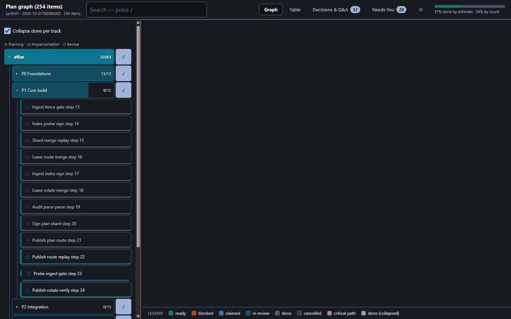
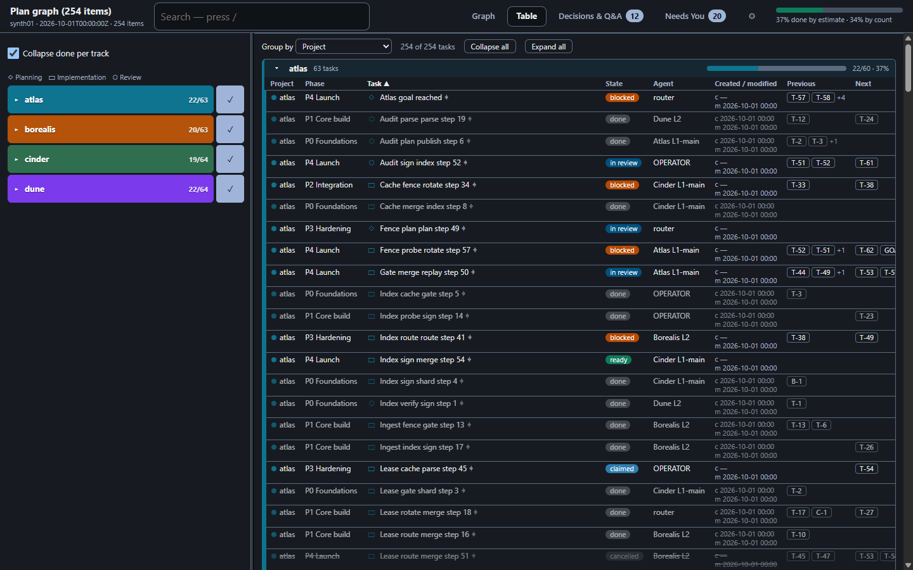

# plangraph

A plan-graph for agent-driven work: items with owner, estimate, dependencies and evidence;
computed **ready / blocked / critical path**; "done" items are locked; and one self-contained
HTML page that shows the plan to a human.



*The rendered page for the synthetic demo snapshot (4 projects x 5 tracks, 254 items). The
sidebar is only the filter: a project > phase > task tree in project colours (planning, implementation
and review have different symbols; a switch on each project/phase filters every page). The sidebar
edge can be dragged to resize it. Pages sit in the header: Graph, Table, Decisions & Q&A, Needs You, Settings.*



*Table page: dense tables grouped by any column (project, phase, task type, state, agent, dates, links),
one table and one progress bar per group; hover a decision/question chip for a preview. The Decisions &
Q&A page connects each decision/question to task, phase and project and lets you answer in the page
(answers are kept locally and exported as JSON for the keeper).*

## What is in the repo

| path | what |
|---|---|
| `src/plangraph/render.py` | snapshot JSON → one self-contained HTML page (`python -m plangraph.render`) |
| `src/plangraph/web/` | the page's own CSS/JS (graph, table, sidebar, filters) |
| `src/plangraph/views*.py` | pure views over a snapshot: ready, blocked, critical path, slack, brief |
| `src/plangraph/keeper/` | the plan-keeper service (SQLite, auth, evidence verifiers; POSIX only — uses `fcntl`) |
| `tools/` | batch apply, markdown sync, plan check, importer |
| `examples/` | fictional plans, a batch, `snapshot.json` |
| `docs/` | proposal, spec, runbook, UI/UX reviews |

## Setup

Requirements: Python 3.11+, `pytest` for the tests, Node.js for the viewport/layout tests. The page
needs no build step. Cytoscape and dagre are vendored in `vendor/`; the page loads layout libraries
from a CDN when rendered with `--cdn` (offline mode is not yet available for the new UI).

```bash
git clone https://github.com/Ch3fUlrich/plangraph.git
cd plangraph
pip install pytest
PYTHONPATH=src python -m plangraph.render --snapshot examples/snapshot.json --out plan.html --cdn
```

Open `plan.html` in a browser (or serve it: `python -m http.server --directory .`).

Run the tests (the keeper tests need Linux/macOS or WSL):

```bash
PYTHONPATH=src python -m pytest tests -q
# UI/render only, works on Windows too:
PYTHONPATH=src python -m pytest tests/test_ui*.py tests/test_render*.py tests/test_views.py -q
```

Keeper, batches and the public/private repo split are described in `docs/KEEPER.md`,
`docs/BATCH.md` and `docs/PUBLIC.md`.

## Why our own app instead of an existing tracker

We looked at Beads (and a keeper in front of it), YAML-in-git, graph databases with policy, Gas
Town, project tools (Vikunja, Plane, OpenProject, Jira, OneDev, Forgejo), workflow engines and small
agent-task tools; the comparison is in `docs/PROPOSAL.md`. For now we build our own, for two reasons:

1. **Development speed.** A small SQLite keeper plus a static page is something we can change in
   an afternoon. The plan model (ready/blocked, locked done items, evidence, per-field ownership)
   is the product; we do not want to wait on, or fork, someone else's schema to change it.
2. **Churn in the alternatives' APIs and MCP surfaces.** The agent-task tools we evaluated change
   their commands, tool names and storage often (several are alpha). An agent workflow that
   depends on a moving MCP/API breaks silently; ours is a small, pinned, tested surface.

None of the existing tools had all of: network view, computed ready/blocked, locked done items
and an agent API. We reuse the parts that are stable (Cytoscape.js, dagre, Python `graphlib`) and
borrow ideas from Beads (ready/blocked, claims, critical path). Revisit this when an alternative's
interface stops moving.

## Status

Work in progress. Plans, batches, status and handoffs live in a separate private data repository (SPLIT-DATA-REPO).
