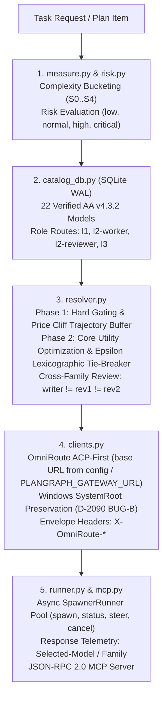
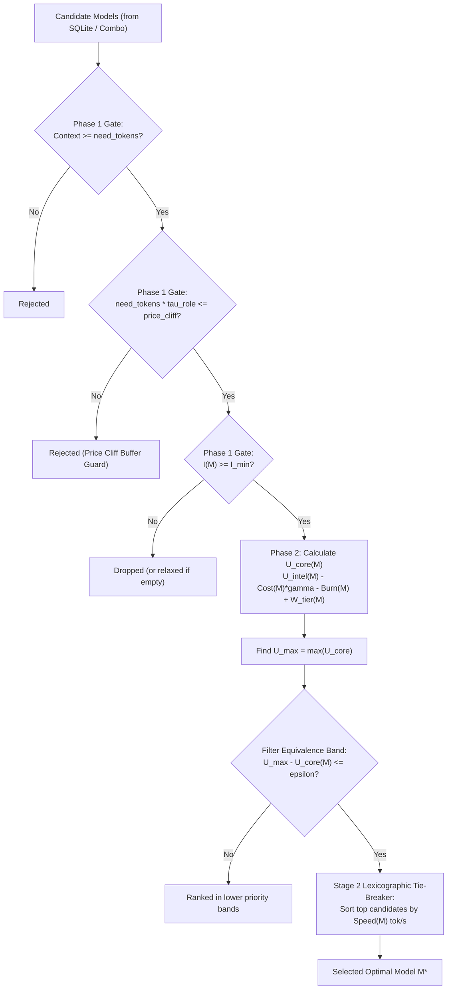
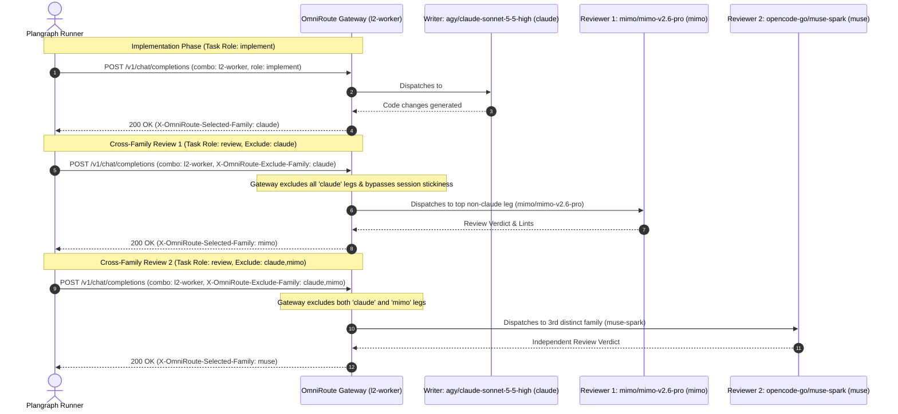

# Plangraph Spawner & Model Routing Architecture

## Spawn by card

Install the package on each host, then use `python -m plangraph.spawner.cli`
(or `python tools/plangraph-spawn.py` from a source checkout). No central keeper
or Temporal service is required for this slice.

```bash
python -m plangraph.spawner.cli route --card @card.json --role implement --json
python -m plangraph.spawner.cli spawn --card @card.json --role implement "Implement the card"
python -m plangraph.spawner.cli spawn --card @card.json --role review --review-of run-ID "Review"
python -m plangraph.spawner.cli ps
python -m plangraph.spawner.cli result run-ID
```

Cards may also be inline JSON. `--state PATH` precedes the verb; otherwise
`PLANGRAPH_SPAWN_STATE` or the XDG plangraph state directory is used.
`--dry-run` plans without a child. Spawn returns a `wait_cmd`:
`plangraph-spawn wait RUN_ID --timeout SECONDS` (omit timeout to block indefinitely).
Never use `pgrep -f` wait loops, including in writer/seat briefs: they can match
the waiting shell itself. Wait reads atomic run records, not process names;
its timeout stops waiting, not the writer.
`--no-fallthrough` disables automatic advancement after a captured provider stop.
Plain stdout, including text saying 429, is never provider evidence.

Private `runs/<run_id>/record.json` contains card hash, role, complete plan,
chosen leg, served model/family, writer family, status, started/ended timestamps,
attempts with provider stop details, job id, pid, and stdout tail.
These records are the only source for `--review-of`; unknown ids refuse.

On terminal save the supervisor publishes a completion per run to
`inbox/parent.jsonl` and the authenticated live keeper HTTP sink. Events
include stable `event_id`, DONE/FAILED, run_id, rc, head_sha, take_cmd and
discard_cmd. `PLANGRAPH_SPAWN_PARENT_SESSION` and `PLANGRAPH_SPAWN_ITEM` identify
the destination session and keeper item. The private parent inbox does not by
itself inject a message into an agent session. Terminal run records are the
durable retry journal. The pluggable `deliver(recipient, event)` sink can bridge
a fleet bus. The default keeper sink uses the spawner-role `record_run` API;
it does not close items or bypass the keeper's authorization checks.
`PLANGRAPH_SPAWN_NOTIFY_CMD` optionally names an argv-style command (no shell);
it receives recipient as its final argument and event JSON on stdin. Consumers
must deduplicate by event_id: external delivery is at-least-once across crashes.
Failed hooks are logged and retried on re-save; local inbox replay is idempotent.
`PLANGRAPH_SPAWN_RUN_TIMEOUT` optionally bounds each child execution in seconds;
expiry kills its process tree and records rc 124 with FAILED completion.
The detached supervisor must survive the child; killing the supervisor itself
requires a future recovery service. This interim event contract carries over to
the later Temporal implementation (also covers FLEET-STATUS-HOOK).
Writing run roles (implement/fix) guard shared .git/config against in-place mutations (e.g. core.autocrlf), restoring original bytes and failing the run if changed.
`--model`/`--leg` require `--override-reason` of at least ten characters,
audited through `routing.hand_picked` to `spawn-overrides.jsonl`.
The Mimo path fence still applies to overrides.

MCP tools `plangraph_agent_route`, `spawn`, `ps`, `result`, `status`, `cancel`
(all with the `plangraph_agent_` prefix) share these records. Spawn requires
`card` and `prompt` in its schema; model_or_combo requires override_reason.
Result/status/cancel accept `run_id`; legacy job-id operations remain available.
No CLI or MCP endpoint writes leg state. Gateway adapters call
`runner.provider_response` with actual captured responses.

Runtime path: `src/plangraph/planner/routing.py` is the only module allowed to
import `plangraph.spawner` at runtime; the boundary is enforced by
`tests/test_spawner_import_guard.py`. Selection runs without a feature flag.

### Card-driven routing core

`planner.routing.plan_spawn(card, role="implement"|"review")` applies the
canonical `route_card` eligibility and tier rules to role-tagged `DEFAULT_LEGS`.
Writers start with `omniroute/cx-gpt-6.1-sol`, then agy Gemini, Mimo Flash,
and direct DeepSeek. Review seats start with Qoder Qwen, free DeepSeek, free
GLM, agy Gemini, then Mimo; Claude is not a default writer or review seat.
Two review seats must have different families from every writer and each other;
an impossible fence returns fewer seats and an explicit plan error, not a fallback.

An explicitly supplied `benchmark=` mapping (model or leg id to resolver metric
row), or sequence of rows with `model_id`, ranks measured legs only inside their
existing tier. Legs without rows go **last inside their tier**, retaining their
relative operator order. `plan.gaps` (also in `to_dict()`) records each missing
role-policy leg as `{leg, model, reason: "no benchmark row"}`; reasons name each
gap, including legs filtered by eligibility or provider state. With `benchmark=None`,
all role-policy legs are gaps, `p_source` is `operator-order`, and reasons explicitly
say `benchmark data absent` (the legacy `no benchmark p` reason remains compatible).
`plan_spawn(..., strict=True)` refuses any missing role-policy row with
`SpawnRefused("benchmark rows missing: <legs>")`. This is the routing hook for the
production CLI's `--require-bench`.

Operator rules and `route_card` tier order come first; U_core only permutes within a tier.
CLI route/spawn and MCP load an existing `PLANGRAPH_CATALOG_DB` (default `~/.cache/plangraph/spawner_catalog.db`), unless `--bench-db`/`bench_db` overrides it.
Route JSON `candidates` exposes each leg's tier, `u_core` (null without a row), `p_source` (`prior`/`measured`), and skip reason/evidence; live limited legs are skipped.

`benchmark_rows_from_db(path)` returns `(rows_by_model_id, errors)` using SQLite
read-only mode; it never creates a missing database. It accepts `catalog_benchmarks`
or OmniRoute `model_benchmarks` (catalog takes precedence if both exist).
`BENCHMARK_COLUMNS` documents the small column alias map. Missing/unreadable files,
missing tables and malformed model IDs return an empty mapping with explicit errors.
Duplicate model rows expose `benchmark_row_count`; the first row supplies metrics.

### Required benchmark release/swap gate (D-2576)

Before an OmniRoute image release or swap, check both host database snapshots:

```bash
python tools/bench_gate.py --db workstation.sqlite --db server.sqlite --json
```

Every distinct model in `DEFAULT_LEGS` with an `implement` or `review` role must
have at least one row **in each database**. Output includes per-model counts and
total rows per database as evidence. Exit codes: **0** complete coverage, **1**
missing policy rows (models and database named), **2** unreadable database or
unsupported/missing benchmark table. No data is synthesized or seeded by this gate;
benchmark preparation/shipping lanes must supply the real rows.

`leg_reader=` accepts a store or leg-status callable; card `account` and `combo`
scope live provider evidence exactly. `next_leg_after_provider_stop` records
actual 429/402 responses with nonempty provider text and advances to the next
currently eligible leg. Other responses do not suppress a leg. Transport adapters
must supply actual provider responses, never agent output or exit-code guesses.

`hand_picked` always requires an override reason of at least ten nonblank characters,
enforces the Mimo provider fence, and appends an audit JSON line to
`$XDG_STATE_HOME/plangraph/spawn-overrides.jsonl` (or injected `log_path`).
Readiness remains separate in `planner/readiness.py`.

Plangraph Spawner provisions, routes, and supervises autonomous agents across multi-model coding workflows. It combines a local WAL-mode SQLite benchmark catalog, a 5-rung tier priority ladder, fine-grained task complexity and risk measurement, OmniRoute ACP-first execution with full Windows Tailnet environment preservation, cross-family code review isolation, and a JSON-RPC 2.0 MCP server.

---

## 1. Architecture Overview

The spawner pipeline follows a deterministic, layered design:



---

## 2. Risk Assessment & Complexity Telemetry

Plangraph measures task write sets and repository signals to deterministically classify complexity and risk:

```mermaid
flowchart LR
    subgraph Signals["Repository & Write Set Signals"]
        Diff["Git Diff / Paths"]
        Lines["Modified Line Count"]
        Mods["Distinct Modules"]
        Fanout["Import Fanout\n(Scoped AST / Blocklisted Grep)"]
        Tests["Test Coverage Check"]
    end

    subgraph Complexity["Complexity Classification (measure.py)"]
        S0["S0: Trivial / Pure Docs (<= 20 lines, 1 file, 0 fanout)"]
        S1["S1: Small Module (<= 80 lines, <= 2 files, fanout <= 2)"]
        S2["S2: Standard Task (<= 250 lines, <= 5 files, fanout <= 5)"]
        S3["S3: Multi-Module (<= 12 files or fanout <= 12)"]
        S4["S4: Cross-Cutting Architectural (> 12 files or fanout > 12)\nDecomposition Trigger: should_decompose = True"]
    end

    subgraph RiskEval["Risk Evaluation (risk.py)"]
        Low["Low Risk: S0 / Pure Docs\nI_min = 37.5, Reviewers = 0..1"]
        Normal["Normal Risk: Tested S1..S3\nI_min = 44.0, Reviewers = 1"]
        High["High Risk: Critical Paths / S4 / Untested S2+\nI_min = 46.0, Reviewers = 2"]
        Critical["Critical Risk: Auth, Crypto, Policy, Security\nI_min = 50.0, Reviewers = 2"]
    end

    Signals --> Complexity
    Complexity --> RiskEval
```



### Complexity Bucketing Matrix (`measure.py`)

| Bucket | Max Files | Max Lines | Max Fanout | Description | Action |
|---|---|---|---|---|---|
| **S0** | 1 (or docs) | $\le 20$ | 0 | Trivial / documentation change | Direct execution, 0-1 reviewer |
| **S1** | $\le 2$ | $\le 80$ | $\le 2$ | Small single-module change | Standard execution, 1 reviewer |
| **S2** | $\le 5$ | $\le 250$ | $\le 5$ | Standard multi-file feature/fix | Standard execution, 1 reviewer |
| **S3** | $\le 12$ | $\le 500$ | $\le 12$ | Multi-module feature/refactor | Enhanced model, 1-2 reviewers |
| **S4** | $> 12$ | $> 500$ | $> 12$ | Cross-cutting architectural change | `should_decompose = True`, 2 reviewers |

### Smarter Symbol Fanout & Ubiquitous Blocklist

To prevent false fanout escalations from common function and method names, `measure.py` filters candidate symbols against `UBIQUITOUS_SYMBOLS_BLOCKLIST`:

- **Blocked Ubiquitous Symbols**: `run`, `get`, `set`, `resolve`, `validate`, `to_dict`, `from_dict`, `__init__`, `items`, `keys`, `values`, `update`, `parse`, `close`, `setup`, `teardown`, `main`, `start`, `stop`, `execute`, `handle`, `process`, `load`, `dump`, `read`, `write`, `send`, `receive`, etc.
- **AST Caller Scoping**: When only ubiquitous symbols or file paths are present, `ast_caller_fanout()` scans the repository using Python's `ast` parser to inspect `Import` and `ImportFrom` statements, counting only modules that legitimately import the modified files.

---

## 3. Two-Stage Mathematical Routing Algorithm (`resolver.py`)

Model selection is governed by a unified two-stage lexicographic optimization algorithm that decouples intelligence ramps, protects against price cliffs, prevents throughput distortion, and avoids double-counting prompt caching benefits.



### Phase 1: Hard Gating & Price Cliff Trajectory Buffer

Every candidate model $M$ must satisfy three hard gates:

1. **Context Capacity**: $\text{Context}(M) \ge \text{need\_tokens}$
2. **Multi-Turn Price Cliff Trajectory Buffer**:
   To prevent multi-turn tool calling loops from crossing catastrophic pricing thresholds (e.g. Anthropic Claude Haiku 100K token price cliff), `need_tokens` is scaled by a role-specific trajectory factor $\tau_{\text{role}}$:
   $$\text{Trajectory Tokens} = \text{need\_tokens} \times \tau_{\text{role}}$$
   $$\text{Gate}_{\text{cliff}}(M) = \begin{cases} \text{Pass} & \text{if } M.\text{price\_cliff\_tokens} \text{ is None or } \text{Trajectory Tokens} \le M.\text{price\_cliff\_tokens} \\ \text{Reject} & \text{otherwise} \end{cases}$$

| Role | Trajectory Factor $\tau_{\text{role}}$ | Rationale |
|---|---|---|
| `implement` / `worker` | **1.5×** | Multi-turn edit-test-debug loops generate significant cumulative context. |
| `driver` / `orchestrate` | **1.3×** | Task dispatch and supervision generate moderate multi-turn context. |
| `review` / `reviewer` | **1.1×** | Reviews read diffs and files with bounded conversation depth. |

*Example*: At 70,000 tokens, Haiku (`price_cliff = 100000`) is rejected for workers ($70\text{k} \times 1.5 = 105\text{k} > 100\text{k}$) while safely admitted for reviewers ($70\text{k} \times 1.1 = 77\text{k} \le 100\text{k}$).

3. **Intelligence Floor**: $I(M) \ge I_{\min}$ for the evaluated risk band.

---

### Phase 2: Core Utility Scoring ($U_{\text{core}}$)

The core utility score $U_{\text{core}}(M)$ balances intelligence, cost sensitivity, quota pool burn, and subscription priority:

$$U_{\text{intel}}(M) = \alpha_{\text{role}} \cdot \left(\min\left(I(M) - I_{\min}, I_{\text{target}} - I_{\min}\right) + \max\left(0, I(M) - I_{\text{target}}\right) \cdot \beta_{\text{excess}}\right)$$

$$U_{\text{core}}(M) = U_{\text{intel}}(M) - \text{Cost}(M) \cdot \gamma_{\text{cost}} - \text{Burn}(M) \cdot 1.0 + W_{\text{tier}}(M)$$

#### Decoupled Risk & Competency Parameters

By decoupling $I_{\text{target}} > I_{\min}$, the intelligence ramp rewards models that reach the target competency level while scaling excess capability according to task risk:

| Risk Band | Min Floor $I_{\min}$ | Target Ramp $I_{\text{target}}$ | Cost Weight $\gamma_{\text{cost}}$ | Excess Weight $\beta_{\text{excess}}$ | Tie Equivalence $\epsilon$ | Reviewers |
|---|---|---|---|---|---|---|
| `low` | 37.5 | 41.0 | 15.0 | 0.2 | 0.5 | 0–1 |
| `normal` | 44.0 | 47.0 | 10.0 | 0.4 | 0.5 | 1 |
| `high` | 46.0 | 50.0 | 4.0 | 0.6 | 0.3 | 2 |
| `critical` | 50.0 | 54.0 | 4.0 | 0.6 | 0.3 | 2 |

#### Role Multiplier ($\alpha_{\text{role}}$)

Role scaling amplifies intelligence gains above $I_{\min}$ for critical supervisory roles:
- `implement` / `worker`: $\alpha_{\text{role}} = 1.0$
- `driver` / `orchestrator`: $\alpha_{\text{role}} = 1.1$
- `review` / `reviewer`: $\alpha_{\text{role}} = 1.2$

#### Tier Priority Weights ($W_{\text{tier}}$)

Guarantees subscription and free pools are prioritized over paid per-token APIs:
$$W_{\text{tier}}(M) = \begin{cases} (4 - \text{rung}(M)) \times 3.5 & \text{if } \text{rung}(M) \le 4 \\ -35.0 & \text{otherwise (unknown)} \end{cases}$$
- `trial` (rung 0): $+14.0$
- `free` (rung 1): $+10.5$
- `credit` (rung 2): $+7.0$
- `subscription` (rung 3): $+3.5$
- `paid` (rung 4): $0.0$

---

### Stage 2: Lexicographic Throughput Tie-Breaker

Linear throughput bonuses in primary utility scoring previously allowed fast models to override up to 18 points of intelligence. Plangraph confines throughput strictly to a **two-stage lexicographic tie-breaker**:

1. Find the highest core utility among surviving candidates:
   $$U_{\max} = \max_{M \in \mathcal{C}} U_{\text{core}}(M)$$
2. Collect the equivalence band of candidates whose utility is within $\epsilon$ of $U_{\max}$:
   $$\mathcal{C}_{\text{top}} = \{ M \in \mathcal{C} \mid U_{\max} - U_{\text{core}}(M) \le \epsilon \}$$
   *(where $\epsilon = 0.5$ for low/normal risk, $\epsilon = 0.3$ for high/critical risk)*
3. Resolve ties within $\mathcal{C}_{\text{top}}$ by verified token generation speed:
   $$M^* = \arg\max_{M \in \mathcal{C}_{\text{top}}} \text{Speed}(M)$$

Candidates with noticeably inferior core utility ($> \epsilon$ points lower) can **never** win solely by virtue of generation speed.

---

### Input Contract, Fail-Closed Rules and Sensitivity

- Numeric inputs are validated before scoring. NaN, +inf, -inf, negative values, and None are rejected with ValueError; a missing intelligence value is rejected with ValueError. A missing or None `context_window`/`context_tokens` falls back to 128000 and a missing or None speed counts as 0 (unmeasured, tie-break only); a present but invalid context window or `price_cliff_tokens` raises ValueError.
- Absent-field defaults (field missing, not None for required numerics): `cost_per_task_usd` 0.20 USD per task, `pool_burn_weight` 1.0, `context_window`/`context_tokens` 128000, speed 0 (unmeasured). `aa_intelligence` has no default and a missing value raises ValueError.
- `need_tokens` must be a positive finite number (an int or integral float); bools, non-numeric values, NaN/inf, non-integral floats, and values <= 0 raise ValueError.
- Unknown risk and unknown role values raise ValueError. The role `"drive"` is accepted and uses alpha 1.1 and trajectory factor 1.3.
- For high and critical risk bands, a candidate below `I_min` fails closed. The only escape is `relax_floor=True` with a non-empty `relax_reason`; when applied, result keys `relaxed` and `relax_reason` are set. A blank reason is not accepted.
- For low and normal risk bands a floor miss does not raise: the highest-intelligence candidates are kept and ranked, and `relaxed` stays false.
- There is no hardcoded fallback model. If no candidate is eligible, both `resolve_review_plan` and `resolve_model_for_task` raise instead of returning a default.
- Catalog fallback (W27/D-2637): during a DB read failure, registered offline legs remain eligible; operator deactivation cannot be enforced while the DB is unreadable. A `catalog_db_error` alert is emitted once per failure episode and rows carry `catalog_source=offline_fallback_db_error`.
- Exclusions (family/author/gated/availability) are applied in every fallback path, including relaxed-floor paths.
- The context gate requires `ctx >= need_tokens * trajectory_factor`; role trajectory factors are applied consistently.
- Risk monotonicity uses `envelope_intelligence` as a best-effort envelope: candidates are filtered to intelligence at or above the best lower-band pick; when that leaves none, resolution falls back to the floor rules, so the envelope cannot be met in every case.
- Tie-breaking uses an epsilon band with absolute utility thresholds of 0.5 and 0.3 utility points.
- Stability is measured by tools/spawner_sensitivity.py over several seeds (key `stability_seeds` in docs/spawner-sensitivity.json); high/critical beta_excess 0.6 and critical gamma_cost 4.0 keep the intelligence +-1 pick flip rate <= 0.10 on every listed seed; the flips that remain at critical are the cost of the hard risk-monotone envelope (critical's intelligence floor is the best lower-band pick, a hard filter), and the strict monotone guarantee (1e-9) is kept.
- The committed sensitivity artifact is `docs/spawner-sensitivity.json`. Regenerate it with `python3 tools/spawner_sensitivity.py --out docs/spawner-sensitivity.json --catalogs 200`. Flip-rate numbers are read from that file; do not invent numbers — see the file.
- The `cost_per_task_usd` field is the catalogued price in USD per task. Utility subtracts `cost_per_task_usd * gamma_cost` in utility points.
- Absolute cost scale matters on purpose: a 10x price change may reorder near-ties inside the epsilon band because cost is real money. Outside the band the order follows utility at any cost scale (proved by `test_order_follows_utility_outside_epsilon_band_any_cost_scale`).
- Speed-scale invariance (`test_speed_scale_invariance`) holds because speed is only a relative tie-break inside the band.

---

## 4. 5-Rung Tier Priority Order & Quota Pools

Every model candidate is assigned a tier according to its billing and quota consumption profile:

| Rung | Tier | Description | Examples |
|---|---|---|---|
| **0** | `trial` | Zero-cost evaluation tiers | Experimental free trial keys |
| **1** | `free` | No marginal cost, daily replenished allowance | `agy/gemini-3.8-flash-tiered-high`, `qoder/qwen3.8-flash-next` |
| **2** | `credit` | Pre-funded non-recurring promotional balance | Promotional API balances |
| **3** | `subscription` | Fixed recurring subscription pools; strictly prioritized before paid APIs | `agy` (Claude/Gemini), `cxa` (Codex Luna), `mimo` (v2.6 pro/flash), `opencode-go`, `claude` |
| **4** | `paid` | Pay-as-you-go per-token APIs; used strictly as last resort | `deepseek` direct API, `gemini` direct API |

### Quota Pool Mechanics

1. **Antigravity (`agy`) Multi-Pool**:
   - Manages 3 independent pools: free daily tier, pro subscription seat allowance, and team pooled capacity.
   - Prevents starvation across concurrent planning and worker sessions.
2. **OpenCode-Go (`opencode-go`) Rolling Caps**:
   - Tracks sliding window usage caps per rolling 5-hour and 24-hour periods.
   - Models like `qwen3.8-max` and `glm-5.2-max` consume from subscription credits before failing over.
3. **MIMO Subscription & Cache Hit Discount**:
   - `mimo/mimo-v2.6-pro` and `mimo/mimo-v2.6-flash` operate under a deep subscription pool.
   - Features a **98% prompt caching discount** (`0.924` cache hit rate), reducing task cost to `$0.13` (Pro) and `$0.04` (Flash).
   - This economic and performance profile places `mimo/mimo-v2.6-pro` ahead of `opencode-go/qwen3.8-max` in utility ranking.

---

## 5. Verified AA v4.3.2 Benchmark Catalog

The SQLite catalog (`src/plangraph/spawner/catalog_schema.sql`, `catalog_seed.py`, `catalog_db.py`) records 22 verified models benchmarked under Artificial Analysis v4.3.2 (October 2026):

| Rank | Model ID | Family | Tier | AA Intel | Verified tok/s | Direct tok/s | Task Cost ($) | Cache Hit | Role Routes |
|---|---|---|---|---|---|---|---|---|---|
| 1 | `agy/claude-opus-5-5-high` | claude | subscription | 57.6 | 98.0 | 45.0 | $1.82 | 88.0% | `l1-orchestrator` |
| 2 | `gemini/gemini-4-argon-high` | gemini | paid | 53.0 | 120.0 | 60.0 | $0.85 | 85.0% | `l1-orchestrator` |
| 3 | `agy/claude-sonnet-5-5-xhigh` | claude | subscription | 48.5 | 95.0 | 50.0 | $1.25 | 91.0% | `l1-orchestrator`, `l2-reviewer` |
| 4 | `agy/claude-sonnet-5-5-high` | claude | subscription | 46.8 | 100.0 | 52.0 | $1.12 | 91.0% | `l1-orchestrator`, `l2-worker`, `l2-reviewer` |
| 5 | `mimo/mimo-v2.6-pro` | mimo | subscription | **46.0** | **51.0** | **29.0** | **$0.13** | **92.4%** | `l1-orchestrator`, `l2-worker`, `l2-reviewer` |
| 6 | `opencode-go/qwen3.8-max` | qwen | subscription | 45.4 | 85.0 | 50.0 | $0.45 | 80.0% | `l1-orchestrator`, `l2-worker` |
| 7 | `opencode-go/deepseek-v4-flash-max` | deepseek | subscription | **45.0** | **231.0** | **115.0** | **$0.26** | 84.0% | `l2-worker`, `l3-driver` |
| 8 | `opencode-go/glm-5.2-max` | glm | subscription | 45.1 | 90.0 | 55.0 | $0.35 | 82.0% | `l2-worker`, `l2-reviewer` |
| 9 | `opencode-go/muse-spark-1.3-contributor` | muse | subscription | 45.0 | 287.0 | 140.0 | $1.37 | 78.0% | `l2-worker` |
| 10 | `deepseek/deepseek-v4-flash-max` | deepseek | paid | **45.0** | **231.0** | **115.0** | **$0.26** | 84.0% | `l2-worker`, `l3-driver` |
| 11 | `claude/claude-haiku-4-5` | claude | subscription | 43.4 | 130.0 | 70.0 | $0.21 | 89.0% | `l2-worker` |
| 12 | `cxa/gpt-6-luna-high` | gpt | subscription | **38.4** | **180.0** | **95.0** | **$0.07** | **85.0%** | `l1-orchestrator`, `l2-worker`, `l2-reviewer`, `l3-driver` |
| 13 | `mimo/mimo-v2.6-flash` | mimo | subscription | 37.9 | **54.0** | **29.0** | **$0.04** | **92.4%** | `l2-worker`, `l3-driver` |
| 14 | `agy/gemini-3.8-flash-tiered-high` | gemini | free | 41.0 | 158.0 | 85.0 | $1.24 | 86.0% | `l1-orchestrator`, `l2-worker` |
| 15 | `qoder/qwen3.8-flash-next` | qwen | free | 40.0 | 175.0 | 90.0 | $0.05 | 81.0% | `l2-worker`, `l3-driver` |
| 16 | `cxa/gpt-6-astra-max` | gpt | subscription | 53.0 | 69.0 | 35.0 | $3.26 | 70.0% | *(Gated: Codex ACP luna-only)* |
| 17 | `cxa/gpt-6-sol-max` | gpt | subscription | 52.0 | 60.0 | 30.0 | $0.72 | 75.0% | *(Gated: Codex ACP luna-only)* |
| 18 | `cxa/gpt-6-sol-xhigh` | gpt | subscription | 50.5 | 65.0 | 32.0 | $0.58 | 75.0% | *(Gated: Codex ACP luna-only)* |
| 19 | `cxa/gpt-6-sol-high` | gpt | subscription | 48.0 | 72.0 | 38.0 | $0.44 | 75.0% | *(Gated: Codex ACP luna-only)* |
| 20 | `cxa/gpt-6-sol-medium` | gpt | subscription | 44.0 | 85.0 | 45.0 | $0.31 | 75.0% | *(Gated: Codex ACP luna-only)* |
| 21 | `cxa/gpt-6-sol-low` | gpt | subscription | 40.0 | 110.0 | 60.0 | $0.20 | 75.0% | *(Gated: Codex ACP luna-only)* |
| 22 | `cxa/gpt-6-luna-low` | gpt | subscription | 34.0 | 220.0 | 120.0 | $0.03 | 85.0% | `l3-driver` |

### Key Ranking & Guardrail Invariants

- **`mimo/mimo-v2.6-pro` vs `opencode-go/qwen3.8-max`**:
  `mimo/mimo-v2.6-pro` has `46.0` AA Intelligence vs `45.4` for Qwen, verified token speed of `51 tok/s` (with `29 tok/s` direct API floor), lower task cost ($0.13 vs $0.45), higher cache hit rate (`92.4%` vs `80.0%`), and access to a deeper subscription pool. Utility scoring deterministically ranks `mimo/mimo-v2.6-pro` ahead of Qwen in both `l1-orchestrator` and `l2-worker`.
- **`mimo/mimo-v2.6-flash` Performance**:
  Measured at `54 tok/s` overall verified, `29 tok/s` direct API, `75.4` CyberBench score, and only `$0.04/task` cost, making it the premier budget fast-worker for S0/S1 tasks.
- **Codex ACP Luna-Only Policy**:
  Codex ACP (`cxa`) currently supports `cxa/gpt-6-luna-high` (`38.4` Intel, `180 tok/s`, `$0.07/task`) as the sole active production model. Models under `cxa/gpt-6-astra-max` and `cxa/gpt-6-sol-*` are gated (`status = 'gated'`, `available = 0`) to avoid silent failure or API timeouts.
- **Claude Sonnet 5.5 Effort Clamping**:
  Anthropic Claude Sonnet 5.5 does not support effort level `max`. `clamp_effort()` automatically transforms requested effort `max` $\rightarrow$ `xhigh` for all `claude-sonnet-5-5*` models.
- **Claude Haiku Price Cliff**:
  `claude/claude-haiku-4-5` imposes a steep price increase for contexts above 100K tokens. When `need_tokens > 100000`, the resolver strictly drops Haiku from candidate pools.
- **DeepSeek Flash v1017**:
  The updated DeepSeek Flash v1017 snapshot reaches an Artificial Analysis Intelligence Index of `45.0` at `$0.26/task` cost and `231 tok/s` verified throughput. Available in both `opencode-go` subscription (`opencode-go/deepseek-v4-flash-max`, $U_{\text{core}} = 0.90$) and direct paid PAYG (`deepseek/deepseek-v4-flash-max`, $U_{\text{core}} = -2.60$). Subscription DeepSeek Flash beats Qwen Max ($U_{\text{core}} = -0.60$) on cost efficiency while providing strong code reasoning.

---

## 6. Cross-Family Review Protocol

To prevent self-review bias and single-model blindspots, Plangraph enforces strict cross-family isolation over shared OmniRoute combos:

$$\text{writer.family} \neq \text{reviewer}_1\text{.family} \neq \text{reviewer}_2\text{.family}$$



### Routing Envelope Headers

Requests dispatched through OmniRoute include routing envelope headers:

| Header | Description | Example |
|---|---|---|
| `X-OmniRoute-Task-Role` | Operational role | `implement`, `review`, `orchestrate`, `drive` |
| `X-OmniRoute-Risk` | Assessed risk band | `low`, `normal`, `high`, `critical` |
| `X-OmniRoute-Min-Intelligence` | Intelligence floor | `44.0` (normal), `45.0` (high), `46.0` (critical) |
| `X-OmniRoute-Required-Context` | Required token context | `32000`, `64000`, `128000` |
| `X-OmniRoute-Exclude-Family` | Comma-separated excluded families | `claude` (Rev 1), `claude,mimo` (Rev 2) |
| `X-OmniRoute-Author-Model` | ID of the author/writer model | `agy/claude-sonnet-5-5-high` |
| `X-OmniRoute-Effort` | Reasoning effort level | `low`, `medium`, `high`, `xhigh` |

### Gateway Response Telemetry

OmniRoute gateways return response headers reflecting the model actually selected and served:
- `X-OmniRoute-Selected-Model`: Canonical model identifier (e.g. `mimo/mimo-v2.6-pro`)
- `X-OmniRoute-Selected-Provider`: Active provider identifier (e.g. `mimo`)
- `X-OmniRoute-Selected-Family`: Canonical model family (e.g. `mimo`)

### Dual Reviewer Isolation Walkthrough

For a high-risk task where `agy/claude-sonnet-5-5-high` (family `claude`) is the writer:
1. **Writer**: Dispatched to `l2-worker`. Served model is `agy/claude-sonnet-5-5-high` (`claude`).
2. **Reviewer 1**: Dispatched to `l2-worker` with `X-OmniRoute-Exclude-Family: claude`. Gateway drops all Claude models; top remaining candidate is `mimo/mimo-v2.6-pro` (`mimo`).
3. **Reviewer 2**: Dispatched to `l2-worker` with `X-OmniRoute-Exclude-Family: claude,mimo`. Gateway drops both Claude and MIMO models; top remaining candidate is `opencode-go/qwen3.8-max` (`qwen`) or `opencode-go/muse-spark-1.3-contributor` (`muse`).

All 3 participants run over the **exact same** `l2-worker` combo definition without maintaining manual per-reviewer routes.

---

## 7. MCP Server & CLI Reference

### JSON-RPC 2.0 MCP Server (`src/plangraph/spawner/mcp.py`)

Run stdio MCP server:
```bash
python -m plangraph.spawner.mcp
```

#### Available MCP Tools

1. `plangraph_agent_spawn`:
   - `prompt` (string, required): Task prompt instructions.
   - `model_or_combo` (string, default `l2-worker`): Target model ID or combo route.
   - `role` (enum: `implement`, `review`, `orchestrate`, `drive`): Execution role.
   - `risk` (enum: `low`, `normal`, `high`, `critical`): Risk classification.
   - `dry_run` (boolean, default `false`): Plan command and telemetry without spawning subprocess.
   - `wait_seconds` (number, default `0.0`): Seconds to await process completion.
2. `plangraph_agent_status`:
   - `job_id` (string, optional): Specific job ID to inspect (returns all jobs if omitted).
3. `plangraph_agent_steer`:
   - `job_id` (string, required): Active job ID.
   - `message` (string, required): Steering instruction delivered to the agent process.
4. `plangraph_agent_cancel`:
   - `job_id` (string, required): Job ID to cancel.
5. `plangraph_agent_query_catalog`:
   - `combo` (string, optional): Filter by combo (e.g. `l2-worker`).
   - `family` (string, optional): Filter by model family (e.g. `mimo`, `claude`).
   - `min_intelligence` (number, optional): Minimum AA Intelligence floor.
6. `plangraph_agent_health`:
   - Reports spawner version, active/total jobs, catalog model counts, and the effective base URL the child receives (empty when none is configured).

#### Gateway endpoint setting

The base URL every gateway client uses is deployment config, read at run time; no
default ships in the source. Two helpers divide the work: `effective_child_base_url()`
is the URL a spawned child ends up using — and the one `plangraph_agent_health`
reports — while `effective_gateway_base_url()` resolves the environment sources, where
`OMNIROUTE_BASE_URL` wins over `PLANGRAPH_GATEWAY_URL`:

| source, in the order it is honoured | key |
|---|---|
| the child's own `OPENCODE_CONFIG_CONTENT` (kept by `setdefault`, see below) | `providers.omniroute.settings.baseURL` |
| environment (provider-level override, wins when set) | `OMNIROUTE_BASE_URL` |
| environment (gateway default) | `PLANGRAPH_GATEWAY_URL` |

On hosts without a root config (such as Windows workst), launch the spawner CLI with `PLANGRAPH_GATEWAY_URL=http://127.0.0.1:20128/v1` to point to the local gateway.

A gateway-keyed model (provider `mimo`/`omniroute`) with no base URL from any source
now fails closed on every platform — a Linux host with neither the root overlay nor a
URL environment variable launches no process and the run fails with
`not_served_on_host: gateway_base_url_unresolved`, falling through to the next leg.

A gateway breaker 503 / circuit-open counts as a failed run: it is never retried in a
loop on the same leg and is not a provider stop (only 429/402 advance the leg state);
the next writer picks the card up.

`gateway_url()` also takes a config mapping and reads its `gateway_url` key, but no
production caller passes one today: that argument exists for callers that do pass it
(the tests exercise it).

`build_child_env` merges into whatever `OPENCODE_CONFIG_CONTENT` already carries using
`setdefault`, so a child config that already sets `settings.baseURL` keeps that value
and no environment source displaces it. With no such key and neither environment
variable set, `build_child_env` writes no `baseURL` into the child provider config (a
caller that needs a value supplies its own), and `plangraph_agent_health` reports
`gateway_default_url` as `""`. Both sides read the same one helper,
`plangraph.spawner.clients.effective_child_base_url()`, so the reported URL always
matches the effective one.

### SQLite Catalog DB CLI (`src/plangraph/spawner/catalog_db.py`)

- **Initialize & Seed Database**:
  ```bash
  python -m plangraph.spawner.catalog_db init-and-seed [--db-path PATH]
  ```
- **Export Deterministic JSON**:
  ```bash
  python -m plangraph.spawner.catalog_db export-json [--output PATH]
  ```
- **Export OmniRoute Combos**:
  ```bash
  python -m plangraph.spawner.catalog_db export-combos [--output PATH]
  ```

### Provisioning the catalog DB (D3)

```bash
python3 -m plangraph.spawner.catalog_db init-and-seed
```

With no arguments this creates the default production DB
(`~/.cache/plangraph/spawner_catalog.db`) idempotently: re-running reproduces the
same rows, no duplicates. `PLANGRAPH_CATALOG_DB` overrides the path; `--db-path
PATH` works in either position (`... --db-path P init-and-seed` or `...
init-and-seed --db-path P`) and writes only `P`.

---

## 8. Host Bootstrap & AutoOS Delegation

Host binary and client prerequisites are delegated to AutoOS (`deploy/requirements-host.json`, `deploy/bootstrap.ps1`, `deploy/bootstrap.sh`) without duplicating package management code:

- Core runtimes: `git`, `python`, `nodejs`, `tailscale`, `omniroute`, `opencode-cli`
- Agent CLIs: `claude-code`, `qwen-code`, `gemini-cli`, `qoder-cli`, `agent-skill-links`

For host provisioning instructions, refer to [`deploy/README.md`](../deploy/README.md).
# Bounded dispatch and gateway evidence

`spawn --wait S` waits at most S seconds after supervisor startup. The default,
`--wait 0`, returns the run id immediately with `status: running`; a detached
supervisor keeps the child and record monitor alive. Use `result RUN_ID` to read
the eventual result. If all eligible legs are limited, dispatch returns exit code
3 with the plan's evidence list and starts no child. Provider stops trigger a
fresh eligibility plan with the original card, role and writer-family exclusions;
already attempted legs are never retried during that run.

The OmniRoute fork emits provider failures as one JSON line on **stderr**:

```json
{"autoos_provider_response":{"leg":"omniroute/cx-gpt-6.1-sol","status":429,"body":"provider quota exhausted","headers":{"Retry-After":"60"}}}
```

The outer object must contain only `autoos_provider_response`; its object must
contain exactly `leg`, `status`, `body`, and `headers`. Leg and nonempty body are
strings, status is the integer 429 or 402, and headers map strings to strings.
The real child monitor passes this envelope to `runner.provider_response`.
Stdout JSON, free-text errors, other statuses and additional keys are not evidence.
This is a trusted harness transport convention, not cryptographic authentication:
the harness must reserve this envelope and not relay agent-authored stderr as it.
MCP tools do not expose any leg-state mutation operation.

CLI and MCP persist records through private 0600 temporary files and atomic rename.
Records and output tails redact `sk-` tokens, Bearer credentials and `*_KEY=`
assignments; child environment mappings are never persisted. Public entry points
use the shared hardened dispatch adapter in `spawner.runner` (the legacy service
remains available for compatibility).

### Transport envelope nonce (defense in depth)

Each runner invocation generates a random nonce sent as the
`X-OmniRoute-Run-Nonce` request header. A stderr provider envelope must echo
that value as `nonce` inside `autoos_provider_response`. Missing or mismatched
values are ignored and recorded as a `forged_envelope` run event, never a leg
mark. This does **not** close child-controlled stderr forgery: the child process
can still read its own environment, including request-header configuration.
Production must verify the nonce against the OmniRoute call log before trusting
provider evidence; call-log verification remains a follow-up.

CLI route/spawn accept `--require-bench` and repeatable `--bench-db PATH`.
MCP route/spawn accept `require_bench` and `bench_db`. The entry-point default
`PLANGRAPH_REQUIRE_BENCH=1` enables strict coverage; missing rows refuse before
starting a child and name the missing legs.
# Phase-review hardening

Strict benchmark refusals use `BenchRequired`, a `SpawnRefused` subtype carrying
the missing legs; refusal text is not an error classifier. A fallthrough refusal
preserves prior attempts in the run record.

`provider_response` is a trusted gateway-adapter API, not a child-output API.
Child evidence is accepted only through the exact nonce-checked stderr envelope.
Nonces are limited to 4096 active runs and removed on completion or cancellation;
dry runs do not retain nonces. Steering a job without stdin returns an explicit
`no stdin` error rather than claiming delivery.

Pure-document review exemptions carry `review_exempt`; zero reviewers without
that flag are invalid, and high/critical risk cannot claim the exemption.
Regression contracts: `test_existing_safety_contracts` in
`tests/test_w13_regressions.py` rejects card-asserted exemptions;
`test_provider_requires_authenticated_source` in the same file pins the trusted
adapter boundary. `test_candidate_json_and_limit` in `tests/test_w11_selection.py`
pins route JSON utility, prior/measured source, and skip evidence.
The Pro provider limits follow the catalog seed (1,000,000 context and 65,536
output); Flash follows the catalog seed's 1,000,000 context limit. The unused OmniRoute
model registry is omitted while its transport configuration remains available.
# Routing hardening

Mimo IDs are case-sensitive: only `mimo/mimo-v2.6-flash` and
`mimo/mimo-v2.6-pro` are accepted. Mixed-case variants are refused.
SQLite files are created privately before connecting. On Windows, mode bits do
not establish a private ACL; operators must secure the state directory ACL.
# Round-five failure contracts

Spawn refusals, including CLI/MCP preflight failures, persist private run records
with an exit code. Codes are 1 for execution/I/O failure, 2 for card/policy
refusal, 3 for benchmark policy/data failure, and 4 for exhausted provider legs.
If storage itself fails, the original refusal is retained and the persistence
failure is logged. Explicit override leg IDs are preserved even for shared models.

State queries do not initialize empty SQLite files. AST fanout that cannot read
or parse a Python file is unknown (`not_measured`), conservatively treated as
fanout 13 for sizing. Routing exclusion reasons are typed metadata, not parsed
exception messages. JSON-RPC requests must explicitly include `jsonrpc: "2.0"`.
Every model admission requires exact membership in the resolver catalog or
registered DEFAULT_LEGS. Case-insensitive Mimo detection chooses error text only;
it is not an admission gate. Unknown IDs, including glued and homoglyph variants,
are typed `SpawnRefused` failures.

For source checkouts, add the repository's `tools` directory to PATH to expose
the executable `plangraph-spawn` entry point (or use
`python -m plangraph.spawner.cli`).
# Completion delivery contract

Completion events carry `idempotency_key = run_id + ':' + status`. Delivery is
retryable: a delivered-marker write can fail after a successful sink call.
Each sink MUST durably deduplicate that key per recipient before exposing an
event, atomically with its observable append. `FileInbox` implements this under
its inbox lock. Command bridges must implement the same contract at the remote
sink; a successful command exit alone cannot guarantee exactly-once effects.
`test_marker_failure_sink_exactly_once` pins marker-failure replay behavior.
# Fixer writers and remaining gaps

Cards may carry `findings`, each with `text` and optional `files`. The pure
`split_findings` helper, also exposed through `plan_spawn.writer_groups`, merges
connected file ownership before balancing components into roughly ten-finding
writers. A shared file is never assigned to two writers. Indivisible components
may exceed ten; findings without files form a final unassigned bucket appended
to the smallest group. Dispatch fans these groups out in parallel.

`render_fixer_brief` numbers every finding and requires each to be fixed or
refuted by a named test, affected tests only (TEST-SPEED-AFFECTED), and
COMMIT before finishing.

Both dispatch paths inspect the full writer output, before tail truncation.
A non-empty Remaining gaps section or unchecked Markdown checklist triggers
one continuation with only those gaps, on the same sandbox and selected leg.
The separate run record has `parent_run_id` and `continuation=1`; the parent
has `continuation_run_id`. A continuation cannot continue again. Clean reports,
nonzero exit codes, review runs, and continuation-limit refusals record their
reason in `continuation_reason`. Dry runs never continue. Live execution proof
belongs to L2/L1; unit tests use synthetic processes.
# Live completion delivery identity

The spawner's keeper completion sink posts `phase=finished` to
`POST /v1/record_run`. Set `PG_URL` to the keeper API base URL and
`PG_TOKEN_FILE` to a file containing a **spawner-role** bearer token. Set
`PLANGRAPH_SPAWN_ITEM` to the claimed/in-review item key. A successful live
acknowledgement precedes `runs/<id>/keeper.delivered`; a local inbox alone is
not keeper delivery. The keeper deduplicates by item, run ID and phase, so
retrying after marker-write failure does not append a second item event.
Missing identity leaves delivery pending with an error naming `PG_URL` and
`PG_TOKEN_FILE`; do not print or copy token contents into diagnostics.

The watchdog also requires `PG_URL` and `PG_TOKEN_FILE` for its keeper
identity. Provision these in its service environment, not an interactive
shell; use the least-privilege identity authorized for the watchdog verbs.
Host availability probes are cached for 300 seconds: newly served models
may not be noticed until that TTL expires.
This is a cache freshness bound, not a five-minute completion or delivery SLA:
child runtime, polling, outages and pending keeper retries can take longer.

### Build-L1 live RUN-EXIT-NOTIFY smoke

Build-L1 runs `bash tools/smoke-run-exit-notify.sh` from the checkout with
`PG_URL`, `PG_TOKEN_FILE` (spawner-role identity authorized for `record_run`
and `show` in the item's project), and `PLANGRAPH_SPAWN_ITEM` set to a real
claimed/in-review item key, for example `plangraph:RUN-EXIT-NOTIFY` if claimed.
Provision the token out of band; never paste it into a brief or command line.
The script uses the permitted cheap local harness alternative: a real Python
child printing OK, supervised through the normal spawn service, without an LLM
request or `--dry-run`. Only command construction is replaced, not monitoring,
record persistence, completion delivery, or the live keeper client.

Success requires rc 0, `runs/<id>/keeper.delivered`, and the same run ID in
`GET /v1/show?key=...`'s `run_ids`, a projection of `run_recorded` item events.
Any missing proof or HTTP/authentication failure exits nonzero. Private state
is retained in `.notify-smoke-*` beneath the checkout for build-L1 inspection.
The writer must not run this against the live keeper; build-L1 owns live proof.
The local marker follows acknowledgement: writing it before sending would lose
events on crash. Exactly-once visibility across marker failure instead relies
on the keeper's atomic `(item, run_id, phase)` idempotency key.
# Review policy

See [Review method](REVIEW-METHOD.md) for file-backed policy and review-scope admission.

## Claude Code sessions

Five MCP tools drive real Claude Code sessions: `plangraph_session_launch`, `plangraph_session_stop`,
`plangraph_session_relaunch`, `plangraph_session_mark_ready`, `plangraph_session_list`. Subprocesses
are argv lists, never shell strings.

Everything invalid is refused with `ParameterRefused` before anything runs: name outside
`[a-z0-9][a-z0-9-]{0,63}`, cwd outside `cwd_roots`, model/effort/permission_mode missing from the
config lists, unlisted `mcp_config`, anything but exactly one of `prompt`/`prompt_file`, a blank
prompt or one starting with `-`, prompt/handoff outside `file_roots`, non-boolean `dry_run`/`force`,
`stop` of a session without a resolved id, or `relaunch` without a ready marker unless `force=True`.

An old id is checked against `claude agents --json` before `launch` replaces a stopped record or a
relaunch proceeds: a poll that fails or returns garbage refuses the action (fail closed), and a
listed id outside `finished`/`stopped` refuses `launch` with "use relaunch" - in `dry_run` too, as
it only reads. Once the process has started, a record write failure still reports the started id.

The config file is selected by `$PLANGRAPH_SESSIONS_CONFIG`, defaulting to
`~/.config/plangraph/sessions.json` when that env var is unset: `cwd_roots`, `file_roots`, `models`,
`efforts`, `permission_modes`, `mcp_configs`, `style_file`, `compact_window`, `ctx_cap_tokens`,
`windows_launcher`. It fails closed - an unknown key, bad scalar or missing file refuses every
action and there is no default model. A present key must carry its type and may not be `null`:
`style_file` a string path, `windows_launcher` only `bg` or `wt`, `compact_window` a digit string,
`ctx_cap_tokens` a positive int. When unset, `ctx_cap_tokens` defaults to 300000 and
`compact_window` to `330000`.

On POSIX (skipped on Windows) every file the config makes us obey must be ours alone: the config
itself must not be a symlink and must be a regular file owned by the current user and not
group/world-writable; the same ownership and mode checks apply to its directory, to every
`mcp_configs` entry and to `style_file`, plus the directory each of those lives in (only that
immediate parent; deeper ancestors are covered by the same-account limit below). Checks fstat
the opened file, never the path, and a symlink alias to an allowed `mcp_config` is fine because the
resolved path is what is compared. `style_file` is stricter: it must resolve inside
`cwd_roots`/`file_roots` and must not be a symlink itself - the configured path is lstat'ed. The
config and `style_file` are read through the descriptor their checks ran on, so the bytes obeyed
are the bytes that passed the checks and a path swapped after a check cannot substitute content.
These checks prove the files are owned by the invoking user account and writable by nobody else -
they cannot defend against that same account or root rewriting them, and on Windows they are not
applied at all.

State lives under `<spawner state>/sessions/`: a `<name>.json` record per session, `<name>.prompt.txt`
(0600), the `<name>.ready.json` marker (handoff, card), and `audit.log` - one scrubbed JSON line per
action with the argv (prompt length only); a dry run writes nothing and leaves no audit line. Prompts,
records and audit text pass the env redactor. A launch that fails after the process may have started -
a timeout or OSError from the run, or a failed `wt.exe` spawn - still writes its record with
`session_id` null and `stopped_ts` unset, so `plangraph_session_list` shows the possible orphan and
`plangraph_session_relaunch` with `force=True` can replace it. A successful launch removes a stale
`<name>.ready.json`. Every audit write is guarded: when `audit.log` cannot be written the action's
own outcome stands and the caller is warned with a `warning` field instead.

`plangraph_session_mark_ready` writes the marker. Relaunch uses the `handoff` argument, else the
marker's handoff; `force=True` waives only the freshness check (handoff newer than the record), never
path containment, and with no marker it restarts bare rather than reusing the record's old handoff.
The stored launch spec is re-validated before the old session is stopped (`claude stop`, never
`rm`/`kill`), the previous session id is excluded when resolving the new one (UUID in launcher
stdout, else a short id on a `background` row of the same name, else the newest `background` row by
name + startedAt near launch), and a post-stop launch failure keeps the record and marker for a
retry. When the record is already marked
stopped but still carries a session id, the id is looked up in `claude agents --json` first: a listed
row in any state but a finished/stopped one is `claude stop`ped before the relaunch - a failed stop
refuses the relaunch and launches nothing - while an unlisted id (or one already finished/stopped)
proceeds without a stop.

`plangraph_session_list` reports `context_tokens` (latest assistant usage sum - input + cache read +
cache creation - from the transcript under `~/.claude/projects/`, reading only the file's last
256 KB) and `context_pct`, a fraction in 0..1 of the configured `ctx_cap_tokens`.

On Windows every `claude` invocation - the launch, `claude stop` and the `claude agents` poll -
must run the real `claude.exe` found via `which`; `.cmd`/`.bat` shims are
refused because cmd.exe would parse the prompt. Sessions start with `claude --bg`, or with
`windows_launcher: "wt"` in a detached `wt.exe` window that only exposes name + startedAt, so the
id comes from `claude agents`.
