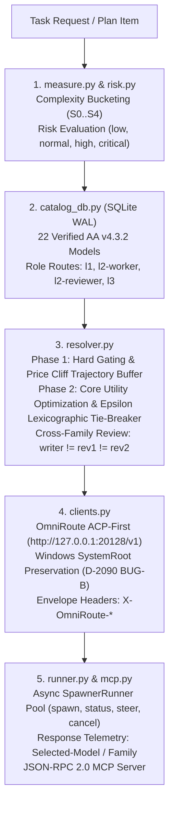
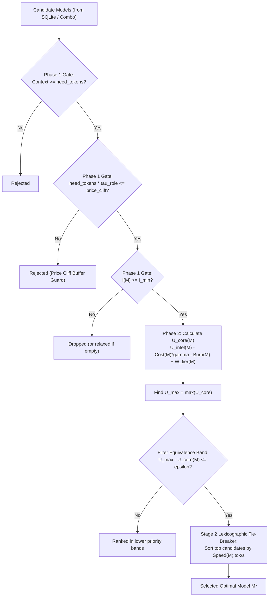
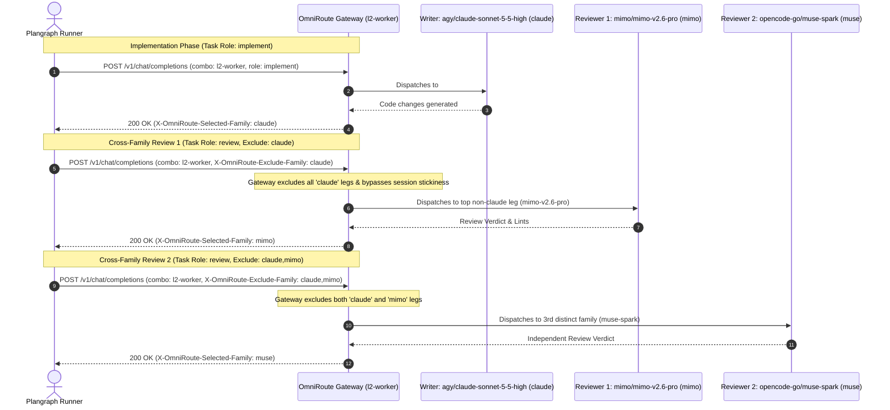

# Plangraph Spawner & Model Routing Architecture

Runtime path: `src/plangraph/planner/routing.py` is the only module allowed to
import `plangraph.spawner` at runtime; the boundary is enforced by
`tests/test_spawner_import_guard.py`, and the switch
`SPAWNER_SELECTION_ENABLED` defaults to `False`.

Plangraph Spawner provisions, routes, and supervises autonomous agents across multi-model coding workflows. It combines a local WAL-mode SQLite benchmark catalog, a 5-rung tier priority ladder, fine-grained task complexity and risk measurement, OmniRoute ACP-first execution with full Windows Tailnet environment preservation, cross-family code review isolation, and a JSON-RPC 2.0 MCP server.

---

## 1. Architecture Overview

The spawner pipeline follows a deterministic, layered design:



---

## 2. Risk Assessment & Complexity Telemetry

Plangraph measures task write sets and repository signals to deterministically classify complexity and risk:

```mermaid
flowchart LR
    subgraph Signals["Repository & Write Set Signals"]
        Diff["Git Diff / Paths"]
        Lines["Modified Line Count"]
        Mods["Distinct Modules"]
        Fanout["Import Fanout\n(Scoped AST / Blocklisted Grep)"]
        Tests["Test Coverage Check"]
    end

    subgraph Complexity["Complexity Classification (measure.py)"]
        S0["S0: Trivial / Pure Docs (<= 20 lines, 1 file, 0 fanout)"]
        S1["S1: Small Module (<= 80 lines, <= 2 files, fanout <= 2)"]
        S2["S2: Standard Task (<= 250 lines, <= 5 files, fanout <= 5)"]
        S3["S3: Multi-Module (<= 12 files or fanout <= 12)"]
        S4["S4: Cross-Cutting Architectural (> 12 files or fanout > 12)\nDecomposition Trigger: should_decompose = True"]
    end

    subgraph RiskEval["Risk Evaluation (risk.py)"]
        Low["Low Risk: S0 / Pure Docs\nI_min = 37.5, Reviewers = 0..1"]
        Normal["Normal Risk: Tested S1..S3\nI_min = 44.0, Reviewers = 1"]
        High["High Risk: Critical Paths / S4 / Untested S2+\nI_min = 46.0, Reviewers = 2"]
        Critical["Critical Risk: Auth, Crypto, Policy, Security\nI_min = 50.0, Reviewers = 2"]
    end

    Signals --> Complexity
    Complexity --> RiskEval
```



### Complexity Bucketing Matrix (`measure.py`)

| Bucket | Max Files | Max Lines | Max Fanout | Description | Action |
|---|---|---|---|---|---|
| **S0** | 1 (or docs) | $\le 20$ | 0 | Trivial / documentation change | Direct execution, 0-1 reviewer |
| **S1** | $\le 2$ | $\le 80$ | $\le 2$ | Small single-module change | Standard execution, 1 reviewer |
| **S2** | $\le 5$ | $\le 250$ | $\le 5$ | Standard multi-file feature/fix | Standard execution, 1 reviewer |
| **S3** | $\le 12$ | $\le 500$ | $\le 12$ | Multi-module feature/refactor | Enhanced model, 1-2 reviewers |
| **S4** | $> 12$ | $> 500$ | $> 12$ | Cross-cutting architectural change | `should_decompose = True`, 2 reviewers |

### Smarter Symbol Fanout & Ubiquitous Blocklist

To prevent false fanout escalations from common function and method names, `measure.py` filters candidate symbols against `UBIQUITOUS_SYMBOLS_BLOCKLIST`:

- **Blocked Ubiquitous Symbols**: `run`, `get`, `set`, `resolve`, `validate`, `to_dict`, `from_dict`, `__init__`, `items`, `keys`, `values`, `update`, `parse`, `close`, `setup`, `teardown`, `main`, `start`, `stop`, `execute`, `handle`, `process`, `load`, `dump`, `read`, `write`, `send`, `receive`, etc.
- **AST Caller Scoping**: When only ubiquitous symbols or file paths are present, `ast_caller_fanout()` scans the repository using Python's `ast` parser to inspect `Import` and `ImportFrom` statements, counting only modules that legitimately import the modified files.

---

## 3. Two-Stage Mathematical Routing Algorithm (`resolver.py`)

Model selection is governed by a unified two-stage lexicographic optimization algorithm that decouples intelligence ramps, protects against price cliffs, prevents throughput distortion, and avoids double-counting prompt caching benefits.



### Phase 1: Hard Gating & Price Cliff Trajectory Buffer

Every candidate model $M$ must satisfy three hard gates:

1. **Context Capacity**: $\text{Context}(M) \ge \text{need\_tokens}$
2. **Multi-Turn Price Cliff Trajectory Buffer**:
   To prevent multi-turn tool calling loops from crossing catastrophic pricing thresholds (e.g. Anthropic Claude Haiku 100K token price cliff), `need_tokens` is scaled by a role-specific trajectory factor $\tau_{\text{role}}$:
   $$\text{Trajectory Tokens} = \text{need\_tokens} \times \tau_{\text{role}}$$
   $$\text{Gate}_{\text{cliff}}(M) = \begin{cases} \text{Pass} & \text{if } M.\text{price\_cliff\_tokens} \text{ is None or } \text{Trajectory Tokens} \le M.\text{price\_cliff\_tokens} \\ \text{Reject} & \text{otherwise} \end{cases}$$

| Role | Trajectory Factor $\tau_{\text{role}}$ | Rationale |
|---|---|---|
| `implement` / `worker` | **1.5×** | Multi-turn edit-test-debug loops generate significant cumulative context. |
| `driver` / `orchestrate` | **1.3×** | Task dispatch and supervision generate moderate multi-turn context. |
| `review` / `reviewer` | **1.1×** | Reviews read diffs and files with bounded conversation depth. |

*Example*: At 70,000 tokens, Haiku (`price_cliff = 100000`) is rejected for workers ($70\text{k} \times 1.5 = 105\text{k} > 100\text{k}$) while safely admitted for reviewers ($70\text{k} \times 1.1 = 77\text{k} \le 100\text{k}$).

3. **Intelligence Floor**: $I(M) \ge I_{\min}$ for the evaluated risk band.

---

### Phase 2: Core Utility Scoring ($U_{\text{core}}$)

The core utility score $U_{\text{core}}(M)$ balances intelligence, cost sensitivity, quota pool burn, and subscription priority:

$$U_{\text{intel}}(M) = \alpha_{\text{role}} \cdot \left(\min\left(I(M) - I_{\min}, I_{\text{target}} - I_{\min}\right) + \max\left(0, I(M) - I_{\text{target}}\right) \cdot \beta_{\text{excess}}\right)$$

$$U_{\text{core}}(M) = U_{\text{intel}}(M) - \text{Cost}(M) \cdot \gamma_{\text{cost}} - \text{Burn}(M) \cdot 1.0 + W_{\text{tier}}(M)$$

#### Decoupled Risk & Competency Parameters

By decoupling $I_{\text{target}} > I_{\min}$, the intelligence ramp rewards models that reach the target competency level while scaling excess capability according to task risk:

| Risk Band | Min Floor $I_{\min}$ | Target Ramp $I_{\text{target}}$ | Cost Weight $\gamma_{\text{cost}}$ | Excess Weight $\beta_{\text{excess}}$ | Tie Equivalence $\epsilon$ | Reviewers |
|---|---|---|---|---|---|---|
| `low` | 37.5 | 41.0 | 15.0 | 0.2 | 0.5 | 0–1 |
| `normal` | 44.0 | 47.0 | 10.0 | 0.4 | 0.5 | 1 |
| `high` | 46.0 | 50.0 | 4.0 | 2.0 | 0.3 | 2 |
| `critical` | 50.0 | 54.0 | 1.5 | 2.5 | 0.3 | 2 |

#### Role Multiplier ($\alpha_{\text{role}}$)

Role scaling amplifies intelligence gains above $I_{\min}$ for critical supervisory roles:
- `implement` / `worker`: $\alpha_{\text{role}} = 1.0$
- `driver` / `orchestrator`: $\alpha_{\text{role}} = 1.1$
- `review` / `reviewer`: $\alpha_{\text{role}} = 1.2$

#### Tier Priority Weights ($W_{\text{tier}}$)

Guarantees subscription and free pools are prioritized over paid per-token APIs:
$$W_{\text{tier}}(M) = \begin{cases} (4 - \text{rung}(M)) \times 3.5 & \text{if } \text{rung}(M) \le 4 \\ -35.0 & \text{otherwise (unknown)} \end{cases}$$
- `trial` (rung 0): $+14.0$
- `free` (rung 1): $+10.5$
- `credit` (rung 2): $+7.0$
- `subscription` (rung 3): $+3.5$
- `paid` (rung 4): $0.0$

---

### Stage 2: Lexicographic Throughput Tie-Breaker

Linear throughput bonuses in primary utility scoring previously allowed fast models to override up to 18 points of intelligence. Plangraph confines throughput strictly to a **two-stage lexicographic tie-breaker**:

1. Find the highest core utility among surviving candidates:
   $$U_{\max} = \max_{M \in \mathcal{C}} U_{\text{core}}(M)$$
2. Collect the equivalence band of candidates whose utility is within $\epsilon$ of $U_{\max}$:
   $$\mathcal{C}_{\text{top}} = \{ M \in \mathcal{C} \mid U_{\max} - U_{\text{core}}(M) \le \epsilon \}$$
   *(where $\epsilon = 0.5$ for low/normal risk, $\epsilon = 0.3$ for high/critical risk)*
3. Resolve ties within $\mathcal{C}_{\text{top}}$ by verified token generation speed:
   $$M^* = \arg\max_{M \in \mathcal{C}_{\text{top}}} \text{Speed}(M)$$

Candidates with noticeably inferior core utility ($> \epsilon$ points lower) can **never** win solely by virtue of generation speed.

---

### Input Contract, Fail-Closed Rules and Sensitivity

- Numeric inputs are validated before scoring. NaN, +inf, -inf, negative values, and None are rejected with ValueError; a missing intelligence value is rejected with ValueError.
- `need_tokens` must be a positive finite number (an int or integral float); bools, non-numeric values, NaN/inf, non-integral floats, and values <= 0 raise ValueError.
- Unknown risk and unknown role values raise ValueError. The role `"drive"` is accepted and uses alpha 1.1 and trajectory factor 1.3.
- For high and critical risk bands, a candidate below `I_min` fails closed. The only escape is `relax_floor=True` with a non-empty `relax_reason`; when applied, result keys `relaxed` and `relax_reason` are set. A blank reason is not accepted.
- For low and normal risk bands a floor miss does not raise: the highest-intelligence candidates are kept and ranked, and `relaxed` stays false.
- There is no hardcoded fallback model. If no candidate is eligible, both `resolve_review_plan` and `resolve_model_for_task` raise instead of returning a default.
- Exclusions (family/author/gated/availability) are applied in every fallback path, including relaxed-floor paths.
- The context gate requires `ctx >= need_tokens * trajectory_factor`; role trajectory factors are applied consistently.
- Risk monotonicity uses `envelope_intelligence` as a best-effort envelope: candidates are filtered to intelligence at or above the best lower-band pick; when that leaves none, resolution falls back to the floor rules, so the envelope cannot be met in every case.
- Tie-breaking uses an epsilon band with absolute utility thresholds of 0.5 and 0.3 utility points.
- The committed sensitivity artifact is `docs/spawner-sensitivity.json`. Regenerate it with `python3 tools/spawner_sensitivity.py --out docs/spawner-sensitivity.json --catalogs 200`. Flip-rate numbers are read from that file; do not invent numbers — see the file.
- The `cost_per_task_usd` field is the catalogued price in USD per task. Utility subtracts `cost_per_task_usd * gamma_cost` in utility points.
- Absolute cost scale matters on purpose: a 10x price change may reorder near-ties inside the epsilon band because cost is real money. Outside the band the order follows utility at any cost scale (proved by `test_order_follows_utility_outside_epsilon_band_any_cost_scale`).
- Speed-scale invariance (`test_speed_scale_invariance`) holds because speed is only a relative tie-break inside the band.

---

## 4. 5-Rung Tier Priority Order & Quota Pools

Every model candidate is assigned a tier according to its billing and quota consumption profile:

| Rung | Tier | Description | Examples |
|---|---|---|---|
| **0** | `trial` | Zero-cost evaluation tiers | Experimental free trial keys |
| **1** | `free` | No marginal cost, daily replenished allowance | `agy/gemini-3.8-flash-tiered-high`, `qoder/qwen3.8-flash-next` |
| **2** | `credit` | Pre-funded non-recurring promotional balance | Promotional API balances |
| **3** | `subscription` | Fixed recurring subscription pools; strictly prioritized before paid APIs | `agy` (Claude/Gemini), `cxa` (Codex Luna), `mimo` (v2.6 pro/flash), `opencode-go`, `claude` |
| **4** | `paid` | Pay-as-you-go per-token APIs; used strictly as last resort | `deepseek` direct API, `gemini` direct API |

### Quota Pool Mechanics

1. **Antigravity (`agy`) Multi-Pool**:
   - Manages 3 independent pools: free daily tier, pro subscription seat allowance, and team pooled capacity.
   - Prevents starvation across concurrent planning and worker sessions.
2. **OpenCode-Go (`opencode-go`) Rolling Caps**:
   - Tracks sliding window usage caps per rolling 5-hour and 24-hour periods.
   - Models like `qwen3.8-max` and `glm-5.2-max` consume from subscription credits before failing over.
3. **MIMO Subscription & Cache Hit Discount**:
   - `mimo/mimo-v2.6-pro` and `mimo/mimo-v2.6-flash` operate under a deep subscription pool.
   - Features a **98% prompt caching discount** (`0.924` cache hit rate), reducing task cost to `$0.13` (Pro) and `$0.04` (Flash).
   - This economic and performance profile places `mimo/mimo-v2.6-pro` ahead of `opencode-go/qwen3.8-max` in utility ranking.

---

## 5. Verified AA v4.3.2 Benchmark Catalog

The SQLite catalog (`src/plangraph/spawner/catalog_schema.sql`, `catalog_seed.py`, `catalog_db.py`) records 22 verified models benchmarked under Artificial Analysis v4.3.2 (October 2026):

| Rank | Model ID | Family | Tier | AA Intel | Verified tok/s | Direct tok/s | Task Cost ($) | Cache Hit | Role Routes |
|---|---|---|---|---|---|---|---|---|---|
| 1 | `agy/claude-opus-5-5-high` | claude | subscription | 57.6 | 98.0 | 45.0 | $1.82 | 88.0% | `l1-orchestrator` |
| 2 | `gemini/gemini-4-argon-high` | gemini | paid | 53.0 | 120.0 | 60.0 | $0.85 | 85.0% | `l1-orchestrator` |
| 3 | `agy/claude-sonnet-5-5-xhigh` | claude | subscription | 48.5 | 95.0 | 50.0 | $1.25 | 91.0% | `l1-orchestrator`, `l2-reviewer` |
| 4 | `agy/claude-sonnet-5-5-high` | claude | subscription | 46.8 | 100.0 | 52.0 | $1.12 | 91.0% | `l1-orchestrator`, `l2-worker`, `l2-reviewer` |
| 5 | `mimo/mimo-v2.6-pro` | mimo | subscription | **46.0** | **51.0** | **29.0** | **$0.13** | **92.4%** | `l1-orchestrator`, `l2-worker`, `l2-reviewer` |
| 6 | `opencode-go/qwen3.8-max` | qwen | subscription | 45.4 | 85.0 | 50.0 | $0.45 | 80.0% | `l1-orchestrator`, `l2-worker` |
| 7 | `opencode-go/deepseek-v4-flash-max` | deepseek | subscription | **45.0** | **231.0** | **115.0** | **$0.26** | 84.0% | `l2-worker`, `l3-driver` |
| 8 | `opencode-go/glm-5.2-max` | glm | subscription | 45.1 | 90.0 | 55.0 | $0.35 | 82.0% | `l2-worker`, `l2-reviewer` |
| 9 | `opencode-go/muse-spark-1.3-contributor` | muse | subscription | 45.0 | 287.0 | 140.0 | $1.37 | 78.0% | `l2-worker` |
| 10 | `deepseek/deepseek-v4-flash-max` | deepseek | paid | **45.0** | **231.0** | **115.0** | **$0.26** | 84.0% | `l2-worker`, `l3-driver` |
| 11 | `claude/claude-haiku-4-5` | claude | subscription | 43.4 | 130.0 | 70.0 | $0.21 | 89.0% | `l2-worker` |
| 12 | `cxa/gpt-6-luna-high` | gpt | subscription | **38.4** | **180.0** | **95.0** | **$0.07** | **85.0%** | `l1-orchestrator`, `l2-worker`, `l2-reviewer`, `l3-driver` |
| 13 | `mimo/mimo-v2.6-flash` | mimo | subscription | 37.9 | **54.0** | **29.0** | **$0.04** | **92.4%** | `l2-worker`, `l3-driver` |
| 14 | `agy/gemini-3.8-flash-tiered-high` | gemini | free | 41.0 | 158.0 | 85.0 | $1.24 | 86.0% | `l1-orchestrator`, `l2-worker` |
| 15 | `qoder/qwen3.8-flash-next` | qwen | free | 40.0 | 175.0 | 90.0 | $0.05 | 81.0% | `l2-worker`, `l3-driver` |
| 16 | `cxa/gpt-6-astra-max` | gpt | subscription | 53.0 | 69.0 | 35.0 | $3.26 | 70.0% | *(Gated: Codex ACP luna-only)* |
| 17 | `cxa/gpt-6-sol-max` | gpt | subscription | 52.0 | 60.0 | 30.0 | $0.72 | 75.0% | *(Gated: Codex ACP luna-only)* |
| 18 | `cxa/gpt-6-sol-xhigh` | gpt | subscription | 50.5 | 65.0 | 32.0 | $0.58 | 75.0% | *(Gated: Codex ACP luna-only)* |
| 19 | `cxa/gpt-6-sol-high` | gpt | subscription | 48.0 | 72.0 | 38.0 | $0.44 | 75.0% | *(Gated: Codex ACP luna-only)* |
| 20 | `cxa/gpt-6-sol-medium` | gpt | subscription | 44.0 | 85.0 | 45.0 | $0.31 | 75.0% | *(Gated: Codex ACP luna-only)* |
| 21 | `cxa/gpt-6-sol-low` | gpt | subscription | 40.0 | 110.0 | 60.0 | $0.20 | 75.0% | *(Gated: Codex ACP luna-only)* |
| 22 | `cxa/gpt-6-luna-low` | gpt | subscription | 34.0 | 220.0 | 120.0 | $0.03 | 85.0% | `l3-driver` |

### Key Ranking & Guardrail Invariants

- **`mimo/mimo-v2.6-pro` vs `opencode-go/qwen3.8-max`**:
  `mimo/mimo-v2.6-pro` has `46.0` AA Intelligence vs `45.4` for Qwen, verified token speed of `51 tok/s` (with `29 tok/s` direct API floor), lower task cost ($0.13 vs $0.45), higher cache hit rate (`92.4%` vs `80.0%`), and access to a deeper subscription pool. Utility scoring deterministically ranks `mimo/mimo-v2.6-pro` ahead of Qwen in both `l1-orchestrator` and `l2-worker`.
- **`mimo/mimo-v2.6-flash` Performance**:
  Measured at `54 tok/s` overall verified, `29 tok/s` direct API, `75.4` CyberBench score, and only `$0.04/task` cost, making it the premier budget fast-worker for S0/S1 tasks.
- **Codex ACP Luna-Only Policy**:
  Codex ACP (`cxa`) currently supports `cxa/gpt-6-luna-high` (`38.4` Intel, `180 tok/s`, `$0.07/task`) as the sole active production model. Models under `cxa/gpt-6-astra-max` and `cxa/gpt-6-sol-*` are gated (`status = 'gated'`, `available = 0`) to avoid silent failure or API timeouts.
- **Claude Sonnet 5.5 Effort Clamping**:
  Anthropic Claude Sonnet 5.5 does not support effort level `max`. `clamp_effort()` automatically transforms requested effort `max` $\rightarrow$ `xhigh` for all `claude-sonnet-5-5*` models.
- **Claude Haiku Price Cliff**:
  `claude/claude-haiku-4-5` imposes a steep price increase for contexts above 100K tokens. When `need_tokens > 100000`, the resolver strictly drops Haiku from candidate pools.
- **DeepSeek Flash v1017**:
  The updated DeepSeek Flash v1017 snapshot reaches an Artificial Analysis Intelligence Index of `45.0` at `$0.26/task` cost and `231 tok/s` verified throughput. Available in both `opencode-go` subscription (`opencode-go/deepseek-v4-flash-max`, $U_{\text{core}} = 0.90$) and direct paid PAYG (`deepseek/deepseek-v4-flash-max`, $U_{\text{core}} = -2.60$). Subscription DeepSeek Flash beats Qwen Max ($U_{\text{core}} = -0.60$) on cost efficiency while providing strong code reasoning.

---

## 6. Cross-Family Review Protocol

To prevent self-review bias and single-model blindspots, Plangraph enforces strict cross-family isolation over shared OmniRoute combos:

$$\text{writer.family} \neq \text{reviewer}_1\text{.family} \neq \text{reviewer}_2\text{.family}$$



### Routing Envelope Headers

Requests dispatched through OmniRoute include routing envelope headers:

| Header | Description | Example |
|---|---|---|
| `X-OmniRoute-Task-Role` | Operational role | `implement`, `review`, `orchestrate`, `drive` |
| `X-OmniRoute-Risk` | Assessed risk band | `low`, `normal`, `high`, `critical` |
| `X-OmniRoute-Min-Intelligence` | Intelligence floor | `44.0` (normal), `45.0` (high), `46.0` (critical) |
| `X-OmniRoute-Required-Context` | Required token context | `32000`, `64000`, `128000` |
| `X-OmniRoute-Exclude-Family` | Comma-separated excluded families | `claude` (Rev 1), `claude,mimo` (Rev 2) |
| `X-OmniRoute-Author-Model` | ID of the author/writer model | `agy/claude-sonnet-5-5-high` |
| `X-OmniRoute-Effort` | Reasoning effort level | `low`, `medium`, `high`, `xhigh` |

### Gateway Response Telemetry

OmniRoute gateways return response headers reflecting the model actually selected and served:
- `X-OmniRoute-Selected-Model`: Canonical model identifier (e.g. `mimo/mimo-v2.6-pro`)
- `X-OmniRoute-Selected-Provider`: Active provider identifier (e.g. `mimo`)
- `X-OmniRoute-Selected-Family`: Canonical model family (e.g. `mimo`)

### Dual Reviewer Isolation Walkthrough

For a high-risk task where `agy/claude-sonnet-5-5-high` (family `claude`) is the writer:
1. **Writer**: Dispatched to `l2-worker`. Served model is `agy/claude-sonnet-5-5-high` (`claude`).
2. **Reviewer 1**: Dispatched to `l2-worker` with `X-OmniRoute-Exclude-Family: claude`. Gateway drops all Claude models; top remaining candidate is `mimo/mimo-v2.6-pro` (`mimo`).
3. **Reviewer 2**: Dispatched to `l2-worker` with `X-OmniRoute-Exclude-Family: claude,mimo`. Gateway drops both Claude and MIMO models; top remaining candidate is `opencode-go/qwen3.8-max` (`qwen`) or `opencode-go/muse-spark-1.3-contributor` (`muse`).

All 3 participants run over the **exact same** `l2-worker` combo definition without maintaining manual per-reviewer routes.

---

## 7. MCP Server & CLI Reference

### JSON-RPC 2.0 MCP Server (`src/plangraph/spawner/mcp.py`)

Run stdio MCP server:
```bash
python -m plangraph.spawner.mcp
```

#### Available MCP Tools

1. `plangraph_agent_spawn`:
   - `prompt` (string, required): Task prompt instructions.
   - `model_or_combo` (string, default `l2-worker`): Target model ID or combo route.
   - `role` (enum: `implement`, `review`, `orchestrate`, `drive`): Execution role.
   - `risk` (enum: `low`, `normal`, `high`, `critical`): Risk classification.
   - `dry_run` (boolean, default `false`): Plan command and telemetry without spawning subprocess.
   - `wait_seconds` (number, default `0.0`): Seconds to await process completion.
2. `plangraph_agent_status`:
   - `job_id` (string, optional): Specific job ID to inspect (returns all jobs if omitted).
3. `plangraph_agent_steer`:
   - `job_id` (string, required): Active job ID.
   - `message` (string, required): Steering instruction delivered to the agent process.
4. `plangraph_agent_cancel`:
   - `job_id` (string, required): Job ID to cancel.
5. `plangraph_agent_query_catalog`:
   - `combo` (string, optional): Filter by combo (e.g. `l2-worker`).
   - `family` (string, optional): Filter by model family (e.g. `mimo`, `claude`).
   - `min_intelligence` (number, optional): Minimum AA Intelligence floor.
6. `plangraph_agent_health`:
   - Reports spawner version, active/total jobs, catalog model counts, and gateway URL.

### SQLite Catalog DB CLI (`src/plangraph/spawner/catalog_db.py`)

- **Initialize & Seed Database**:
  ```bash
  python -m plangraph.spawner.catalog_db init-and-seed [--db-path PATH]
  ```
- **Export Deterministic JSON**:
  ```bash
  python -m plangraph.spawner.catalog_db export-json [--output PATH]
  ```
- **Export OmniRoute Combos**:
  ```bash
  python -m plangraph.spawner.catalog_db export-combos [--output PATH]
  ```

---

## 8. Host Bootstrap & AutoOS Delegation

Host binary and client prerequisites are delegated to AutoOS (`deploy/requirements-host.json`, `deploy/bootstrap.ps1`, `deploy/bootstrap.sh`) without duplicating package management code:

- Core runtimes: `git`, `python`, `nodejs`, `tailscale`, `omniroute`, `opencode-cli`
- Agent CLIs: `claude-code`, `qwen-code`, `gemini-cli`, `qoder-cli`, `agent-skill-links`

For host provisioning instructions, refer to [`deploy/README.md`](../deploy/README.md).
