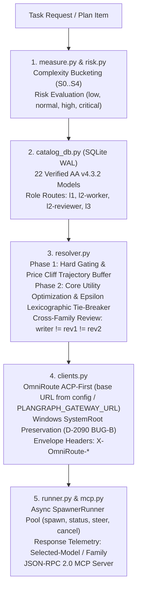
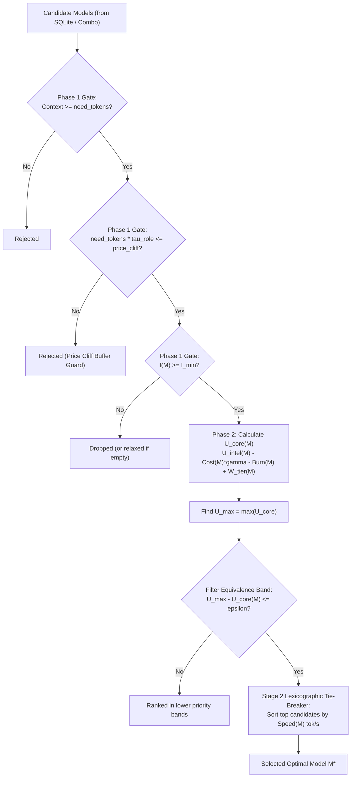

# Plangraph Spawner & Model Routing Architecture
Benchmark catalog queries expose [source URLs and dates](benchmark-catalog.md); component-only evidence never substitutes for a missing composite score.

### Windows prompt delivery
Oversized Qoder commands move the prompt to UTF-8 text stdin before the Windows
argv guard (32,000 characters, or 8,000 for batch shims). This uses the existing
per-job stdin payload path, not a temporary prompt file. Qoder retains an explicit
empty `-p` value with `--input-format text`; missing prompt flags fail with
`stdin_prompt_flag_missing`. Oversized Windows agy
commands use `--input-format stream-json --output-format stream-json -p ""`, with
one UTF-8 NDJSON user event on stdin followed by EOF. The last result's
`response` supplies the answer and verdict; an ERROR or missing result fails
explicitly, without publishing an unsuccessful response as an answer.
Short agy prompts and Linux launches retain their existing argv form; see [background review launches and deadlines](spawner-operations.md) for Windows console suppression and bounded prompt packaging.
Rejected stdin input or an unavailable/closed input pipe fails the run explicitly;
the watchdog never retries a rejected payload as an empty prompt. Gateway config
size refusal leaves the caller's environment unchanged.

### Writer result finalization
Terminal saves dispatch review verdicts to the keeper:
- `verdict.json` audits outcomes; `verdict.delivered` stops replay.
- Invalid evidence, missing keys, unwitnessed families and unparseable verdicts skip.
- Pre-verifier I/O/import failures retry at most three times; lock failures defer without journal writes.
- Verifier exit codes govern retries; ambiguous exceptions after invocation skip to prevent duplicate POSTs.
- Remove both journal and marker explicitly to requeue after repair.
- Delivery markers stop retries even when the completion field is absent.
`worker-core::writer_result::check_result` runs the mandatory Rust file-size
gate before returning a checked result; export rechecks it before content gates,
bundle sealing or publication. A refusal returns `HOLD gate file-size: <detail>`
and no publish/push is attempted. Changed tracked files use the Python CI gate's
400-line rule, exemptions, binary detection, splitlines counting and baseline
ratchet. CI still runs unchanged `tools/check_file_size.py` over all tracked files.
The adjacent Rust changelog gate in slice S1b uses the run-base merge-base and the CI entry/skip-trailer rule, returning `HOLD gate changelog: <detail>` before export or publish/push when an entry is required. The `.docs-map` gate moves into Rust in slice S1c. Doc-only and empty commits do not require skip reasons; section boundaries include indented headings in both Rust and CI.

Cross-host ps distinguishes missing source paths and unreachable SSH hosts; doctor checks configured source directories in parallel (see [cross-host ps](spawner-ps.md)).
Denied-tool OpenCode reviews exiting 1 preserve exact final verdicts from pending text without a stop frame, but not after an explicit non-stop finish; other transport-completion checks remain strict.
### Doctor host source checks

`python3 -m plangraph.spawner.doctor` delegates host source checks to the Rust
`pg-spawnd doctor-sources` subcommand. `doctor.py` resolves it on the host's
`PATH`, never from checkout build artifacts, and reads its JSON check rows with
a ten-second subprocess timeout. Before any checks, optional `env.PATH` from the
local hosts registry entry replaces the inherited PATH for both pg-spawnd and
harness discovery/children. Identity is `PLANGRAPH_HOST_NAME` or registry `self`,
with case-insensitive id/alias lookup; absent configuration retains inherited PATH.
There is no Python fallback for source checks; fresh release clones need no build.

The Rust command reads `plangraph/ps-hosts.json` under `XDG_CONFIG_HOME` (or
`~/.config`), checking valid entries with `src` or `win_src` in parallel with
at most 16 workers. SSH uses batch mode, a two-second connection timeout and
a three-second probe deadline; source checks support POSIX, WSL and Windows
paths. SSH output and diagnostics are discarded. A missing config or no
eligible entries produces no source check rows; unreadable or malformed
configuration produces `ps_hosts: fail` with `invalid configuration`.

Each `ps_host_<name>` row passes with `ok` on SSH exit 0; exit 44 reports
`src missing`, exit 255 or an SSH launch/I/O error reports `unreachable`, and
a timeout or other exit reports `host query failed`. If the Rust binary is
missing, Python adds `ps_hosts: fail` with `unavailable`; a nonzero subcommand
exit, invalid JSON/non-list response, timeout or other invocation error instead
reports `host query failed`. Any failed check makes doctor exit 1.

## Spawn by card
Fleet sessions disable Superpowers with launch-local `--settings` on Linux and Windows; attended argv and user config stay unchanged.

CLI and overflow admission use the worker-core memory rule:
`effective_free_mb - reservation_mb >= mem_floor_mb`, with MemAvailable as
free memory and `warmup.ramp_mb[role]` as the reservation (an unknown role
uses that host's largest positive ramp). Live run/writer counts never limit
admission. Overflow ranks hosts by free RAM above their floor.
Admission reads `caps.mem_floor_mb` and `warmup.ramp_mb` for each host
from the worker-core hosts registry (`$XDG_CONFIG_HOME/plangraph/hosts.json`,
or `~/.config/plangraph/hosts.json`), the same location used by fleet-sync.
Local identity is `PLANGRAPH_HOST_NAME` when set, otherwise registry `self`;
IDs and aliases resolve case-insensitively. Routing and the public-repository
allowlist still come from `overflow-hosts.json`, but its legacy run/floor caps
and local limit overrides are ignored. Missing/unreadable registry or missing,
malformed caps exclude that host from overflow. Local admission instead uses
conservative defaults of floor 3000 MB and role 2048 MB, with a logged reason.
The independent OOM guard (D-5057/D-5075) remains unchanged.

Default CLI and MCP spawns try healthy SSH overflow hosts when local RAM
admission refuses, only for repositories in the `public_repos` allowlist.
Private or unknown repositories queue without copying. Failed targets are
excluded for that spawn; when none can accept, a queued record lists safe
refusal reasons. Without overflow config, admitted local runs have no annotation;
below-floor runs queue with matching `reason` and `overflow_reason`. Dry runs do not overflow.
Local benchmark databases cannot be forwarded. CLI/MCP use public `admit_spawn` once in the shared wrapper, not the CLI parent; the service persists queued/remote records.

SSH overflow uses `overflow.remote_spawn` with per-call nonce begin/end sentinel
lines around the remote spawn JSON. Only the single bracketed JSON receipt is
accepted; shell-init banners, env-file echoes and JSON after the end are ignored.
Missing, repeated or reversed sentinel pairs report `receipt_unbracketed` without
retrying an already acknowledged spawn. Remote stderr stays private, and the
existing credential-shape masking helper masks receipts before stdout exposure.
Unreadable receipts or receipts without a nonblank remote run ID produce a
local tracking ID, `acknowledged_unknown=true` and `status=unknown` on the
selected host; they are never refused or retried.

Install the package on each host, then use `python -m plangraph.spawner.cli`
(or `python tools/plangraph-spawn.py` from a source checkout). No central keeper
or Temporal service is required for this slice. **Grok and manual-only Muse:** `omniroute-grok-4.7` uses `omniroute/gc/grok-4.7` for review only (catalog `grok`, seat `xai`). `opencode-console-muse-spark` uses `console-meta/muse-spark-1.3-contributor`; like `opencode-go-muse-spark`, its catalog family is `muse` (seat `meta`). Neither Muse leg routes automatically, even with a review policy lift. Use `--leg` with an audited `--override-reason` of at least ten characters, for scrubbed or public material only; host checks still apply. Runtime rows derive from `DEFAULT_LEGS`, not AA seeds. Policy `review_allowed_families` lifts bans, not an allowlist; Grok needs no JSON exemption.
```bash
python -m plangraph.spawner.cli route --card @card.json --role implement --json
python -m plangraph.spawner.cli spawn --card @card.json --role implement "Implement the card"
python -m plangraph.spawner.cli spawn --card @card.json --role review --review-of run-ID "Review"
python -m plangraph.spawner.cli ps
python -m plangraph.spawner.cli result run-ID
```
Cards may also be inline JSON; `spawn --prompt-file FILE` replaces the prompt argument for prompts over the argv limit; it reads UTF-8, strips a BOM, and a bad file exits 2 with a `prompt_file_*` or `prompt_input_*` refusal. `card.context` (`path:start-end` slices, at most 64) is inlined as a CONTEXT PACK for inline-only legs (cap `PLANGRAPH_CONTEXT_PACK_MAX_CHARS`, default 60000; built once per spawn, each slice file read once and passed through `redact`; a secret-looking name, a `.git` part or an untracked file is skipped with a `context_path_refused` warning; with entries, no git work tree, a symlink loop or too many entries refuse the spawn (without entries a failed listing only adds `big_file_scan_skipped`); a range past the end of the file adds `context_range_past_eof`) and a brief naming a 400+ line file without a slice adds a `big_file_unsliced` warning (D-3622, D-3649). `--state PATH` precedes the verb; otherwise
`PLANGRAPH_SPAWN_STATE` or the XDG plangraph state directory is used.
`--dry-run` plans without a child. Spawn returns a `wait_cmd`:
`plangraph-spawn wait RUN_ID --timeout SECONDS` (omit timeout to block indefinitely).
Never use `pgrep -f` wait loops, including in writer/seat briefs: they can match
the waiting shell itself. Wait reads atomic run records, not process names;
its timeout stops waiting, not the writer.
`--no-fallthrough` disables automatic advancement after a captured provider stop.
Plain stdout, including text saying 429, is never provider evidence.

Private `runs/<run_id>/record.json` contains card hash, role, complete plan,
chosen leg, served model/family with witness kind (a structured claude `system/init` model is a native witness; a mismatch with the requested leg sets `served_model_mismatch`), writer family, status, started/ended timestamps,
attempts with provider stop details, job id, pid, and stdout tail.
These records are the only source for `--review-of`; unknown ids refuse.

On terminal save the supervisor publishes a completion per run to
`inbox/parent.jsonl` and the authenticated live keeper HTTP sink. Events
include stable `event_id`, DONE/FAILED, run_id, rc, head_sha, take_cmd and
discard_cmd. `PLANGRAPH_SPAWN_PARENT_SESSION` and `PLANGRAPH_SPAWN_ITEM` identify
the destination session and keeper item. The private parent inbox does not by
itself inject a message into an agent session. Terminal run records are the
durable retry journal. The pluggable `deliver(recipient, event)` sink can bridge
a fleet bus. The default keeper sink uses the spawner-role `record_run` API;
it does not close items or bypass the keeper's authorization checks.
`PLANGRAPH_SPAWN_NOTIFY_CMD` optionally names an argv-style command (no shell);
it receives recipient as its final argument and event JSON on stdin. Consumers
must deduplicate by event_id: external delivery is at-least-once across crashes.
Failed hooks are logged and retried on re-save; local inbox replay is idempotent.
`PLANGRAPH_SPAWN_RUN_TIMEOUT` optionally bounds each child execution in seconds; unset gives a 25-minute review cap, while empty means no review cap;
expiry kills its process tree and records rc 124 with FAILED completion.
The detached supervisor must survive the child; killing the supervisor itself
requires a future recovery service. This interim event contract carries over to
the later Temporal implementation (also covers FLEET-STATUS-HOOK).
Writing run roles (implement/fix) guard shared .git/config against in-place mutations (e.g. core.autocrlf), restoring original bytes and failing the run if changed. The spawner kills only the process tree it started: the root is proven ours at spawn (direct child, own group; or Job Object member), a snapshot of its descendants is taken before any signal, and a kill is verified (up to 10 s). Survivors fail the run with reason `kill_incomplete` (event `kill_incomplete`, `survivors` pids): no fall-through leg, no second writer. Runs use argv exec only (no shell wrapper), enforced by a static guard test.

Slice 1 cancellation with survivors ends the run as `failed` with reason `kill_incomplete` and never publishes `cancelled`; already-terminal cancellation results keep their status and exit code. Leg probes track spawned job IDs (not shared working directories), wait at most five seconds per launch/cancel/monitor cleanup operation, and attempt every owned job even after an error. Successful cleanup removes the temporary directory; incomplete cleanup raises an explicit error and retains it rather than deleting it under a possibly live process. `setsid` containment and periodic reaping are not implemented yet.
`--model`/`--leg` require `--override-reason` of at least ten characters,
audited through `routing.hand_picked` to `spawn-overrides.jsonl`.
The Mimo path fence still applies to overrides. Review seats: [spawner-seats.md](spawner-seats.md) (D-3198).

CLI `probe --leg ID` / `probe --all-writers` (`--timeout S`, `--json`) and MCP `plangraph_agent_probe`: [liveness and env knobs](spawner-leg-state.md) (`PLANGRAPH_LEG_DOWN_S`, `PLANGRAPH_LEG_PROBE_TIMEOUT_S`, `PLANGRAPH_LEG_PROBE_TTL_S`).
A probe with its harness binary missing reports `host-not-ready` and books no leg event.
CLI `launch-spec` (placement R6a-3d; nothing calls it yet): one JSON request on stdin, one launch spec on stdout (argv, cwd, the complete child env, stdin, warnings, events) for pg-spawnd; optional request `leg.explicit` must be boolean: only `true` permits document review without `diff_ref`, absent/false still refuses; it reuses the spawn prep and never launches; exit 2 = one redacted refusal line, exit 1 = internal error (type name only).
MCP `route`, `spawn`, `ps`, `result`, `status`, `cancel` (with `plangraph_agent_` prefix) share these records. Spawn requires
`card` and `prompt` in its schema; model_or_combo requires override_reason.
Result/status/cancel accept `run_id`; legacy job-id operations remain available.
MCP `ps` is compact (all running/queued runs, the newest 20 ended, `total`, `omitted`); use `result` or CLI `ps` for full records.
No JSON-RPC notification is answered or dispatched. A reply over 8 MiB becomes a `ReplyTooLarge` error (code -32000, same request id); stdio keeps serving.
Only actual probe results write liveness state. Gateway adapters call
`runner.provider_response` with actual captured responses.

Runtime path: `src/plangraph/planner/routing.py` is the only module allowed to
import `plangraph.spawner` at runtime; the boundary is enforced by
`tests/test_spawner_import_guard.py`. Selection runs without a feature flag.

### Card-driven routing core

`planner.routing.plan_spawn(card, role="implement"|"review")` applies the
canonical `route_card` eligibility and tier rules to role-tagged `DEFAULT_LEGS`.
Writers put eligible free legs first, then subscriptions in `WRITER_ORDER` (`planner/legs.py`), headed by `omniroute/cx-gpt-6.1-sol`; banned/off families are skipped for writers too.
Review seats start with Qoder Qwen, then what the route policy leaves; a no-verdict model (`opencode-go/qwen3.8-flash`, D-3225) is never a seat; Claude is no default writer or seat. A review without a writer family refuses (D-1533). The `claude` harness (Haiku review leg, D-3605) runs with an allowlisted env (`claude_env.py`: HOME, PATH, PWD, locale, XDG_*, proxies, `CLAUDE_CONFIG_DIR`; every other variable is dropped whatever its case), and a host without the `claude` binary skips the leg as `harness_missing: claude` (D-3649). A finished claude run's stdout (the record's `stdout_tail`) is the final text of its stream-json `result` event (else the last assistant text), so `tools/seat_verdict.py` finds the `VERDICT:` line; the raw stream is kept as `claude-stream.jsonl` beside the run's `live.log`, which still carries the raw activity feed.
Claude 5.5 and effort-variant legs (operator 2026-11-09): `agy-claude-{sonnet,opus}-5-5-{low,medium,high}`
(agy harness, review and implement), `agy-gemini-3.8-flash-{low,medium,high}` (review),
`cx-gpt-6-luna-{low,medium,high,xhigh,max}` (inline-only review) and
`cx-gpt-6.1-sol-{low,medium,high,xhigh,max}` (implement). The ids are what `agy models` and
OmniRoute `/v1/models` served that day; agy serves no Sonnet xhigh and cx serves no `-ultra`, so neither is a leg.
They live in `EXPLICIT_LEGS`, not `DEFAULT_LEGS`: an explicit `--leg` pick (or the model
override) spawns them, and no route, keeper plan or role order changes (D-3605: Claude is no
default writer or seat; D-3828: no writer fallback). `SpawnService.route` appends them to
the plan as `explicit_only` skips, so `route` shows them; `plan_spawn` itself does not list them. A Claude leg is claude-family: the fence refuses
it for a claude writer, given or via `review_of`; with mixed writers the D-3084 per-part rule
admits a seat that covers another writer part. The Claude and sol-effort writers are
`EXPLICIT_WRITERS`, which the spawn service admits for `implement`. The catalog spelling
`agy/<model>` (MCP `model_or_combo`) resolves to the agy leg that holds the bare model. A cx
effort model is not declared in the AutoOS root opencode config, so `render_gateway_providers`
adds `providers.omniroute.models["cx-<m>-<effort>"]` (`modelID` `cx/<m>-<effort>`, the base
model's limit) for that run only; without it opencode answers `provider.no-route`.
Leg notes ("after its Friday-evening reset") are static text: availability is the leg state (`limited` after a provider stop), not a schedule.
Two review seats must differ in family from every writer and each other; an impossible fence returns fewer seats and an explicit plan error, not a fallback.

An explicitly supplied `benchmark=` mapping (model or leg id to resolver metric
row), or sequence of rows with `model_id`, ranks measured legs only inside their
existing tier. Legs without rows go **last inside their tier**, retaining their
relative operator order. `plan.gaps` (also in `to_dict()`) records each missing
role-policy leg as `{leg, model, reason: "no benchmark row"}`; reasons name each
gap, including legs filtered by eligibility or provider state. With `benchmark=None`,
all role-policy legs are gaps, `p_source` is `operator-order`, and reasons explicitly
say `benchmark data absent` (the legacy `no benchmark p` reason remains compatible).
`plan_spawn(..., strict=True)` refuses any missing role-policy row with
`SpawnRefused("benchmark rows missing: <legs>")`. This is the routing hook for the
production CLI's `--require-bench`.

Operator rules and `route_card` tier order come first; U_core only permutes within a tier, and only for review/orchestrate: implement keeps the writer order (D-2683), so a writer route shows `u_core` without applying it.
CLI route/spawn and MCP load an existing `PLANGRAPH_CATALOG_DB` (default `~/.cache/plangraph/spawner_catalog.db`), unless `--bench-db`/`bench_db` overrides it.
Route JSON `candidates` exposes each leg's tier, `u_core` (null without a row), `p_source` (`prior`/`measured`), and skip reason/evidence; live limited legs are skipped.

`benchmark_rows_from_db(path)` returns `(rows_by_model_id, errors)` using SQLite
read-only mode; it never creates a missing database. It accepts `catalog_benchmarks`
or OmniRoute `model_benchmarks` (catalog takes precedence if both exist).
`BENCHMARK_COLUMNS` documents the small column alias map. Missing/unreadable files,
missing tables and malformed model IDs return an empty mapping with explicit errors.
Duplicate model rows expose `benchmark_row_count`; the first row supplies metrics.

### Required benchmark release/swap gate (D-2576)

Before an OmniRoute image release or swap, check both host database snapshots:

```bash
python tools/bench_gate.py --db workstation.sqlite --db server.sqlite --json
```

Every distinct model in `DEFAULT_LEGS` with an `implement` or `review` role must
have at least one row **in each database**. Output includes per-model counts and
total rows per database as evidence. Exit codes: **0** complete coverage, **1**
missing policy rows (models and database named), **2** unreadable database or
unsupported/missing benchmark table. No data is synthesized or seeded by this gate;
benchmark preparation/shipping lanes must supply the real rows.

`leg_reader=` accepts a store or leg-status callable; card `account` and `combo`
scope live provider evidence exactly. `next_leg_after_provider_stop` records
actual 429/402 responses with nonempty provider text and advances to the next
currently eligible leg. Other responses do not suppress a leg. Transport adapters
must supply actual provider responses, never agent output or exit-code guesses.

`hand_picked` always requires an override reason of at least ten nonblank characters,
enforces the Mimo provider fence, and appends an audit JSON line to
`$XDG_STATE_HOME/plangraph/spawn-overrides.jsonl` (or injected `log_path`).
Readiness remains separate in `planner/readiness.py`.

Plangraph Spawner provisions, routes, and supervises autonomous agents across multi-model coding workflows. It combines a local WAL-mode SQLite benchmark catalog, a 5-rung tier priority ladder, fine-grained task complexity and risk measurement, OmniRoute ACP-first execution with full Windows Tailnet environment preservation, cross-family code review isolation, and a JSON-RPC 2.0 MCP server.

---

## 1. Architecture Overview

The spawner pipeline follows a deterministic, layered design:



---

## 2. Risk Assessment & Complexity Telemetry

Plangraph measures task write sets and repository signals to deterministically classify complexity and risk:

```mermaid
flowchart LR
    subgraph Signals["Repository & Write Set Signals"]
        Diff["Git Diff / Paths"]
        Lines["Modified Line Count"]
        Mods["Distinct Modules"]
        Fanout["Import Fanout\n(Scoped AST / Blocklisted Grep)"]
        Tests["Test Coverage Check"]
    end

    subgraph Complexity["Complexity Classification (measure.py)"]
        S0["S0: Trivial / Pure Docs (<= 20 lines, 1 file, 0 fanout)"]
        S1["S1: Small Module (<= 80 lines, <= 2 files, fanout <= 2)"]
        S2["S2: Standard Task (<= 250 lines, <= 5 files, fanout <= 5)"]
        S3["S3: Multi-Module (<= 12 files or fanout <= 12)"]
        S4["S4: Cross-Cutting Architectural (> 12 files or fanout > 12)\nDecomposition Trigger: should_decompose = True"]
    end

    subgraph RiskEval["Risk Evaluation (risk.py)"]
        Low["Low Risk: S0 / Pure Docs\nI_min = 37.5, Reviewers = 0..1"]
        Normal["Normal Risk: Tested S1..S3\nI_min = 44.0, Reviewers = 1"]
        High["High Risk: Critical Paths / S4 / Untested S2+\nI_min = 46.0, Reviewers = 2"]
        Critical["Critical Risk: Auth, Crypto, Policy, Security\nI_min = 50.0, Reviewers = 2"]
    end

    Signals --> Complexity
    Complexity --> RiskEval
```



### Complexity Bucketing Matrix (`measure.py`)

| Bucket | Max Files | Max Lines | Max Fanout | Description | Action |
|---|---|---|---|---|---|
| **S0** | 1 (or docs) | $\le 20$ | 0 | Trivial / documentation change | Direct execution, 0-1 reviewer |
| **S1** | $\le 2$ | $\le 80$ | $\le 2$ | Small single-module change | Standard execution, 1 reviewer |
| **S2** | $\le 5$ | $\le 250$ | $\le 5$ | Standard multi-file feature/fix | Standard execution, 1 reviewer |
| **S3** | $\le 12$ | $\le 500$ | $\le 12$ | Multi-module feature/refactor | Enhanced model, 1-2 reviewers |
| **S4** | $> 12$ | $> 500$ | $> 12$ | Cross-cutting architectural change | `should_decompose = True`, 2 reviewers |

### Smarter Symbol Fanout & Ubiquitous Blocklist

To prevent false fanout escalations from common function and method names, `measure.py` filters candidate symbols against `UBIQUITOUS_SYMBOLS_BLOCKLIST`:

- **Blocked Ubiquitous Symbols**: `run`, `get`, `set`, `resolve`, `validate`, `to_dict`, `from_dict`, `__init__`, `items`, `keys`, `values`, `update`, `parse`, `close`, `setup`, `teardown`, `main`, `start`, `stop`, `execute`, `handle`, `process`, `load`, `dump`, `read`, `write`, `send`, `receive`, etc.
- **AST Caller Scoping**: When only ubiquitous symbols or file paths are present, `ast_caller_fanout()` scans the repository using Python's `ast` parser to inspect `Import` and `ImportFrom` statements, counting only modules that legitimately import the modified files.

---

## 3. Two-Stage Mathematical Routing Algorithm (`resolver.py`)

Model selection is governed by a unified two-stage lexicographic optimization algorithm that decouples intelligence ramps, protects against price cliffs, prevents throughput distortion, and avoids double-counting prompt caching benefits.



### Phase 1: Hard Gating & Price Cliff Trajectory Buffer

Every candidate model $M$ must satisfy three hard gates:

1. **Context Capacity**: $\text{Context}(M) \ge \text{need\_tokens}$
2. **Multi-Turn Price Cliff Trajectory Buffer**:
   To prevent multi-turn tool calling loops from crossing catastrophic pricing thresholds (e.g. Anthropic Claude Haiku 100K token price cliff), `need_tokens` is scaled by a role-specific trajectory factor $\tau_{\text{role}}$:
   $$\text{Trajectory Tokens} = \text{need\_tokens} \times \tau_{\text{role}}$$
   $$\text{Gate}_{\text{cliff}}(M) = \begin{cases} \text{Pass} & \text{if } M.\text{price\_cliff\_tokens} \text{ is None or } \text{Trajectory Tokens} \le M.\text{price\_cliff\_tokens} \\ \text{Reject} & \text{otherwise} \end{cases}$$

| Role | Trajectory Factor $\tau_{\text{role}}$ | Rationale |
|---|---|---|
| `implement` / `worker` | **1.5×** | Multi-turn edit-test-debug loops generate significant cumulative context. |
| `driver` / `orchestrate` | **1.3×** | Task dispatch and supervision generate moderate multi-turn context. |
| `review` / `reviewer` | **1.1×** | Reviews read diffs and files with bounded conversation depth. |

*Example*: At 70,000 tokens, Haiku (`price_cliff = 100000`) is rejected for workers ($70\text{k} \times 1.5 = 105\text{k} > 100\text{k}$) while safely admitted for reviewers ($70\text{k} \times 1.1 = 77\text{k} \le 100\text{k}$).

3. **Intelligence Floor**: $I(M) \ge I_{\min}$ for the evaluated risk band.

---

### Phase 2: Core Utility Scoring ($U_{\text{core}}$)

The core utility score $U_{\text{core}}(M)$ balances intelligence, cost sensitivity, quota pool burn, and subscription priority:

$$U_{\text{intel}}(M) = \alpha_{\text{role}} \cdot \left(\min\left(I(M) - I_{\min}, I_{\text{target}} - I_{\min}\right) + \max\left(0, I(M) - I_{\text{target}}\right) \cdot \beta_{\text{excess}}\right)$$

$$U_{\text{core}}(M) = U_{\text{intel}}(M) - \text{Cost}(M) \cdot \gamma_{\text{cost}} - \text{Burn}(M) \cdot 1.0 + W_{\text{tier}}(M)$$

#### Decoupled Risk & Competency Parameters

By decoupling $I_{\text{target}} > I_{\min}$, the intelligence ramp rewards models that reach the target competency level while scaling excess capability according to task risk:

| Risk Band | Min Floor $I_{\min}$ | Target Ramp $I_{\text{target}}$ | Cost Weight $\gamma_{\text{cost}}$ | Excess Weight $\beta_{\text{excess}}$ | Tie Equivalence $\epsilon$ | Reviewers |
|---|---|---|---|---|---|---|
| `low` | 37.5 | 41.0 | 15.0 | 0.2 | 0.5 | 0–1 |
| `normal` | 44.0 | 47.0 | 10.0 | 0.4 | 0.5 | 1 |
| `high` | 46.0 | 50.0 | 4.0 | 0.6 | 0.3 | 2 |
| `critical` | 50.0 | 54.0 | 4.0 | 0.6 | 0.3 | 2 |

#### Role Multiplier ($\alpha_{\text{role}}$)

Role scaling amplifies intelligence gains above $I_{\min}$ for critical supervisory roles:
- `implement` / `worker`: $\alpha_{\text{role}} = 1.0$
- `driver` / `orchestrator`: $\alpha_{\text{role}} = 1.1$
- `review` / `reviewer`: $\alpha_{\text{role}} = 1.2$

#### Tier Priority Weights ($W_{\text{tier}}$)

Guarantees subscription and free pools are prioritized over paid per-token APIs:
$$W_{\text{tier}}(M) = \begin{cases} (4 - \text{rung}(M)) \times 3.5 & \text{if } \text{rung}(M) \le 4 \\ -35.0 & \text{otherwise (unknown)} \end{cases}$$
- `trial` (rung 0): $+14.0$
- `free` (rung 1): $+10.5$
- `credit` (rung 2): $+7.0$
- `subscription` (rung 3): $+3.5$
- `paid` (rung 4): $0.0$

---

### Stage 2: Lexicographic Throughput Tie-Breaker

Linear throughput bonuses in primary utility scoring previously allowed fast models to override up to 18 points of intelligence. Plangraph confines throughput strictly to a **two-stage lexicographic tie-breaker**:

1. Find the highest core utility among surviving candidates:
   $$U_{\max} = \max_{M \in \mathcal{C}} U_{\text{core}}(M)$$
2. Collect the equivalence band of candidates whose utility is within $\epsilon$ of $U_{\max}$:
   $$\mathcal{C}_{\text{top}} = \{ M \in \mathcal{C} \mid U_{\max} - U_{\text{core}}(M) \le \epsilon \}$$
   *(where $\epsilon = 0.5$ for low/normal risk, $\epsilon = 0.3$ for high/critical risk)*
3. Resolve ties within $\mathcal{C}_{\text{top}}$ by verified token generation speed:
   $$M^* = \arg\max_{M \in \mathcal{C}_{\text{top}}} \text{Speed}(M)$$

Candidates with noticeably inferior core utility ($> \epsilon$ points lower) can **never** win solely by virtue of generation speed.

---

### Input Contract, Fail-Closed Rules and Sensitivity

- Numeric inputs are validated before scoring. NaN, +inf, -inf, negative values, and None are rejected with ValueError; a missing intelligence value is rejected with ValueError. A missing or None `context_window`/`context_tokens` falls back to 128000 and a missing or None speed counts as 0 (unmeasured, tie-break only); a present but invalid context window or `price_cliff_tokens` raises ValueError.
- Absent-field defaults (field missing, not None for required numerics): `cost_per_task_usd` 0.20 USD per task, `pool_burn_weight` 1.0, `context_window`/`context_tokens` 128000, speed 0 (unmeasured). `aa_intelligence` has no default and a missing value raises ValueError.
- `need_tokens` must be a positive finite number (an int or integral float); bools, non-numeric values, NaN/inf, non-integral floats, and values <= 0 raise ValueError.
- Unknown risk and unknown role values raise ValueError. The role `"drive"` is accepted and uses alpha 1.1 and trajectory factor 1.3.
- For high and critical risk bands, a candidate below `I_min` fails closed. The only escape is `relax_floor=True` with a non-empty `relax_reason`; when applied, result keys `relaxed` and `relax_reason` are set. A blank reason is not accepted.
- For low and normal risk bands a floor miss does not raise: the highest-intelligence candidates are kept and ranked, and `relaxed` stays false.
- There is no hardcoded fallback model. If no candidate is eligible, both `resolve_review_plan` and `resolve_model_for_task` raise instead of returning a default.
- Catalog fallback (W27/D-2637): during a DB read failure, registered offline legs remain eligible; operator deactivation cannot be enforced while the DB is unreadable. A `catalog_db_error` alert is emitted once per failure episode and rows carry `catalog_source=offline_fallback_db_error`.
- Exclusions (family/author/gated/availability) are applied in every fallback path, including relaxed-floor paths.
- The context gate requires `ctx >= need_tokens * trajectory_factor`; role trajectory factors are applied consistently.
- Risk monotonicity uses `envelope_intelligence` as a best-effort envelope: candidates are filtered to intelligence at or above the best lower-band pick; when that leaves none, resolution falls back to the floor rules, so the envelope cannot be met in every case.
- Tie-breaking uses an epsilon band with absolute utility thresholds of 0.5 and 0.3 utility points.
- Stability is measured by tools/spawner_sensitivity.py over several seeds (key `stability_seeds` in docs/spawner-sensitivity.json); high/critical beta_excess 0.6 and critical gamma_cost 4.0 keep the intelligence +-1 pick flip rate <= 0.10 on every listed seed; the flips that remain at critical are the cost of the hard risk-monotone envelope (critical's intelligence floor is the best lower-band pick, a hard filter), and the strict monotone guarantee (1e-9) is kept.
- The committed sensitivity artifact is `docs/spawner-sensitivity.json`. Regenerate it with `python3 tools/spawner_sensitivity.py --out docs/spawner-sensitivity.json --catalogs 200`. Flip-rate numbers are read from that file; do not invent numbers — see the file.
- The `cost_per_task_usd` field is the catalogued price in USD per task. Utility subtracts `cost_per_task_usd * gamma_cost` in utility points.
- Absolute cost scale matters on purpose: a 10x price change may reorder near-ties inside the epsilon band because cost is real money. Outside the band the order follows utility at any cost scale (proved by `test_order_follows_utility_outside_epsilon_band_any_cost_scale`).
- Speed-scale invariance (`test_speed_scale_invariance`) holds because speed is only a relative tie-break inside the band.

---

Benchmark catalog and ranking invariants: see [verified benchmarks](spawner-benchmarks.md).

Continue with [review protocol, interfaces, and operations](spawner-operations.md); see [OOM policy](../deploy/oom-policy.md) for repository checks versus live-pressure evidence.
See [spawner prompt rules](operations/spawner-prompt-rules.md) for fixer reports and retry bounds.
The served-model probe cache has a five-minute freshness bound,
not a five-minute completion or delivery SLA; see the operations guide for details.

Cross-host ps: see [site configuration and transport](spawner-ps.md); [host readiness](placement-rules.md#host-readiness-consumer-contract) requires a matching ps entry and string source paths. Its ps `target` and overflow `ssh` must be the same string, even for aliases of one machine; mismatch lines name both values. Ordinary malformed host/probe and state-write errors emit per-host failure lines rather than aborting the fan-out; resource exhaustion (`MemoryError`, `RecursionError`) and process-control exceptions propagate instead.
# Remote ps protocol

The SSH ps endpoint serializes only running and queued records. Terminal history
does not consume the 1 MiB transport budget; malformed terminal fields do not
hide live runs. Malformed live replies and oversized replies name the queried
host as unknown rather than silently omitting it.
