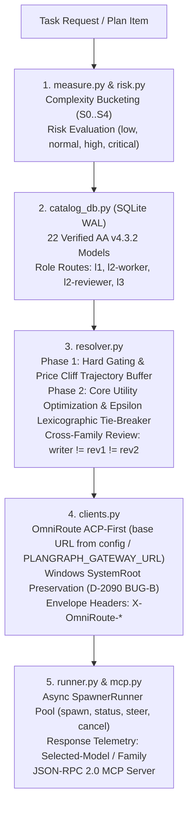
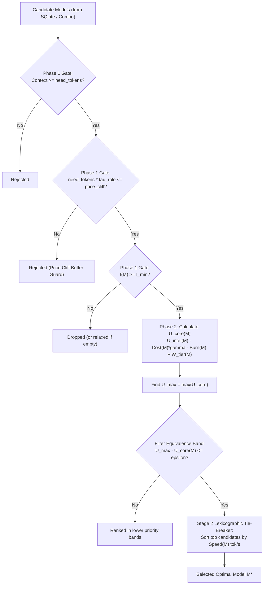

# Plangraph Spawner & Model Routing Architecture

### QUOTA-PAUSE-GATE

The usage owner creates `quota-pause` in the spawner state directory at usage
>=95% and unlinks it at reset. Presence alone (including a dangling symlink)
pauses admission: no second meter, expiry or automatic clearing. Flag read errors
also pause admission.
An empty/unset state falls back to `PLANGRAPH_SPAWN_STATE`, then
`$XDG_STATE_HOME/plangraph`; an empty/unset XDG root uses
`~/.local/state/plangraph`.
Session `launch` and `relaunch` refuse with `quota pause` before invoking the
action or stopping an existing session, without a model filter. Dry runs do not
bypass the quota check or write audit records.
Leg-aware checks in launch-spec, pre-launch probing and seat prompt assembly
pause legs whose `id` or `model` starts with `claude-`, accepting object or mapping
metadata. Known other providers are unaffected; missing provider metadata is
unknown-provider and cannot bypass a pause.
`basic-analysis` is the sole exempt role. After stripping one trailing `-<digits>`
counter, a role or session name must equal `basic-analysis` or end in `-basic-analysis`.
Thus `<host>-L1-` + `basic-analysis-0412` is exempt; `basic-analysis-helper-0001`,
`not-basic-analysisx-0001` and empty names are not.
Seat mixins accept `state` or `_state`. Probes check runner roots (`state`,
`_state`, `state_root`) or environment defaults before resolving the probe store,
then check its `state_root` or database parent if no runner root was configured.
Launch-spec retains its required `state` and `role` request fields; quota refusals
use reason code `quota_pause`. Omitted required fields remain invalid requests,
not environment-defaulted builds.
The deployed ctx-watchdog skips its external router call with one alert line for
either a flag or symlink, or a missing, invalid, unreadable or unsearchable state
directory. Its home fallback is systemd `%h`, independent of the manager's `HOME`;
redeploy the service template to apply the guard.

Source mode skips only credential-name assignment masking, for spawner-generated review git diffs and tracked context-file content; private-key blocks are masked in both modes, and token-shaped rules and context private-key refusal remain. Internal exact spans, never framing markers, keep caller text/card fields under the full scrubber at the final prompt boundary; command/stdin and prompt records use that same result. Source mode never applies to env, logs, stdout/stderr tails, run records or caller text, and has no flag, env, card, CLI or MCP switch.
Python and Rust order: complete/truncated PEM, Bearer, then plain-mode pre-pass P:
shield every matched assignment's name/quote/separator with an indexed marker
`U+E000 + decimal index + U+E001`, leaving values untouched; run the wrapped join,
then restore the names.
P is skipped entirely if either shield character already occurs in the text.
Then main's order runs: full assignments, wrapped prefixed tokens, URL userinfo,
token catalog and JWT. The shielded join cannot cross/eat a credential name while
its value is unmasked. Source mode skips P and assignments; its order is unchanged.
The catalog covers OpenAI, GitHub, Slack, AWS and Google prefixes; wrapped bodies
share its alphabets/floors and bounded 4096-byte LF/CRLF joins.
Source spans must start and end on line boundaries; invalid spans (even empty ones) withhold the prompt.
Long hex (32+), then base64/url-safe blobs (40+, mixing letters and digits), run
only on child output via Python's `redact_output`, and as part of Rust's `redact`.
Python never runs these broad rules on prompts or record structures: SHAs and hashes
must stay readable there, including run IDs, card hashes and prompt SHA-256 fields.
Stored stdout/stderr tails have already passed the output scrubber at collection.
A tail therefore masks commit SHAs and long slash paths: take SHAs from git or the run record, never from a tail.

### Prompt delivery

Every harness and helper receives the prompt by stdin or file, never argv, for
all prompt sizes on every OS (D-5233). Python's Linux OOM child inherits the stdin
pipe; pg-spawnd uses the same launch-spec transport.
Child env construction drops only known legacy task carriers (`PROMPT`, `PROMPT_TEXT`,
`PROMPT_SUFFIX`, `TASK_PROMPT`, `PLANGRAPH_TASK_PROMPT`, case-insensitive), including
overlays; unrelated shell/theme/template configuration survives. Rust refuses exact
prompt carriers and embedded prompts of at least 16 bytes in argv/env, without
mistaking short incidental substrings of flags or model names for task transport.
SSH overflow passes a staged UTF-8 file to the real spawn CLI's `--prompt-file`
option, preserving trailing newlines without shell command substitution.
Request-budget refusals keep the launch adapter's exit status in their run record;
pre-exec refusals without an exit code also retain the named `prompt_too_large` reason.
Qoder retains an explicit empty `-p` value with `--input-format text`; missing prompt flags fail with
`stdin_prompt_flag_missing` in launch-spec refusals and Python run records. All agy commands use
`--input-format stream-json --output-format stream-json -p ""`, with
one UTF-8 NDJSON user event on stdin followed by EOF. The last result's
`response` supplies the answer and verdict; an ERROR or missing result fails
explicitly, without publishing an unsuccessful response as an answer.
OpenCode, Claude, Gemini and Qwen read text stdin; Codex uses `exec -`. Fleet sessions
also read stdin; SSH overflow uses `--prompt-file` without shell expansion. Assembled
prompts exceeding the leg budget (three chars/token) record `prompt_too_large`.
Rejected stdin input or an unavailable/closed input pipe fails the run explicitly;
the watchdog never retries a rejected payload as an empty prompt. Gateway config
size refusal leaves the caller's environment unchanged.

### MiMo seat timeouts and verdict packaging (MIMO-VERDICT-TIMEOUTS)

For MiMo seats and all other `review` runs, `run_watchdog_limits.thresholds` sets
`hard_max=True`, including default caps: reviews never wait for a writer's first
edit and ignore a valid `hard_first_edit` opt-in. Card limits must be positive,
finite numbers (not booleans); invalid limits refuse the spawn. Without a card
`max_min`, an unset `PLANGRAPH_SPAWN_RUN_TIMEOUT` gives a 25-minute cap, an empty
value keeps the default 90-minute wall, and a positive numeric value sets seconds.
The package-wide `inline_diff_prompt` bound change was dropped to preserve main's
cost-context contract: `max_chars` measures only the diff and exact-fit diffs pass.
Oversized diffs keep `InlineDiffError`'s `diff too large for leg` text and diff-only
size, prefixed with `prompt_too_large`. Seat assembly maps that refusal to
`PromptBoundError` (`ContextError` and `InlineDiffError`) with `inline_diff_oversized`;
the base `InlineDiffError` is not itself a context/bound error. Whole-prompt admission retains `inline_prompt_oversized`
for oversized instructions/framing, both under the named `prompt_too_large`
reason regardless of `PLANGRAPH_CONTEXT_STRICT`. Neither truncates;
missing diff references, empty diffs and failed `git diff` calls fail explicitly.

In `opencode_answer.final_answer`, `allow_unfinished=True` accepts pending text
with no finish frame or after `tool-calls`, unless an earlier finish blocked it.
Reasons other than `stop` or `tool-calls`, including missing or unknown reasons,
fail closed: pending text is discarded and unfinished tails stay ineligible.
Only a `stop` with non-blank pending text clears that block; empty or
whitespace-only stops and tool calls cannot launder truncation into a verdict.
A completed `stop` answer remains eligible.

### Reasoning-only output exhaustion (MIMO-REASONING-OUTPUT-LIMIT)

Before decoding display stdout, `opencode_answer.record_steps` retains each
`step_finish` as an `opencode_step_finish` event with `finish_reason`,
`output_tokens` and `reasoning_tokens`; absent usage remains null, not zero.
Structured `output-limit` errors and the matching OpenCode stderr diagnostic
add `opencode_output_limit`. These are diagnostic events, not served-model witnesses.
A final `length` step with output zero, or that error with no text/output,
adds `opencode_reasoning_exhausted`; later completed output is not retried.
Display-text decoding also protects plain/mixed stdout answers; diagnostic-only JSON, including blank separator lines, is not answer text.
The monitor's events reach `record.json` through either dispatch path.

For an OpenCode inline `review`, shared `SeatSpawnMixin._launch_leg` retries
once with the same prompt, model and harness, never unchanged. MiMo v2.6 Flash
and Pro use model-local `body.thinking.type=disabled` (zero reasoning budget)
in the isolated child config; the root config and other roles are unchanged.
An already-disabled or unsupported control is unavailable, not an unchanged retry.
The failed attempt and its events stay in the record, with `reasoning_retry=1`
saved before the retry. Tool denial, fresh job isolation and the original review
wall deadline remain in force. No new retry loop or provider-health booking is added.
The retry requires more than 30 seconds of remaining wall budget. Base-service launches keep their original shielded monitor cancellation and ownership fields.
Repeated zero-output exhaustion, an unavailable cap, or no remaining retry budget
ends the run `failed` with terminal `reason: reasoning_output_limit`; no spare leg
or writer continuation runs. Cancellation, timeout and kill-incomplete still win.
Terminal status, reason, attempts and events are saved at the shared launch boundary before either caller returns; routed exhaustion keeps normal failure witness metadata, and both callers finalize `ended` and release monitor registrations in `finally`.
Normal output, nonzero-output truncation and non-review roles retain existing behavior except that base-service watchdog exits now retain one attempt row, matching routed dispatch; `terminal_record` adds no rows, retries do not duplicate watchdog rows, and cancellation rows are unchanged.
Hermetic coverage is in `tests/test_spawner_review_tools_inline.py` and
`tests/test_spawner_runner_answer.py`; the live #768 seat is an after-merge operator check.

### Writer result finalization
Terminal saves dispatch review verdicts to the keeper:
- `verdict.json` audits outcomes; `verdict.delivered` stops replay.
- Invalid evidence, missing keys, unwitnessed families and unparseable verdicts skip.
- Pre-verifier I/O/import failures retry at most three times; lock failures defer without journal writes.
- Verifier exit codes govern retries; ambiguous exceptions after invocation skip to prevent duplicate POSTs.
- Remove both journal and marker explicitly to requeue after repair.
- Delivery markers stop retries even when the completion field is absent.
Spawn records take `item_key` (or the legacy `item` alias) from the card, falling back to `PLANGRAPH_SPAWN_ITEM` only when neither card field supplies a value. Python and `pg-spawnd` require an ASCII `project:ID` key (at most 200 characters total and 180 in the ID); invalid explicit values stay null with a warning rather than falling through to another identity. Prompt mentions never supply an item key. Review/judge records without a key retain a `seat_item_missing` warning event. Main's verdict outbox above is the only automatic posting path; record-derived posting refuses a `--key` that differs from a recorded `item_key`, including null. Legacy records without the field retain the manual CLI path.
The `evidence.json` manual path also refuses any supplied `item_key` or `key` that differs from `--key`, including null or conflicting aliases, before reading reviewer tokens or posting. Missing-seat events are deduplicated against launch events and remain persisted on dry runs and queue refusals.
Companion records still bind the target when `evidence.json` is present: missing evidence identity cannot override a record's explicit null or different key, and malformed companion records fail closed. Git-config capture refusals also retain validated identity and launch/missing-seat events. The record-only path checks record identity independently of the evidence builder. Manual invocations always require `--key` (including legacy records); omission exits 2 before reading seat files or tokens. Non-dry completed Python dispatch saves also preserve missing-seat and launch events.
`worker-core::writer_result::check_result` runs the mandatory Rust file-size
gate before returning a checked result; export rechecks it before content gates,
bundle sealing or publication. A refusal returns `HOLD gate file-size: <detail>`
and no publish/push is attempted. Changed tracked files use the Python CI gate's
400-line rule, exemptions, binary detection, splitlines counting and baseline
ratchet. CI still runs unchanged `tools/check_file_size.py` over all tracked files.
The adjacent Rust changelog gate in slice S1b uses the run-base merge-base and the CI entry/skip-trailer rule, returning `HOLD gate changelog: <detail>` before export or publish/push when an entry is required. Doc-only and empty commits do not require skip reasons; section boundaries include indented headings in both Rust and CI.
The S1c Rust docs-map gate reads `.docs-map` from the committed head and compares changed paths over `merge-base(base, head)..head`. Each matching rule needs at least one mapped doc in that range; failures return `HOLD gate docs-map:` with unmatched `source -> doc` pairs before export/content gates or publication. Missing maps pass; malformed rules/dates hold. `# enforce-after:` begins enforcement inclusively on that local calendar date (earlier missing-doc matches do not hold); entries have no expiry syntax. CI retains its stricter union of merge-base and head policies, so removing head rules cannot disable CI enforcement. Shared JSON cases exercise Rust/Python parsing and glob parity.

Cross-host ps distinguishes missing source paths and unreachable SSH hosts; doctor checks configured source directories in parallel (see [cross-host ps](spawner-ps.md)).
Denied-tool OpenCode reviews exiting 1 preserve exact final verdicts from pending text without a stop frame, but not after an explicit non-stop finish; other transport-completion checks remain strict.
Isolated OpenCode Go reviews accept credential rows with `active = 1` (legacy)
or `active IS NULL` (v2 in use), never `active = 0`. Only the most recently updated
eligible row is copied; ties prefer the most recently created row, then the smallest
credential ID. This selection also applies to mixed legacy/v2 stores. A failed query or install reports
`no row / inactive or store error`, not a login instruction; credentials stay out of logs and events.
### Doctor host source checks

`python3 -m plangraph.spawner.doctor` delegates host source checks to the Rust
`pg-spawnd doctor-sources` subcommand. `doctor.py` resolves it on the host's
`PATH`, never from checkout build artifacts, and reads its JSON check rows with
a derived subprocess timeout: ten seconds plus three seconds per batch of up to
16 configured hosts (at least ten seconds). Before any checks, optional `env.PATH` from the
local hosts registry entry replaces the inherited PATH for both pg-spawnd and
harness discovery/children. Identity is `PLANGRAPH_HOST_NAME` or registry `self`,
with case-insensitive id/alias lookup; absent configuration retains inherited PATH.
Windows PATH keys are case-insensitive (`Path` is accepted).
A present but unusable registry produces `host_path: fail`, distinguishing an identity mismatch from invalid
configuration without printing registry or environment values. PATH is restored after checks, even on exceptions.
There is no Python fallback for source checks; fresh release clones need no build.
Fleet snapshots likewise delegate the read-only JSON projection to
`pg-spawnd fleet-snapshot`; the Python loader supplies persisted registry and run
records without probing, and projection failures preserve the existing
`fleet: null` fallback.

The Rust command reads `plangraph/ps-hosts.json` under `XDG_CONFIG_HOME` (or
`~/.config`), checking valid entries with `src` or `win_src` in parallel with
at most 16 workers. SSH uses batch mode, a two-second connection timeout and
a three-second probe deadline; source checks support POSIX, WSL and Windows
paths. SSH output and diagnostics are discarded. A missing config or no
eligible entries produces no source check rows; unreadable or malformed
configuration produces `ps_hosts: fail` with `invalid configuration`.

Each `ps_host_<name>` row passes with `ok` on SSH exit 0; exit 44 reports
`src missing`, exit 255 or an SSH launch/I/O error reports `unreachable`, and
a timeout or other exit reports `host query failed`. If the Rust binary is
missing, Python adds `ps_hosts: fail` with `unavailable`; a nonzero subcommand
exit, invalid JSON/non-list response, timeout or other invocation error instead
reports `host query failed`. Any failed check makes doctor exit 1.

## Spawn by card
Fleet sessions disable Superpowers with launch-local `--settings` on Linux and Windows; attended argv and user config stay unchanged.

CLI and overflow admission use the worker-core memory rule:
`effective_free_mb - reservation_mb >= mem_floor_mb`, with MemAvailable as
free memory and `warmup.ramp_mb[role]` as the reservation (an unknown role
uses that host's largest positive ramp). Live run/writer counts never limit
admission. Overflow ranks hosts by free RAM above their floor.
Admission reads `caps.mem_floor_mb` and `warmup.ramp_mb` for each host
from the worker-core hosts registry (`$XDG_CONFIG_HOME/plangraph/hosts.json`,
or `~/.config/plangraph/hosts.json`), the same location used by fleet-sync.
Local identity is `PLANGRAPH_HOST_NAME` when set, otherwise registry `self`;
IDs and aliases resolve case-insensitively. Routing and the public-repository
allowlist still come from `overflow-hosts.json`; legacy run/floor caps and local
limit overrides are ignored except the orchestration thresholds below. Missing registry or
malformed caps exclude that host from overflow. Local admission instead uses
conservative defaults of floor 3000 MB and role 2048 MB, with a logged reason.
The independent OOM guard (D-5057/D-5075) remains unchanged.

Default CLI and MCP spawns try healthy SSH overflow hosts when local RAM
admission refuses, only for repositories in the `public_repos` allowlist.
Private or unknown repositories queue without copying. Failed targets are
excluded for that spawn; when none can accept, a queued record lists safe
refusal reasons. Without overflow config, admitted local runs have no annotation;
below-floor runs queue with matching `reason` and `overflow_reason`. Dry runs do not overflow.
Local benchmark databases cannot be forwarded. CLI/MCP use public `admit_spawn` once in the shared wrapper, not the CLI parent; the service persists queued/remote records.
Per-host `orchestration_only: true` in `hosts.json` (or the local overflow hosts entry; default false)
makes implement/review/research remote-first: rank MemAvailable minus floor, then config order; no run-count caps.
Local fallback requires RAM admission, `local_min_available_mb` (overflow config, default 4096) and
`local_max_swap_used_pct` (default 90); below/above respectively refuses with that name, exit 2, never queues.
Spawn/refusal records carry `placement: {host, reason, free_mb}`: sampled MemAvailable and
`remote_most_free_ram`, `local_fallback_no_remote`, `local_benchmark_database`, or refusal.
Route planning never samples admission resources: absent a supplied placement snapshot,
it reports `placement_not_evaluated` with null host/free RAM. Missing or unreadable swap
readings refuse local fallback as `local_swap_unavailable`; see [placement rules](placement-rules.md).

SSH overflow uses `overflow.remote_spawn` with per-call nonce begin/end sentinel
lines around the remote spawn JSON. Only the single bracketed JSON receipt is
accepted; shell-init banners, env-file echoes and JSON after the end are ignored.
Missing, repeated or reversed sentinel pairs report `receipt_unbracketed` without
retrying an already acknowledged spawn. Remote stderr stays private, and the
existing credential-shape masking helper masks receipts before stdout exposure.
Unreadable receipts or receipts without a nonblank remote run ID produce a
local tracking ID, `acknowledged_unknown=true` and `status=unknown` on the
selected host; they are never refused or retried.

Install the package on each host, then use `python -m plangraph.spawner.cli`
(or `python tools/plangraph-spawn.py` from a source checkout). No central keeper
or Temporal service is required for this slice. **Grok and Muse:** `omniroute-grok-4.7` uses `omniroute/gc/grok-4.7` for review only (catalog `grok`, seat `xai`) and remains manual-only. D-5113 admits Muse routes automatically unless policy excludes them; their catalog family is `muse` (seat `meta`). Explicit `--leg` picks still need an audited `--override-reason` of at least ten characters; host checks still apply. Runtime rows derive from `DEFAULT_LEGS`, not AA seeds. Routing carries qualified catalog tiers through utility inputs and CLI JSON, retaining declared tiers when no qualified row exists. `plan_spawn(catalog_rows=...)` injects the same snapshot for tier projection and admission. Free precedes subscription and paid even with partial benchmarks; no new family preference list is added. An `agy/` effort-model override resolves to its explicit effort leg even when a routed leg shares that model.
```bash
python -m plangraph.spawner.cli route --card @card.json --role implement --json
python -m plangraph.spawner.cli spawn --card @card.json --role implement "Implement the card"
python -m plangraph.spawner.cli spawn --card @card.json --role review --review-of run-ID "Review"
python -m plangraph.spawner.cli ps
python -m plangraph.spawner.cli result run-ID
```
Cards may also be inline JSON; `spawn --prompt-file FILE` replaces the prompt argument for prompts over the argv limit; it reads UTF-8, strips a BOM, and a bad file exits 2 with a `prompt_file_*` or `prompt_input_*` refusal. `card.context` (`path:start-end` slices, at most 64) is inlined as a CONTEXT PACK for inline-only legs (cap `PLANGRAPH_CONTEXT_PACK_MAX_CHARS`, default 60000; built once per spawn, each slice file read once and passed through `redact`; a secret-looking name, a `.git` part or an untracked file is skipped with a `context_path_refused` warning; with entries, no git work tree, a symlink loop or too many entries refuse the spawn (without entries a failed listing only adds `big_file_scan_skipped`); a range past the end of the file adds `context_range_past_eof`) and a brief naming a 400+ line file without a slice adds a `big_file_unsliced` warning (D-3622, D-3649). `--state PATH` precedes the verb; otherwise
`PLANGRAPH_SPAWN_STATE` or the XDG plangraph state directory is used.
`--dry-run` plans without a child. Spawn returns a `wait_cmd`:
`plangraph-spawn wait RUN_ID --timeout SECONDS` (omit timeout to block indefinitely).
Never use `pgrep -f` wait loops, including in writer/seat briefs: they can match
the waiting shell itself. Wait reads atomic run records, not process names;
its timeout stops waiting, not the writer.
`--no-fallthrough` disables automatic advancement after a captured provider stop.
Plain stdout, including text saying 429, is never provider evidence.

### Opt-in per-attempt worktrees (RUN-WORKTREE slice 1)

CLI `spawn --run-worktree` / service `spawn(run_worktree=True)` creates a fresh
`attempt-<uuid>` directory before each launch, including sequential fallthroughs
and fixer continuations. The trusted `PLANGRAPH_SETTINGS` JSON/TOML top-level
`worktree_root` config key overrides the per-host default `<state>/worktrees`.
Fetch has a 30-second timeout outside the exclusive **`<root>/.lock`**; the fetched
SHA is pinned before locked dependency checks and `git worktree add`. This exact
lock name is reserved for WORKTREE-REAPER, not held during network waits.
New lanes use the fetched `origin/main` head, never the caller's HEAD. Optional
card `lane_branch` names the branch (default `lane/<run_id>`); `continuation: true`
resumes that existing local branch's tip instead. Card `finished_dependencies`
lists exactly 40- or 64-hex commit SHAs: a new lane refuses with `RunWorktreeDependencyNotMerged`
(`run_worktree_dependency_not_merged`) if any is not an ancestor of fetched main,
including missing commits. Continuations are sequential handoffs, not concurrent
writers on one branch; retained earlier directories must no longer be used.
Git failures become `SpawnRefused` codes: `run_worktree_invalid_branch`,
`run_worktree_branch_exists`, `run_worktree_branch_missing`, `run_worktree_fetch_failed`,
`run_worktree_fetch_timeout`, `run_worktree_base_unavailable`,
`run_worktree_git_timeout` or `run_worktree_create_failed`, without raw Git diagnostics.
The private run record saves `run_worktree: {path, branch, base_sha}` before launch
and retains ordered creation evidence in `worktree_attempts`; `base_sha` is the
attempt's starting commit (main head or continuation tip). A failed fixer creation
records no worktree and a null cwd, never its parent's path. Runner `JobInfo.cwd`,
process cwd and child PWD use that path. With the flag off, cwd is unchanged;
dry runs create nothing. No worktrees are removed, no pg-reap lock sharing is
implemented, and enabling by default and the Rust port remain later slices.

Private `runs/<run_id>/record.json` contains card hash, role, complete plan,
chosen leg, served model/family with witness kind (a structured claude `system/init` model is a native witness; a mismatch with the requested leg sets `served_model_mismatch`), writer family, status, started/ended timestamps,
attempts with provider stop details, job id, pid, and stdout tail.
These records are the only source for `--review-of`; unknown ids refuse. Linux supervisors record their process start-time token; non-Linux supervisor startup skips the `/proc` import and lookup. POSIX orphan checks attempt the `/proc` lookup when a recorded start-time token is present, even on non-Linux hosts. A reused supervisor pid ends the run as `orphaned` before signaling; matching or unreadable start-time evidence retains the POSIX missing-process check (permission denied means alive). Windows orphan checks return before importing process-stat helpers or signaling.

On terminal save the supervisor publishes a completion per run to
`inbox/parent.jsonl` and the authenticated live keeper HTTP sink. Events
include stable `event_id`, DONE/FAILED, run_id, rc, head_sha, take_cmd and
discard_cmd. `PLANGRAPH_SPAWN_PARENT_SESSION` and `PLANGRAPH_SPAWN_ITEM` identify
the destination session and keeper item. The private parent inbox does not by
itself inject a message into an agent session. Terminal run records are the
durable retry journal. The pluggable `deliver(recipient, event)` sink can bridge
a fleet bus. The default keeper sink uses the spawner-role `record_run` API;
it does not close items or bypass the keeper's authorization checks.
`PLANGRAPH_SPAWN_NOTIFY_CMD` optionally names an argv-style command (no shell);
it receives recipient as its final argument and event JSON on stdin. Consumers
must deduplicate by event_id: external delivery is at-least-once across crashes.
Failed hooks are logged and retried on re-save; local inbox replay is idempotent.
`PLANGRAPH_SPAWN_RUN_TIMEOUT` optionally bounds each child execution in seconds; unset gives a 25-minute review cap, while empty means no review cap;
expiry kills its process tree and records rc 124 with FAILED completion.
Terminal stall/timeout records preserve their outcome and events even without a watchdog event (`watchdog: null`). A provider stop leaves the harness status and exit code unchanged (completed with exit 0 stays completed), adding `provider_stop` only when no reason exists and the stopped leg's own coverage slot names a seat group, preserving it in the attempt and unfilled-slot error while leaving completed non-seat reasons unset and tolerating empty, absent or non-dict coverage entries.
The detached supervisor must survive the child; killing the supervisor itself
requires a future recovery service. This interim event contract carries over to
the later Temporal implementation (also covers FLEET-STATUS-HOOK).
Writing run roles (implement/fix) guard shared .git/config against in-place mutations (e.g. core.autocrlf), restoring original bytes and failing the run if changed. The spawner kills only the process tree it started: the root is proven ours at spawn (direct child, own group; or Job Object member), a snapshot of its descendants is taken before any signal, and a kill is verified (up to 10 s). Survivors fail the run with reason `kill_incomplete` (event `kill_incomplete`, `survivors` pids): no fall-through leg, no second writer. Runs use argv exec only (no shell wrapper), enforced by a static guard test.

Slice 1 cancellation with survivors ends the run as `failed` with reason `kill_incomplete` and never publishes `cancelled`; already-terminal cancellation results keep their status and exit code. Leg probes track spawned job IDs (not shared working directories), wait at most five seconds per launch/cancel/monitor cleanup operation, and attempt every owned job even after an error. Successful cleanup removes the temporary directory; incomplete cleanup raises an explicit error and retains it rather than deleting it under a possibly live process. `setsid` containment and periodic reaping are not implemented yet.
`--model`/`--leg` require `--override-reason` of at least ten characters,
audited through `routing.hand_picked` to `spawn-overrides.jsonl`.
The Mimo path fence still applies to overrides. Review seats: [spawner-seats.md](spawner-seats.md) (D-3198).

CLI `probe --leg ID` / `probe --all-writers` (`--timeout S`, `--json`) and MCP `plangraph_agent_probe`: [liveness and env knobs](spawner-leg-state.md) (`PLANGRAPH_LEG_DOWN_S`, `PLANGRAPH_LEG_PROBE_TIMEOUT_S`, `PLANGRAPH_LEG_PROBE_TTL_S`).
A probe with its harness binary missing reports `host-not-ready` and books no leg event. Probe timeouts must be finite and strictly positive; TTL remains nonnegative (zero disables automatic probes). Invalid settings refuse before probe state writes, and CLI parameter refusals are JSON `ParameterRefused` with exit 2. Timeout errors name `--timeout` for an explicit CLI argument, `timeout_s` for a direct probe argument, or `PLANGRAPH_LEG_PROBE_TIMEOUT_S` for the environment. CLI and MCP probe refusal handlers catch only parameter-validation errors, not internal `ValueError`s. Spawn-call exceptions report probe infrastructure failure and never book leg liveness.
Probe and quota bookkeeping key a leg by its model string: only a bare model of an agy leg gets the `agy/` prefix, a provider-qualified model is its own key, and legacy record rows without a harness keep their model-only key.
Failed probes retain a scrubbed, single-line excerpt of the last 400 stderr
characters in their result, output line and leg-state event. A `running` record
on the same model/harness with a nonempty `live.log` grown within
`LIVE_RUN_WRITE_WINDOW_S` (120 seconds) overrides only the probe failure:
`probe_failed_leg_serving` records the diagnostic without a retry/down-until
time and does not block dispatch. Stale, empty or missing logs do not override.
Real quota/usage-limit evidence from `exit_outcome` still books the leg down;
serving evidence never clears that provider signal. Probes share the owning
service's resolved state directory, with no environment fallback; pre/post size
snapshots reject touches of old logs, truncations, replacements and read races.
Only the explicit stderr excerpt extends the legacy 300-character reason bound.
Ordinary probe JSON omits `state`; it is never emitted as null.
CLI `launch-spec` (placement R6a-3d; nothing calls it yet): one JSON request on stdin, one launch spec on stdout (argv, cwd, the complete child env, stdin, warnings, events) for pg-spawnd; optional request `leg.explicit` must be boolean: only `true` permits document review without `diff_ref`, absent/false still refuses; it reuses the spawn prep and never launches; exit 2 = one redacted refusal line, exit 1 = internal error (type name only).
MCP `route`, `spawn`, `ps`, `result`, `status`, `cancel` (with `plangraph_agent_` prefix) share these records. Spawn requires
`card` and `prompt` in its schema; model_or_combo requires override_reason.
Result/status/cancel accept `run_id`; legacy job-id operations remain available.
MCP `ps` is compact (all running/queued runs, the newest 20 ended, `total`, `omitted`); use `result` or CLI `ps` for full records.
No JSON-RPC notification is answered or dispatched. A reply over 8 MiB becomes a `ReplyTooLarge` error (code -32000, same request id); stdio keeps serving.
Only actual probe results write liveness state. Gateway adapters call
`runner.provider_response` with actual captured responses.

Runtime path: `src/plangraph/planner/routing.py` is the only module allowed to
import `plangraph.spawner` at runtime; the boundary is enforced by
`tests/test_spawner_import_guard.py`. Selection runs without a feature flag.

### Card-driven routing core

`planner.routing.plan_spawn(card, role="implement"|"review")` applies the
canonical `route_card` eligibility and tier rules to role-tagged `DEFAULT_LEGS`.
Writers use Sol xhigh then agy Gemini Flash (`WRITER_ORDER`); plain Sol is explicit-only. See [implement route defaults](routing.md); banned/off families are skipped for writers too.
Other roles and the remaining implementation fallbacks put eligible free inputs before subscriptions and paid inputs (D-5092). Catalog cost tiers project onto registered legs without changing their roles, safety exclusions, or family metadata. Sonnet, main's Opus registration, high-effort Opus, gateway DeepSeek/Muse, personal Argon, and Big Pickle remain registered (D-5113). Grok's manual-only gate, both Zen free legs' exact permanent D-4196/D-3828 disables, and Qoder's stop remain enforced; Muse retains main's implementation/review/orchestration admission, and Big Pickle retains its GLM family. Sonnet retains orchestration/review, high-effort Opus review only, and medium-effort Opus review/orchestration. No Claude-family leg may enter an automatic implement route, including custom role-bearing tables; explicitly audited effort-variant writer picks remain available.

`plan_spawn` shares one catalog snapshot for admission and tier projection.
Callers may supply `catalog_rows` explicitly for deterministic offline planning;
an empty snapshot uses the registered leg tiers and still rejects unknown models.
Exact-order tests pin this input and isolate benchmark discovery from host files. Role-neutral keeper routes over the default table retain main's D-3828 readiness admission; S5's implementation fallbacks apply to role-bearing routes, not readiness. Custom tables remain explicit inputs.
Review ordering preserves main's cost-first, per-leg measurement gate: measured rows precede missing rows within the same tier; unmeasured rows retain MiMo's existing role preference and Haiku's last-within-tier fallback. Provider-qualified tier identities win over unrelated bare names. Neither Haiku nor a measured paid row crosses a cheaper tier. A no-verdict model (`opencode-go/qwen3.8-flash`, D-3225) is never a seat. A review without a writer family refuses (D-1533). The `claude` harness (Haiku review leg, D-3605) runs with an allowlisted env (`claude_env.py`: HOME, PATH, PWD, locale, XDG_*, proxies, `CLAUDE_CONFIG_DIR`; every other variable is dropped whatever its case), and a host without the `claude` binary skips the leg as `harness_missing: claude` (D-3649). A finished claude run's stdout (the record's `stdout_tail`) is the final text of its stream-json `result` event (else the last assistant text), so `tools/seat_verdict.py` finds the `VERDICT:` line; the raw stream is kept as `claude-stream.jsonl` beside the run's `live.log`, which still carries the raw activity feed.
Claude 5.5 and effort-variant legs (operator 2026-11-09): `agy-claude-{sonnet,opus}-5-5-{low,medium,high}`
(agy harness, review and implement), `agy-gemini-3.8-flash-{low,medium,high}` (review),
`cx-gpt-6-luna-{low,medium,high,xhigh,max}` (inline-only review) and
`cx-gpt-6.1-sol-{low,medium,high,xhigh,max}` (implement). The ids are what `agy models` and
OmniRoute `/v1/models` served that day; agy serves no Sonnet xhigh and cx serves no `-ultra`, so neither is a leg.
Except Sol xhigh (automatic, D-5206), these and plain Sol live in `EXPLICIT_LEGS`, not
`DEFAULT_LEGS`: an audited `--leg` or model override spawns them. Claude never enters
automatic implement routes. `SpawnService.route` appends explicit-only legs to
the plan as `explicit_only` skips, so `route` shows them; `plan_spawn` itself does not list them. A Claude leg is claude-family: the fence refuses
it for a claude writer, given or via `review_of`; with mixed writers the D-3084 per-part rule
admits a seat that covers another writer part. The Claude and sol-effort writers are
`EXPLICIT_WRITERS`; explicit implementation admission uses each registered leg's roles. The catalog spelling
`agy/<model>` (MCP `model_or_combo`) resolves to a seat-capable agy leg holding the bare model, never an orchestrate-only alias. A cx
effort model is not declared in the AutoOS root opencode config, so `render_gateway_providers`
adds `providers.omniroute.models["cx-<m>-<effort>"]` (`modelID` `cx/<m>-<effort>`, the base
model's limit) for that run only; without it opencode answers `provider.no-route`.
Leg notes ("after its Friday-evening reset") are static text: availability is the leg state (`limited` after a provider stop), not a schedule.
Two review seats must differ in family from every writer and each other; an impossible fence returns fewer seats and an explicit plan error, not a fallback. Route slots are planned, final only after dispatch. Seat-group answers and each run's `plan.review_seats` / `plan.seat_coverage` follow `chosen_leg`, including cross-family fallthrough; exhausted slots report `distinct_family_unavailable` with attempt reasons. Whole canonical families (including alternate legs) are reserved per slot and resolved identities are checked again on save and group publication. Routes explicitly name an anthropic second family; see [seat records](spawner-seats.md). The existing `spawner/seat_artifact.py` owns resolved-slot metadata and final review-evidence publication, separately from seat dispatch; retaining its name avoids introducing a new Python module.

An explicitly supplied `benchmark=` mapping (model or leg id to resolver metric
row), or sequence of rows with `model_id`, ranks measured legs only inside their
existing tier. Legs without rows go **last inside their tier**, retaining their
relative operator order. `plan.gaps` (also in `to_dict()`) records each missing
role-policy leg as `{leg, model, reason: "no benchmark row"}`; reasons name each
gap, including legs filtered by eligibility or provider state. With `benchmark=None`,
all role-policy legs are gaps, `p_source` is `operator-order`, and reasons explicitly
say `benchmark data absent` (the legacy `no benchmark p` reason remains compatible).
`plan_spawn(..., strict=True)` refuses any missing role-policy row with
`SpawnRefused("benchmark rows missing: <legs>")`. This is the routing hook for the
production CLI's `--require-bench`.

Operator safety rules and `route_card` tier order come first; U_core permutes measured inputs within a tier for every role, including implement (D-5092). Same-family review inputs keep table order; free inputs never move behind subscriptions. The generic resolver retains its utility/epsilon-band algorithm without a model-name or post-ranking tier pin.
CLI route/spawn and MCP load an existing `PLANGRAPH_CATALOG_DB` (default `~/.cache/plangraph/spawner_catalog.db`), unless `--bench-db`/`bench_db` overrides it.
Route JSON `candidates` exposes each leg's tier, `u_core` (null without a row), `p_source` (`prior`/`measured`), and skip reason/evidence; live limited legs are skipped.

`benchmark_rows_from_db(path)` returns `(rows_by_model_id, errors)` using SQLite
read-only mode; it never creates a missing database. It accepts `catalog_benchmarks`
or OmniRoute `model_benchmarks` (catalog takes precedence if both exist).
`BENCHMARK_COLUMNS` documents the small column alias map. Missing/unreadable files,
missing tables and malformed model IDs return an empty mapping with explicit errors. Shared default registrations do not change explicit effort-model alias resolution.
Duplicate model rows expose `benchmark_row_count`; the first row supplies metrics. Bare harness model ids also resolve exact provider-qualified benchmark rows; explicit bare rows win, missing rows remain gaps, and the Opus high-effort leg maps to `agy/claude-opus-5-5-high`. No probe latency is treated as a benchmark measurement.

### Required benchmark release/swap gate (D-2576)

Before an OmniRoute image release or swap, check both host database snapshots:

```bash
python tools/bench_gate.py --db workstation.sqlite --db server.sqlite --json
```

Every distinct model in `DEFAULT_LEGS` with an `implement` or `review` role must
have at least one row **in each database**. Output includes per-model counts and
total rows per database as evidence. Exit codes: **0** complete coverage, **1**
missing policy rows (models and database named), **2** unreadable database or
unsupported/missing benchmark table. No data is synthesized or seeded by this gate;
benchmark preparation/shipping lanes must supply the real rows.

`leg_reader=` accepts a store or leg-status callable; card `account` and `combo`
scope live provider evidence exactly. `next_leg_after_provider_stop` records
actual 429/402 responses with nonempty provider text and advances to the next
currently eligible leg. Other responses do not suppress a leg. Transport adapters
must supply actual provider responses, never agent output or exit-code guesses.

`hand_picked` always requires an override reason of at least ten nonblank characters,
enforces the Mimo provider fence, and appends an audit JSON line to
`$XDG_STATE_HOME/plangraph/spawn-overrides.jsonl` (or injected `log_path`).
Readiness remains separate in `planner/readiness.py`.

Plangraph Spawner provisions, routes, and supervises autonomous agents across multi-model coding workflows. It combines a local WAL-mode SQLite benchmark catalog, a 5-rung tier priority ladder, fine-grained task complexity and risk measurement, OmniRoute ACP-first execution with full Windows Tailnet environment preservation, cross-family code review isolation, and a JSON-RPC 2.0 MCP server.

---

## 1. Architecture Overview

The spawner pipeline follows a deterministic, layered design:



---

## 2. Risk Assessment & Complexity Telemetry

Plangraph measures task write sets and repository signals to deterministically classify complexity and risk:

```mermaid
flowchart LR
    subgraph Signals["Repository & Write Set Signals"]
        Diff["Git Diff / Paths"]
        Lines["Modified Line Count"]
        Mods["Distinct Modules"]
        Fanout["Import Fanout\n(Scoped AST / Blocklisted Grep)"]
        Tests["Test Coverage Check"]
    end

    subgraph Complexity["Complexity Classification (measure.py)"]
        S0["S0: Trivial / Pure Docs (<= 20 lines, 1 file, 0 fanout)"]
        S1["S1: Small Module (<= 80 lines, <= 2 files, fanout <= 2)"]
        S2["S2: Standard Task (<= 250 lines, <= 5 files, fanout <= 5)"]
        S3["S3: Multi-Module (<= 12 files or fanout <= 12)"]
        S4["S4: Cross-Cutting Architectural (> 12 files or fanout > 12)\nDecomposition Trigger: should_decompose = True"]
    end

    subgraph RiskEval["Risk Evaluation (risk.py)"]
        Low["Low Risk: S0 / Pure Docs\nI_min = 37.5, Reviewers = 0..1"]
        Normal["Normal Risk: Tested S1..S3\nI_min = 44.0, Reviewers = 1"]
        High["High Risk: Critical Paths / S4 / Untested S2+\nI_min = 46.0, Reviewers = 2"]
        Critical["Critical Risk: Auth, Crypto, Policy, Security\nI_min = 50.0, Reviewers = 2"]
    end

    Signals --> Complexity
    Complexity --> RiskEval
```



### Complexity Bucketing Matrix (`measure.py`)

| Bucket | Max Files | Max Lines | Max Fanout | Description | Action |
|---|---|---|---|---|---|
| **S0** | 1 (or docs) | $\le 20$ | 0 | Trivial / documentation change | Direct execution, 0-1 reviewer |
| **S1** | $\le 2$ | $\le 80$ | $\le 2$ | Small single-module change | Standard execution, 1 reviewer |
| **S2** | $\le 5$ | $\le 250$ | $\le 5$ | Standard multi-file feature/fix | Standard execution, 1 reviewer |
| **S3** | $\le 12$ | $\le 500$ | $\le 12$ | Multi-module feature/refactor | Enhanced model, 1-2 reviewers |
| **S4** | $> 12$ | $> 500$ | $> 12$ | Cross-cutting architectural change | `should_decompose = True`, 2 reviewers |

### Smarter Symbol Fanout & Ubiquitous Blocklist

To prevent false fanout escalations from common function and method names, `measure.py` filters candidate symbols against `UBIQUITOUS_SYMBOLS_BLOCKLIST`:

- **Blocked Ubiquitous Symbols**: `run`, `get`, `set`, `resolve`, `validate`, `to_dict`, `from_dict`, `__init__`, `items`, `keys`, `values`, `update`, `parse`, `close`, `setup`, `teardown`, `main`, `start`, `stop`, `execute`, `handle`, `process`, `load`, `dump`, `read`, `write`, `send`, `receive`, etc.
- **AST Caller Scoping**: When only ubiquitous symbols or file paths are present, `ast_caller_fanout()` scans the repository using Python's `ast` parser to inspect `Import` and `ImportFrom` statements, counting only modules that legitimately import the modified files.

---

## 3. Two-Stage Mathematical Routing Algorithm (`resolver.py`)

Model selection is governed by a unified two-stage lexicographic optimization algorithm that decouples intelligence ramps, protects against price cliffs, prevents throughput distortion, and avoids double-counting prompt caching benefits.



### Phase 1: Hard Gating & Price Cliff Trajectory Buffer

Every candidate model $M$ must satisfy three hard gates:

1. **Context Capacity**: $\text{Context}(M) \ge \text{need\_tokens}$
2. **Multi-Turn Price Cliff Trajectory Buffer**:
   To prevent multi-turn tool calling loops from crossing catastrophic pricing thresholds (e.g. Anthropic Claude Haiku 100K token price cliff), `need_tokens` is scaled by a role-specific trajectory factor $\tau_{\text{role}}$:
   $$\text{Trajectory Tokens} = \text{need\_tokens} \times \tau_{\text{role}}$$
   $$\text{Gate}_{\text{cliff}}(M) = \begin{cases} \text{Pass} & \text{if } M.\text{price\_cliff\_tokens} \text{ is None or } \text{Trajectory Tokens} \le M.\text{price\_cliff\_tokens} \\ \text{Reject} & \text{otherwise} \end{cases}$$

| Role | Trajectory Factor $\tau_{\text{role}}$ | Rationale |
|---|---|---|
| `implement` / `worker` | **1.5×** | Multi-turn edit-test-debug loops generate significant cumulative context. |
| `driver` / `orchestrate` | **1.3×** | Task dispatch and supervision generate moderate multi-turn context. |
| `review` / `reviewer` | **1.1×** | Reviews read diffs and files with bounded conversation depth. |

*Example*: At 70,000 tokens, Haiku (`price_cliff = 100000`) is rejected for workers ($70\text{k} \times 1.5 = 105\text{k} > 100\text{k}$) while safely admitted for reviewers ($70\text{k} \times 1.1 = 77\text{k} \le 100\text{k}$).

3. **Intelligence Floor**: $I(M) \ge I_{\min}$ for the evaluated risk band.

---

### Phase 2: Core Utility Scoring ($U_{\text{core}}$)

The core utility score $U_{\text{core}}(M)$ balances intelligence, cost sensitivity, quota pool burn, and subscription priority:

$$U_{\text{intel}}(M) = \alpha_{\text{role}} \cdot \left(\min\left(I(M) - I_{\min}, I_{\text{target}} - I_{\min}\right) + \max\left(0, I(M) - I_{\text{target}}\right) \cdot \beta_{\text{excess}}\right)$$

$$U_{\text{core}}(M) = U_{\text{intel}}(M) - \text{Cost}(M) \cdot \gamma_{\text{cost}} - \text{Burn}(M) \cdot 1.0 + W_{\text{tier}}(M)$$

#### Decoupled Risk & Competency Parameters

By decoupling $I_{\text{target}} > I_{\min}$, the intelligence ramp rewards models that reach the target competency level while scaling excess capability according to task risk:

| Risk Band | Min Floor $I_{\min}$ | Target Ramp $I_{\text{target}}$ | Cost Weight $\gamma_{\text{cost}}$ | Excess Weight $\beta_{\text{excess}}$ | Tie Equivalence $\epsilon$ | Reviewers |
|---|---|---|---|---|---|---|
| `low` | 37.5 | 41.0 | 15.0 | 0.2 | 0.5 | 0–1 |
| `normal` | 44.0 | 47.0 | 10.0 | 0.4 | 0.5 | 1 |
| `high` | 46.0 | 50.0 | 4.0 | 0.6 | 0.3 | 2 |
| `critical` | 50.0 | 54.0 | 4.0 | 0.6 | 0.3 | 2 |

#### Role Multiplier ($\alpha_{\text{role}}$)

Role scaling amplifies intelligence gains above $I_{\min}$ for critical supervisory roles:
- `implement` / `worker`: $\alpha_{\text{role}} = 1.0$
- `driver` / `orchestrator`: $\alpha_{\text{role}} = 1.1$
- `review` / `reviewer`: $\alpha_{\text{role}} = 1.2$

#### Tier Priority Weights ($W_{\text{tier}}$)

Guarantees subscription and free pools are prioritized over paid per-token APIs:
$$W_{\text{tier}}(M) = \begin{cases} (4 - \text{rung}(M)) \times 3.5 & \text{if } \text{rung}(M) \le 4 \\ -35.0 & \text{otherwise (unknown)} \end{cases}$$
- `trial` (rung 0): $+14.0$
- `free` (rung 1): $+10.5$
- `credit` (rung 2): $+7.0$
- `subscription` (rung 3): $+3.5$
- `paid` (rung 4): $0.0$

---

### Stage 2: Lexicographic Throughput Tie-Breaker

Linear throughput bonuses in primary utility scoring previously allowed fast models to override up to 18 points of intelligence. Plangraph confines throughput strictly to a **two-stage lexicographic tie-breaker**:

1. Find the highest core utility among surviving candidates:
   $$U_{\max} = \max_{M \in \mathcal{C}} U_{\text{core}}(M)$$
2. Collect the equivalence band of candidates whose utility is within $\epsilon$ of $U_{\max}$:
   $$\mathcal{C}_{\text{top}} = \{ M \in \mathcal{C} \mid U_{\max} - U_{\text{core}}(M) \le \epsilon \}$$
   *(where $\epsilon = 0.5$ for low/normal risk, $\epsilon = 0.3$ for high/critical risk)*
3. Resolve ties within $\mathcal{C}_{\text{top}}$ by verified token generation speed:
   $$M^* = \arg\max_{M \in \mathcal{C}_{\text{top}}} \text{Speed}(M)$$

Candidates with noticeably inferior core utility ($> \epsilon$ points lower) can **never** win solely by virtue of generation speed.

---

### Input Contract, Fail-Closed Rules and Sensitivity

- Numeric inputs are validated before scoring. NaN, +inf, -inf, negative values, and None are rejected with ValueError; a missing intelligence value is rejected with ValueError. A missing or None `context_window`/`context_tokens` falls back to 128000 and a missing or None speed counts as 0 (unmeasured, tie-break only); a present but invalid context window or `price_cliff_tokens` raises ValueError.
- Absent-field defaults (field missing, not None for required numerics): `cost_per_task_usd` 0.20 USD per task, `pool_burn_weight` 1.0, `context_window`/`context_tokens` 128000, speed 0 (unmeasured). `aa_intelligence` has no default and a missing value raises ValueError.
- `need_tokens` must be a positive finite number (an int or integral float); bools, non-numeric values, NaN/inf, non-integral floats, and values <= 0 raise ValueError.
- Unknown risk and unknown role values raise ValueError. The role `"drive"` is accepted and uses alpha 1.1 and trajectory factor 1.3.
- For high and critical risk bands, a candidate below `I_min` fails closed. The only escape is `relax_floor=True` with a non-empty `relax_reason`; when applied, result keys `relaxed` and `relax_reason` are set. A blank reason is not accepted.
- For low and normal risk bands a floor miss does not raise: the highest-intelligence candidates are kept and ranked, and `relaxed` stays false.
- There is no hardcoded fallback model. If no candidate is eligible, both `resolve_review_plan` and `resolve_model_for_task` raise instead of returning a default.
- Catalog fallback (W27/D-2637): during a DB read failure, registered offline legs remain eligible; operator deactivation cannot be enforced while the DB is unreadable. A `catalog_db_error` alert is emitted once per failure episode and rows carry `catalog_source=offline_fallback_db_error`.
- Exclusions (family/author/gated/availability) are applied in every fallback path, including relaxed-floor paths.
- The context gate requires `ctx >= need_tokens * trajectory_factor`; role trajectory factors are applied consistently.
- Risk monotonicity uses `envelope_intelligence` as a best-effort envelope: candidates are filtered to intelligence at or above the best lower-band pick; when that leaves none, resolution falls back to the floor rules, so the envelope cannot be met in every case.
- Tie-breaking uses an epsilon band with absolute utility thresholds of 0.5 and 0.3 utility points.
- Stability is measured by tools/spawner_sensitivity.py over several seeds (key `stability_seeds` in docs/spawner-sensitivity.json); high/critical beta_excess 0.6 and critical gamma_cost 4.0 keep the intelligence +-1 pick flip rate <= 0.10 on every listed seed; the flips that remain at critical are the cost of the hard risk-monotone envelope (critical's intelligence floor is the best lower-band pick, a hard filter), and the strict monotone guarantee (1e-9) is kept.
- The committed sensitivity artifact is `docs/spawner-sensitivity.json`. Regenerate it with `python3 tools/spawner_sensitivity.py --out docs/spawner-sensitivity.json --catalogs 200`. Flip-rate numbers are read from that file; do not invent numbers — see the file.
- The `cost_per_task_usd` field is the catalogued price in USD per task. Utility subtracts `cost_per_task_usd * gamma_cost` in utility points.
- Absolute cost scale matters on purpose: a 10x price change may reorder near-ties inside the epsilon band because cost is real money. Outside the band the order follows utility at any cost scale (proved by `test_order_follows_utility_outside_epsilon_band_any_cost_scale`).
- Speed-scale invariance (`test_speed_scale_invariance`) holds because speed is only a relative tie-break inside the band.

---

Benchmark catalog and ranking invariants: see [verified benchmarks](spawner-benchmarks.md).

Continue with [review protocol, interfaces, and operations](spawner-operations.md); see [OOM policy](../deploy/oom-policy.md) for repository checks versus live-pressure evidence.
See [spawner prompt rules](operations/spawner-prompt-rules.md) for fixer reports and retry bounds.
The served-model probe cache has a five-minute freshness bound,
not a five-minute completion or delivery SLA; see the operations guide for details.

Cross-host ps: see [site configuration and transport](spawner-ps.md); [host readiness](placement-rules.md#host-readiness-consumer-contract) requires a matching ps entry and string source paths. Its ps `target` and overflow `ssh` must be the same string, even for aliases of one machine; mismatch lines name both values. Ordinary malformed host/probe and state-write errors emit per-host failure lines rather than aborting the fan-out; resource exhaustion (`MemoryError`, `RecursionError`) and process-control exceptions propagate instead.
# Remote ps protocol

The SSH ps endpoint serializes only running and queued records. Terminal history
does not consume the 1 MiB transport budget; malformed terminal fields do not
hide live runs. Malformed live replies and oversized replies name the queried
host as unknown rather than silently omitting it.
Rust source-filter tests and pytest's real `configured_hosts` checks consume
`tests/fixtures/doctor_sources.json`, binding both validators and probe limits
to the same accepted/rejected cases. Rust embeds JSON, never Python source or
an interpreter; CRLF checkouts cannot break the doctor's deadline-limit checks.
