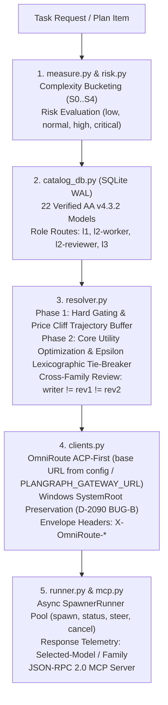
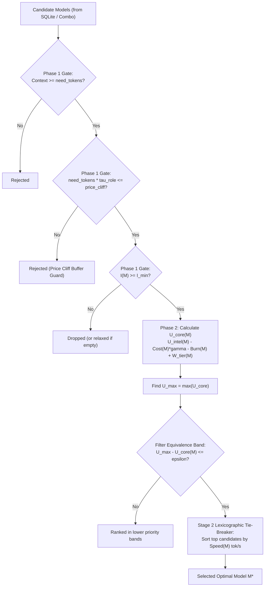

# Plangraph Spawner & Model Routing Architecture — [disk admission and target trim](operations/spawner-disk-admission.md) · [writer feeder](writer-feeder.md)

| Config key | Values | Default / details |
| --- | --- | --- |
| `work_mode` | `auto`, `piecewise`, `batch` | `batch`; [configuration](work-mode.md), [auto rule and route mode/reason output](routing.md#automatic-work-mode-d-5952--rule-341) |

### QUOTA-PAUSE-GATE

The usage owner creates `quota-pause` in the spawner state directory at usage >=95% and unlinks it at reset.
Presence alone (including a dangling symlink) pauses admission: no second meter, expiry or automatic clearing. Flag read errors also pause admission.
An empty/unset state falls back to `PLANGRAPH_SPAWN_STATE`, then `$XDG_STATE_HOME/plangraph`; an empty/unset XDG root uses `~/.local/state/plangraph`.
Session `launch` and `relaunch` refuse with `quota pause` before invoking the
action or stopping an existing session, without a model filter. Dry runs do not
bypass the quota check or write audit records.

For an operator pause, place a regular UTF-8 file named `fleet-launch.pause` in the spawner state
directory. Session launch, launch preview and relaunch refuse with the trimmed file contents as the
reason; an empty file reports `operator pause`. Remove the file to resume accepting session launches.
Leg-aware checks in launch-spec, pre-launch probing and seat prompt assembly
pause legs whose `id` or `model` starts with `claude-`, accepting object or mapping
metadata. Known other providers are unaffected; missing provider metadata is
unknown-provider and cannot bypass a pause.
`basic-analysis` is the sole exempt role. After stripping one trailing `-<digits>`
counter, a role or session name must equal `basic-analysis` or end in `-basic-analysis`.
Thus `<host>-L1-` + `basic-analysis-0412` is exempt; `basic-analysis-helper-0001`,
`not-basic-analysisx-0001` and empty names are not.
Seat mixins accept `state` or `_state`. Probes check runner roots (`state`,
`_state`, `state_root`) or environment defaults before resolving the probe store,
then check its `state_root` or database parent if no runner root was configured.
Launch-spec retains its required `state` and `role` request fields; quota refusals
use reason code `quota_pause`. Omitted required fields remain invalid requests,
not environment-defaulted builds.
The deployed ctx-watchdog skips its external router call with one alert line for
either a flag or symlink, or a missing, invalid, unreadable or unsearchable state
directory. Its home fallback is systemd `%h`, independent of the manager's `HOME`;
redeploy the service template to apply the guard.

Source mode skips only credential-name assignment masking, for spawner-generated review git diffs and tracked context-file content; private-key blocks are masked in both modes, and token-shaped rules and context private-key refusal remain. Internal exact spans, never framing markers, keep caller text/card fields under the full scrubber at the final prompt boundary; command/stdin and prompt records use that same result. Source mode never applies to env, logs, stdout/stderr tails, run records or caller text, and has no flag, env, card, CLI or MCP switch.
Python and Rust order: complete/truncated PEM, Bearer, then plain-mode pre-pass P (Python first masks wider names as below):
shield every matched assignment's name/quote/separator with an indexed marker
`U+E000 + decimal index + U+E001`, leaving values untouched; run the wrapped join,
then restore the names.
P escapes literal opening markers before shielding so they stay readable and cannot disable the wrapped join.
Then main's order runs: full assignments, wrapped prefixed tokens, URL userinfo,
token catalog and JWT. P protects only OLD matched names; the unchanged joins can still eat wider names.
Source mode (`redact_source`) skips P and both assignment stages; its order is unchanged.
Python masks wider plain assignments and exact `os.environ` subscript assignments through the physical line end (CR/LF only), before P. D-5703 extends those masks through any intersecting wrapped span that pre-A1 main already masked, including its final physical line; OLD behavior and both joins are unchanged. A1 masks the value before a join can eat the wider name (a1-J03); slice C still owns name preservation.
Exact new double-quoted colon keys remain open gap A2, the JSON-key rule. Next-line and backslash continuation forms remain open gap slice C REDACT-ASSIGN-JOIN-GAPS; neither join is fixed.
JSON-tail limit-loss: a wider plain assignment hides the rest of its line, including later limit evidence inside JSON strings or dict-style text. Structured 429/402 JSON readers can lose limit evidence after scrubbing; dict-style lines are not read even raw, while raw streaming refusal detection and raw step accounting still run before scrubbing.
Slice A2 also owns three known gaps: a wider name starting where an older-rule match ends is not masked yet; a wider name hides the whole rest of its line, including a later older-rule label; and quoted keys with blanks before the colon stay as on main.
Under D-5703, fixture-known readable credential portions are compared against local git-loaded pre-A1 e7964367 modules and tagged with their owner, not endorsed as correct. A2 owns below-floor wrapped assignment continuation a1-J04 (5); slice C owns remaining join gaps; Rust-readable expectations belong to slice B `plangraph:REDACT-RUST-NAME-SCOPE-ALIGN`. The old Python assignment rule already consumes the stray closing bracket in `API_KEY=[REDACTED]]`.
D-5751 pins both historical modules to full commit `e7964367542646ea603a1fc84f67f7036b298bcb` and checks helper identity plus an A1-only behavior difference, preventing absolute imports from silently using the current scanner. The LF/CRLF-before-separator fixture rows retain slice C ownership. The Python and Rust parity tests require wrapped assignments to be masked even when the input carries literal U+E000, U+E001 or indexed markers. Mask-growth tests preserve literal placeholders and reject ambiguous alignments. Both Python modules' work is counted, with a separate child CPU limit covering C-regex blank-run work.
Secrecy-safe over-masks remain unchanged: mismatched or half quotes around wider names, Unicode line and paragraph separators counted as blanks, and a comparison sign after a subscript name.
The catalog covers OpenAI, GitHub, Slack, AWS and Google prefixes; wrapped bodies
share its alphabets/floors and bounded 4096-byte LF/CRLF joins.
Source spans must start and end on line boundaries; invalid spans (even empty ones) withhold the prompt.
Long hex (32+), then base64/url-safe blobs (40+, mixing letters and digits), run
only on child output via Python's `redact_output`, and as part of Rust's `redact`.
Python never runs these broad rules on prompts or record structures: SHAs and hashes
must stay readable there, including run IDs, card hashes and prompt SHA-256 fields. Run records add immutable process-load `tree_sha` and `tree_branch` (or `detached`) captured once by a bounded Git read when the spawner code loads, independent of the job cwd and later checkout moves; record persistence performs no Git I/O; old records may omit them. A code path without its own `.git` marker records null identity, a `tree_absent` reason and a warning, including installed packages within an enclosing project checkout. See [checkout auditing](fleet-sync.md#production-checkout-guard-and-audit).
Stored stdout/stderr tails and `live.log` have already passed the output scrubber at collection. The supervisor stderr log rotates by copy and in-place truncate, so its path is never absent.
Exact word-boundary 40-hex commit SHAs (either case) resolved from `card.diff_ref` (`head` and `base`) or resolved as commits in the run cwd from the run's own prompt via `git cat-file --batch-check` stay visible in run output (`stdout_tail`, `live.log`, `prompt.txt`, child stdin and `seat/review.txt`); any other 40-hex or longer hex/blob token (including a 64-hex token containing an allowlisted SHA, or one joined to it by `-`, `+` or a hex fragment) remains masked. Only a path-shaped token (`/` or the token edge on both sides, no hex fragment of 8+ digits beside it) keeps an allowlisted SHA.

### Prompt delivery

Prompts travel by stdin or file on every launch path (D-5233). See
[spawner prompt rules](operations/spawner-prompt-rules.md) for transport contracts,
carrier validation, failure behavior, fixer reports, retry bounds and the role header and skill prefix.

### MiMo seat timeouts and reasoning-only output

Review seats are hard-capped from their first output, and reasoning-only output exhaustion is
handled without losing the verdict: see [MiMo seats](operations/spawner-mimo-seats.md)
(MIMO-VERDICT-TIMEOUTS, MIMO-REASONING-OUTPUT-LIMIT).

### Writer result finalization
Terminal saves dispatch review verdicts to the keeper:
- `verdict.json` audits outcomes; `verdict.delivered` stops replay.
- Invalid evidence, missing keys, unwitnessed families and unparseable verdicts skip.
- Pre-verifier I/O/import failures retry at most three times; lock failures defer without journal writes.
- Verifier exit codes govern retries; ambiguous exceptions after invocation skip to prevent duplicate POSTs.
- Remove both journal and marker explicitly to requeue after repair.
- Delivery markers stop retries even when the completion field is absent.
Spawn records take `item_key` (or the legacy `item` alias) from the card, falling back to `PLANGRAPH_SPAWN_ITEM` only when neither card field supplies a value. Python and `pg-spawnd` require an ASCII `project:ID` key (at most 200 characters total and 180 in the ID); invalid explicit values stay null with a warning rather than falling through to another identity. Prompt mentions never supply an item key. Review/judge records without a key retain a `seat_item_missing` warning event. Main's verdict outbox above is the only automatic posting path; record-derived posting refuses a `--key` that differs from a recorded `item_key`, including null. Legacy records without the field retain the manual CLI path.
Python spawn identity removes repeated copies of the same project prefix before launching (for example, `demo:demo:KEY` becomes `demo:KEY`); other colon-qualified IDs remain intact. Record-derived completion SHAs must be exactly 40 hex characters, without trailing newlines; malformed heads refuse immediately rather than entering the persistence retry budget.
The `evidence.json` manual path also refuses any supplied `item_key` or `key` that differs from `--key`, including null or conflicting aliases, before reading reviewer tokens or posting. Missing-seat events are deduplicated against launch events and remain persisted on dry runs and queue refusals.
Companion records still bind the target when `evidence.json` is present: missing evidence identity cannot override a record's explicit null or different key, and malformed companion records fail closed. Git-config capture refusals also retain validated identity and launch/missing-seat events. The record-only path checks record identity independently of the evidence builder. Manual invocations always require `--key` (including legacy records); omission exits 2 before reading seat files or tokens. Non-dry completed Python dispatch saves also preserve missing-seat and launch events.
`worker-core::writer_result::check_result` runs the mandatory Rust file-size
gate before returning a checked result; export rechecks it before content gates,
bundle sealing or publication. A refusal returns `HOLD gate file-size: <detail>`
and no publish/push is attempted. Changed tracked files use the Python CI gate's
800-line rule (D-5840), exemptions, binary detection, splitlines counting and baseline
ratchet. CI still runs unchanged `tools/check_file_size.py` over all tracked files.
The adjacent Rust changelog gate in slice S1b uses the run-base merge-base and the CI fragment/skip-trailer rule. It rejects each non-release `CHANGELOG.md` edit, including merge resolutions that lose inherited additions or invent lines (ordinary merges preserving parent edits pass); only a nonempty `Release:` final-paragraph trailer permits that commit to edit the ledger. Failures return `HOLD gate changelog: <detail>` before export or publish/push when an entry is required. Doc-only and empty commits do not require fragments or skip reasons, but the release restriction still applies.
The S1c Rust docs-map gate reads `.docs-map` from the committed head and compares changed paths over `merge-base(base, head)..head`. Each matching rule needs at least one mapped doc in that range; failures return `HOLD gate docs-map:` with unmatched `source -> doc` pairs before export/content gates or publication. Missing maps pass; malformed rules/dates hold. `# enforce-after:` begins enforcement inclusively on that local calendar date (earlier missing-doc matches do not hold); entries have no expiry syntax. CI retains its stricter union of merge-base and head policies, so removing head rules cannot disable CI enforcement. Shared JSON cases exercise Rust/Python parsing and glob parity.

`ps --all-hosts` shares the MCP merged listing, normalizes configured host labels, and preserves fixed failure reasons with bounded exception-class and SSH-exit metadata; doctor checks configured source directories in parallel (see [cross-host ps](spawner-ps.md)).
Denied-tool OpenCode reviews exiting 1 preserve exact final verdicts from pending text without a stop frame, but not after an explicit non-stop finish; other transport-completion checks remain strict.
Isolated OpenCode Go reviews accept credential rows with `active = 1` (legacy)
or `active IS NULL` (v2 in use), never `active = 0`. Only the most recently updated
eligible row is copied; ties prefer the most recently created row, then the smallest
credential ID. This selection also applies to mixed legacy/v2 stores. A failed query or install reports
`no row / inactive or store error`, not a login instruction; credentials stay out of logs and events.
### Doctor host source checks

Moved to [doctor checks](operations/spawner-doctor.md); session names, admission window: [queue](operations/spawner-admission-queue.md); landing a batch on a GO row: [land-go](operations/spawner-land-go.md).

## Spawn by card
Fleet sessions disable Superpowers with launch-local `--settings` on Linux and Windows; attended argv and user config stay unchanged.

CLI and overflow admission use the worker-core memory rule:
`effective_free_mb - reservation_mb >= mem_floor_mb`, with MemAvailable as
free memory and `warmup.ramp_mb[role]` as the reservation (an unknown role
uses that host's largest positive ramp). Live run/writer counts never limit
admission. Overflow ranks hosts by free RAM above their floor. A missing or valueless `MemAvailable:` line raises `ValueError` (pre-push workers then size from CPUs).
Admission reads `caps.mem_floor_mb` and `warmup.ramp_mb` for each host
from the worker-core hosts registry (`$XDG_CONFIG_HOME/plangraph/hosts.json`,
or `~/.config/plangraph/hosts.json`), the same location used by fleet-sync.
Local identity is `PLANGRAPH_HOST_NAME` when set, otherwise registry `self`;
IDs and aliases resolve case-insensitively. The registry also supplies SSH
routes, eligible roles, and the `public_repos` list of approved repository
IDs. Missing registry caps exclude a host from overflow. Local admission uses
conservative defaults of floor 3000 MB and role 2048 MB when the registry is
unavailable. The independent OOM guard (D-5057/D-5075) still applies.

Native Codex writers and reviews with a `diff_ref` and no explicit cwd compare
ready local and remote hosts. Candidates must have enough free memory to
cover the floor and role reservation. Of those candidates, the host with the
most free memory above its floor wins. A host set to `placement_fallback` is
considered after the ready workers. Spawn records carry `placement` with
`host`, `reason`, and `free_mb`. Other eligible spawns try SSH overflow when
local admission refuses. Dry runs stay local, and private or unknown
repositories and local benchmark databases stay on the originating host.
Route planning uses a supplied placement snapshot when one is available.
See [placement rules](placement-rules.md).

SSH overflow uses `overflow.remote_spawn` with per-call nonce begin/end sentinel
lines around the remote spawn JSON. Only the single bracketed JSON receipt is
accepted; shell-init banners, env-file echoes and JSON after the end are ignored.
Missing, repeated or reversed sentinel pairs report `receipt_unbracketed` without
retrying an already acknowledged spawn. Remote stderr stays private, and the
existing credential-shape masking helper masks receipts before stdout exposure.
Unreadable receipts or receipts without a nonblank remote run ID produce a
local tracking ID, `acknowledged_unknown=true` and `status=unknown` on the
selected host; they are never refused or retried.

Install the package on each host, then use `python -m plangraph.spawner.cli`
(or `python tools/plangraph-spawn.py` from a source checkout). No central keeper
or Temporal service is required for this slice. **Grok and Muse:** `omniroute-grok-4.7` uses `omniroute/gc/grok-4.7` for review only (catalog `grok`, seat `xai`) and remains manual-only. D-5113 admits Muse routes automatically unless policy excludes them; their catalog family is `muse` (seat `meta`). Explicit `--leg` picks still need an audited `--override-reason` of at least ten characters; host checks still apply. Runtime rows derive from `DEFAULT_LEGS`, not AA seeds. Routing carries qualified catalog tiers through utility inputs and CLI JSON, retaining declared tiers when no qualified row exists. `plan_spawn(catalog_rows=...)` injects the same snapshot for tier projection and admission. Free precedes subscription and paid even with partial benchmarks; no new family preference list is added. An `agy/` effort-model override resolves to its explicit effort leg even when a routed leg shares that model.
```bash
python -m plangraph.spawner.cli route --card @card.json --role implement --json
python -m plangraph.spawner.cli spawn --card @card.json --role implement "Implement the card"
python -m plangraph.spawner.cli spawn --card @card.json --role review --review-of run-ID "Review"
python -m plangraph.spawner.cli ps
python -m plangraph.spawner.cli result run-ID
```
Cards may also be inline JSON; `spawn --prompt-file FILE` replaces the prompt argument for prompts over the argv limit; it reads UTF-8, strips a BOM, and a bad file exits 2 with a `prompt_file_*` or `prompt_input_*` refusal. `card.context` (`path:start-end` slices, at most 64) is inlined as a CONTEXT PACK for inline-only legs (cap `PLANGRAPH_CONTEXT_PACK_MAX_CHARS`, default 60000; built once per spawn, each slice file read once and passed through `redact`; a secret-looking name, a `.git` part or an untracked file is skipped with a `context_path_refused` warning; with entries, no git work tree, a symlink loop or too many entries refuse the spawn (without entries a failed listing only adds `big_file_scan_skipped`); a range past the end of the file adds `context_range_past_eof`) and a brief naming a 400+ line file without a slice adds a `big_file_unsliced` warning (D-3622, D-3649). `--state PATH` precedes the verb; otherwise
`PLANGRAPH_SPAWN_STATE` or the XDG plangraph state directory is used.
`spawn --cwd PATH` or card `cwd` selects an absolute existing Git checkout;
relative, missing, non-checkout and conflicting flag/card paths are refused.
Without either, the caller's cwd is unchanged. The selected path is recorded in
`record.cwd` and passed to the runner; `completion.head_sha` is that checkout's
HEAD at completion. Review records also carry it as `head_sha`, and `seat_verdict --head` checks it even when response artifacts are present.
Explicit cwd takes precedence over `diff_ref.repo` for placement; explicit-cwd runs stay local regardless of the public allowlist (below-floor runs queue). SSH overflow is only eligible without explicit cwd and requires every checkout/diff repository to pass the public allowlist; a supplied `diff_ref` without `repo` is refused. Run worktrees retain `selected_cwd` for fresh attempts and fixer continuations even after the parent's attempt is pruned; legacy records recover the service's default checkout. Cwd must be a checkout root with a committed HEAD and is stored as its resolved absolute path. Validation runs once off the async loop; checkout Git operations ignore repository redirects, injected config parameters and alternate object directories.
`--dry-run` plans without a child. Spawn returns a `wait_cmd`:
`plangraph-spawn wait RUN_ID --timeout SECONDS` (omit timeout to block indefinitely).
Never use `pgrep -f` wait loops, including in writer/seat briefs: they can match
the waiting shell itself. Wait reads atomic run records, not process names;
its timeout stops waiting, not the writer. Process waits use `plangraph wait-pid`
(exact `--pid` or `--pid-file`, never a process-table cmdline scan), and
`host_ready` probes non-unit sessions with `plangraph wait-pid --check --pid-file`
for `.pid` targets or exact `pgrep -x --` otherwise.
Set `env.PG_SESSION_UNIT` in a host registry entry to a systemd unit, a
`.pid` file path, or the exact process name (`comm`) to include that session
in readiness checks.
Migration note: a legacy `overflow-hosts.json` `session_unit` is no longer read; readiness
takes the session from `env.PG_SESSION_UNIT` in the host's registry entry, and without it the
session probe is skipped. Move the old value there, and replace a `pgrep -f` command-line
substring (no longer matched under `pgrep -x --`) with a systemd unit name
(`.service`/`.scope`/etc.), a `.pid` file path, or the exact process name (`comm`).
A queued admission is rechecked for cancellation before placement, removed when a host accepts it, and finalized as failed if admission raises an exception.
`--no-fallthrough` disables automatic advancement after a captured provider stop or failed review leg, retaining its quota reason. Review quota refusals advance in the same run immediately, including zero-exit CLI refusals; see [review quota fallthrough](review-quota-fallthrough.md).
Review/seat routes record each failed, limited or not-served attempt with its reason
and try the next leg in the same run, failing only after route exhaustion. Ordinary
failure diagnostics do not book cooldowns, mark legs down or emit LEG_REFUSED; only
recognized availability/quota evidence does. Review `usage_limit:`/`credit_limit:` labels book only when their payload is recognized quota evidence (for example `error: usage limit reached`/`error: credits exhausted`); a label plus `task diagnostic` does not book. Writer
generic failures keep their stop rule; cancellation, safety refusals and watchdog
terminals still stop immediately. Safety refusal attempts precede provider-stop classification without overwriting distinct terminal reasons; specific unavailable diagnostics outrank generic provider stops. Provider-stop responses pass through spawner redaction before being added to attempts, including safety refusals. OOM wrapper marker lines (including prefixed telemetry) are not failure reasons. A `plangraph_oom` envelope on stderr is recorded only as an event and removed from the captured stderr, so each failed attempt keeps its own reason and a later attempt's OOM line cannot overwrite it.
Plain stdout, including text saying 429, is never provider evidence; `not_served_on_host` is a host fact and is never booked as a 429 down window.

### SHA-named run-tree primitive (SPAWNER-RUN-TREE-S1)

Every run works in a detached tree named by the verified `origin/main` SHA; creation, reaping and
pinning are in [run tree](operations/spawner-run-tree.md).

### Opt-in per-attempt worktrees (RUN-WORKTREE slice 1)

CLI `spawn --run-worktree` / service `spawn(run_worktree=True)` creates a fresh
`attempt-<uuid>` directory before each launch, including sequential fallthroughs
and fixer continuations. The trusted `PLANGRAPH_SETTINGS` JSON/TOML top-level
`worktree_root` config key overrides the per-host default `<state>/worktrees`.
Fetch has a 30-second timeout outside the exclusive **`<root>/.lock`**; the fetched
SHA is pinned before locked dependency checks and `git worktree add`. This exact
lock name is reserved for WORKTREE-REAPER, not held during network waits.
New lanes use the fetched `origin/main` head, never the caller's HEAD. Optional
card `lane_branch` names the branch (default `lane/<run_id>`); `continuation: true`
resumes that existing local branch's tip instead. Card `finished_dependencies`
lists exactly 40- or 64-hex commit SHAs: a new lane refuses with `RunWorktreeDependencyNotMerged`
(`run_worktree_dependency_not_merged`) if any is not an ancestor of fetched main,
including missing commits. Continuations are sequential handoffs, not concurrent
writers on one branch; retained earlier directories must no longer be used.
Git failures become `SpawnRefused` codes: `run_worktree_invalid_branch`,
`run_worktree_branch_exists`, `run_worktree_branch_missing`, `run_worktree_fetch_failed`,
`run_worktree_fetch_timeout`, `run_worktree_base_unavailable`,
`run_worktree_git_timeout` or `run_worktree_create_failed`, without raw Git diagnostics.
The private run record saves `run_worktree: {path, branch, base_sha}` before launch
and retains ordered creation evidence in `worktree_attempts`; `base_sha` is the
attempt's starting commit (main head or continuation tip). A failed fixer creation
records no worktree and a null cwd, never its parent's path. Runner `JobInfo.cwd`,
process cwd and child PWD use that path. With the flag off, cwd is unchanged;
dry runs create nothing. Admission fetches origin's default branch (an `origin/HEAD` that names a branch the remote lacks, as in a clone of a lane checkout, is unknown and the default is `main`) and refuses stale workers, continuations and seats (`base_stale`); a card `base_decision` needs scoped operator proof from the configured decision authority to waive known lag; cleanup removes only unadmitted attempts created by this run and never continuations; detached CLI waits for admission (180-second timeout: `base_admission_timeout`, exit 1); the pre-launch leg probes inside that wait get a third of the timeout each and half in all per spawn (`leg_probe.ProbeBudget`), so a hung probe books a probe failure and the spawn fails over to the next leg, then refuses `probe_budget_exhausted`; no pg-reap lock sharing is
implemented, and enabling by default and the Rust port remain later slices.

Session `launch` uses the same fetched-base admission before preparing launch
arguments, reserving its counter or writing its prompt. A stale checkout refuses
with the spawn `base_stale` reason and leaves only the session refusal audit.
The Python session API and `plangraph_session_launch` accept `base_decision`;
waivers use the same fetched operator row scoped to checkout and origin SHAs as
spawns. Successful session records retain the admission SHAs and waiver decision.

OpenCode gateway runs carry a per-job session tag for every role, including Sol
writers and effort variants. After exit (successful or failed), the parent reads
the response-side gateway call log independently of review tool permissions. Only
a unique admitted model from successful rows for that tag supplies a witness;
missing, mismatched tags, failed rows and unknown model IDs stay unwitnessed. Plain-shell CLI runs share the child URL resolver: environment first, existing config mapping next, then `plangraph/omniroute-base-url` under XDG_CONFIG_HOME or HOME/.config. Unresolvable home directories and unreadable, non-regular or over-8-KiB endpoint files mean unconfigured. Management URLs preserve the scheme, host, port and path prefix, removing only a final `/v1` path segment. The private management-key lookup stays parent-only. Serialized witness failures retain endpoint-not-configured, explicit-direct-MiMo, and no-call-log-row reasons through native telemetry fallback; non-gateway legs keep the native reason.
Model identity admission and call-log row parsing live in `spawner/gateway_models.py`;
`spawner/gateway_witness.py` retains compatible re-exports and owns session tagging,
transport and witness orchestration. Admission matches exact model segments in the route table, stripping transport
provider prefixes and the registered `cx-` GPT alias prefix. A different admitted
model keeps its family witness and records `served_model_mismatch` with the raw
requested and served IDs, including when an effort variant serves its base model.
A writer child holds the gateway API key and session tag and can submit calls
with that tag. The witness proves the model served for tagged gateway calls;
it does not prove independence from the child or bind a response to its answer.
The management log credential stays in the parent. The child-writable OpenCode
store remains review-only request-side evidence.
The provider-state snapshot behind leg routing (`routing_support/quota_snapshots.py`)
reads `/api/providers` with the same parent-only management token from
`routing_support/opencode_render.py::load_token` (re-exported by `gateway_witness`), never with the
gateway client key; without a management
token the snapshot is unreachable (`no_key`) instead of refusing every gateway leg.
Run `python -m pytest -q -s tests/test_gateway_witness.py -k route_table_witness_paths`
to list default and explicit legs without a witness path, including disabled
legs. The check uses synthetic rows, assumes gateway-backed MiMo, and also checks
model-family admission; it never contacts a gateway or reads management keys.

Private `runs/<run_id>/record.json` contains card hash, role, complete plan,
chosen leg, served model/family with witness kind (a structured claude `system/init` model is a native witness; a mismatch with the requested leg sets `served_model_mismatch`), writer family, status, started/ended timestamps,
attempts with provider stop details, job id, pid, and stdout tail.
These records are the only source for `--review-of`; unknown ids refuse. Linux supervisors record their process start-time token; non-Linux supervisor startup skips the `/proc` import and lookup. POSIX orphan checks attempt the `/proc` lookup when a recorded start-time token is present, even on non-Linux hosts. A reused supervisor pid ends the run as `orphaned` before signaling; matching or unreadable start-time evidence retains the POSIX missing-process check (permission denied means alive). Windows orphan checks return before importing process-stat helpers or signaling.

On terminal save the supervisor publishes a completion per run to
`inbox/parent.jsonl` and the authenticated live keeper HTTP sink. Events
include stable `event_id`, DONE/FAILED, run_id, rc, head_sha, take_cmd and
discard_cmd. `PLANGRAPH_SPAWN_PARENT_SESSION` and `PLANGRAPH_SPAWN_ITEM` identify
the destination session and keeper item. The private parent inbox does not by
itself inject a message into an agent session. Terminal run records are the
durable retry journal. The pluggable `deliver(recipient, event)` sink can bridge
a fleet bus. The default keeper sink uses the spawner-role `record_run` API;
it does not close items or bypass the keeper's authorization checks. Itemless completions still reach `inbox/parent.jsonl`; the keeper marker records `not-applicable: no item` regardless of transport configuration. Silent-run alerts persist in `watchdog/alerts/*.json` as `kind=stall` with `stalled_at` and `noticed_at`, while bridge outbox events keep `kind=completion`.
`PLANGRAPH_SPAWN_NOTIFY_CMD` optionally names an argv-style command (no shell);
it receives recipient as its final argument and event JSON on stdin. Consumers
must deduplicate by event_id: external delivery is at-least-once across crashes.
Failed hooks are logged and retried on re-save; local inbox replay is idempotent.
`PLANGRAPH_SPAWN_RUN_TIMEOUT` optionally bounds execution in seconds; reviews share one run deadline across all legs and prompt preparation (writers retain per-child limits); unset gives a 25-minute review cap, while empty means no review-specific cap (the ordinary 90-minute maximum still applies); internal `max_s: null` limits have no deadline;
expiry kills its process tree and records rc 124 with FAILED completion.
Terminal stall/timeout records preserve their outcome and events even without a watchdog event (`watchdog: null`). A provider stop leaves the harness status and exit code unchanged (completed with exit 0 stays completed), adding `provider_stop` only when no reason exists and the stopped leg's own coverage slot names a seat group, preserving it in the attempt and unfilled-slot error while leaving completed non-seat reasons unset and tolerating empty, absent or non-dict coverage entries.
Mixed seat/non-seat coverage never resolves a seat to an unrelated chosen leg. The detached supervisor must survive the child; killing the supervisor itself
requires a future recovery service. This interim event contract carries over to
the later Temporal implementation (also covers FLEET-STATUS-HOOK).
Writing run roles (implement/fix) guard shared .git/config against in-place mutations (e.g. core.autocrlf), restoring original bytes and failing the run if changed. The spawner kills only the process tree it started: the root is proven ours at spawn (direct child, own group; or Job Object member), a snapshot of its descendants is taken before any signal, and a kill is verified (up to 10 s). Survivors fail the run with reason `kill_incomplete` (event `kill_incomplete`, `survivors` pids): no fall-through leg, no second writer. Runs use argv exec only (no shell wrapper), enforced by a static guard test.

Slice 1 cancellation with survivors ends the run as `failed` with reason `kill_incomplete` and never publishes `cancelled`; already-terminal cancellation results keep their status and exit code. Leg probes track spawned job IDs (not shared working directories), wait at most five seconds per launch/cancel/monitor cleanup operation, and attempt every owned job even after an error. Successful cleanup removes the temporary directory; incomplete cleanup raises an explicit error and retains it rather than deleting it under a possibly live process. `setsid` containment and periodic reaping are not implemented yet.
`--model`/`--leg` require `--override-reason` of at least ten characters,
audited through `routing.hand_picked` to `spawn-overrides.jsonl`.
The Mimo path fence still applies to overrides. Review seats: [spawner-seats.md](spawner-seats.md) (D-3198).

CLI `probe --leg ID` / `probe --all-writers` / `probe --all-reviewers` (`--timeout S`, `--json`) and MCP `plangraph_agent_probe`: [liveness and env knobs](spawner-leg-state.md) (`PLANGRAPH_LEG_DOWN_S`, `PLANGRAPH_LEG_PROBE_TIMEOUT_S`, `PLANGRAPH_LEG_PROBE_TTL_S`). Scheduled review probing (`deploy/systemd/plangraph-review-probe.{service,timer}`) runs `probe --all-reviewers` with a tiny `OK` prompt and triggers `pg-spawnd check-manage-key` to emit one probe-time `missing_manage_key` alert without refusing calls.
A probe with its harness binary missing reports `host-not-ready` and books no leg event. Probe timeouts must be finite and strictly positive; TTL remains nonnegative (zero disables ordinary automatic probes, not snapshot-error recovery). Invalid settings refuse before probe state writes, and CLI parameter refusals are JSON `ParameterRefused` with exit 2. Timeout errors name `--timeout` for an explicit CLI argument, `timeout_s` for a direct probe argument, or `PLANGRAPH_LEG_PROBE_TIMEOUT_S` for the environment. CLI and MCP probe refusal handlers catch only parameter-validation errors, not internal `ValueError`s. Spawn-call exceptions report probe infrastructure failure and never book leg liveness. `src/plangraph/spawner/leg_probe.py:before_launch` retries snapshot read errors once, then probes before admitting/skipping; failed-probe reasons retain the probe's own cause; only an empty or `unknown` reason is recorded as `leg_probe_failed` (`host_not_ready` for a missing host binary), never as `unknown` (run-e99aae2287e541b48886d0f04e46c37e). See [snapshot recovery](spawner-leg-state.md#snapshot-read-errors-slice-1). Snapshot HTTP 401/403 is an `auth_refused` skip (gateway URL and `PLANGRAPH_PRINCIPAL`, no credentials), not retried or probed; see [leg state](spawner-leg-state.md).
Probe and quota bookkeeping use the harness-aware leg key. AGY model and account scopes, the OmniRoute pool snapshot and reset policy, and fresh launch admission are documented in [leg state](spawner-leg-state.md#agy-quota-scope). A missing or unreadable quota snapshot does not block routing. A silent gateway leg is checked against the call log (`sessionTag`) after 60–90 s; a logged quota error ends the run (exit 7) so the next leg can run. AGY refusals are read from harness output.
Failed probes retain a scrubbed, single-line excerpt of the last 400 stderr
characters in their result, output line and leg-state event. A `running` record
on the same model/harness with a nonempty `live.log` grown within
`LIVE_RUN_WRITE_WINDOW_S` (120 seconds) overrides only the probe failure:
`probe_failed_leg_serving` records the diagnostic without a retry/down-until
time and does not block dispatch. Stale, empty or missing logs do not override.
Real quota/usage-limit evidence from `exit_outcome` still books the leg down;
serving evidence never clears that provider signal. Probes share the owning
service's resolved state directory, with no environment fallback; pre/post size
snapshots reject touches of old logs, truncations, replacements and read races.
Only the explicit stderr excerpt extends the legacy 300-character reason bound.
Ordinary probe JSON omits `state`; it is never emitted as null.
CLI `launch-spec` (placement R6a-3d; nothing calls it yet): one JSON request on stdin, one launch spec on stdout (argv, cwd, the complete child env, stdin, warnings, events) for pg-spawnd; optional request `leg.explicit` must be boolean: only `true` permits document review without `diff_ref`, absent/false still refuses; it reuses the spawn prep and never launches; exit 2 = one redacted refusal line, exit 1 = internal error (type name only).
MCP `route`, `spawn`, `ps`, `result`, `status`, `cancel` (with `plangraph_agent_` prefix) share these records. Spawn requires
`card` and `prompt` in its schema; model_or_combo requires override_reason.
Result/status/cancel accept `run_id`; legacy job-id operations remain available.
MCP `ps` is compact (all running/queued runs, the newest 20 ended, `total`, `omitted`); use `result` or CLI `ps` for full records.
After the Python MCP source changes on disk, reconnect before running a probe
or starting a run or session. Status, result, steer and cancel remain available
in the existing process.
No JSON-RPC notification is answered or dispatched. A reply over 8 MiB becomes a `ReplyTooLarge` error (code -32000, same request id); stdio keeps serving.
Only actual probe results write liveness state. Gateway adapters call
`runner.provider_response` with actual captured responses.

Runtime path: `src/plangraph/planner/routing.py` is the only module allowed to
import `plangraph.spawner` at runtime; the boundary is enforced by
`tests/test_spawner_import_guard.py`. Selection runs without a feature flag.

### Card-driven routing core

`planner.routing.plan_spawn(card, role="implement"|"review")` applies the
canonical `route_card` eligibility and tier rules to role-tagged `DEFAULT_LEGS`.
The declared `WRITER_ORDER` is Sol xhigh then agy Hydrogen high (D-5903); Hydrogen medium serves read-only tools review (agy plan mode); both seats remain unwitnessed; plain Sol is explicit-only. See [implement route defaults](routing.md); banned/off families are skipped for writers too.
Other roles and the remaining implementation fallbacks put eligible free inputs before subscriptions and paid inputs (D-5092). Catalog cost tiers project onto registered legs without changing their roles, safety exclusions, or family metadata. Sonnet, main's Opus registration, high-effort Opus, gateway DeepSeek/Muse, personal Argon, and Big Pickle remain registered (D-5113). Grok's manual-only gate, both Zen free legs' exact permanent D-4196/D-3828 disables, and Qoder's stop remain enforced; Muse retains main's implementation/review/orchestration admission, and Big Pickle retains its GLM family. Sonnet retains orchestration/review, high-effort Opus review only, and medium-effort Opus review/orchestration. No Claude-family leg may enter an automatic implement route, including custom role-bearing tables; explicitly audited effort-variant writer picks remain available.

`plan_spawn` shares one catalog snapshot for admission and tier projection.
Callers may supply `catalog_rows` explicitly for deterministic offline planning;
an empty snapshot uses the registered leg tiers and still rejects unknown models.
Exact-order tests pin this input and isolate benchmark discovery from host files. Role-neutral keeper routes over the default table retain main's D-3828 readiness admission; S5's implementation fallbacks apply to role-bearing routes, not readiness. Custom tables remain explicit inputs.
Review ordering preserves main's cost-first, per-leg measurement gate: measured rows precede missing rows within the same tier; unmeasured rows retain MiMo's existing role preference and Haiku's last-within-tier fallback. Provider-qualified tier identities win over unrelated bare names. Neither Haiku nor a measured paid row crosses a cheaper tier. A no-verdict model (`opencode-go/qwen3.8-flash`, D-3225) is never a seat. A review without a writer family refuses (D-1533). The `claude` harness (Haiku review leg, D-3605) runs with an allowlisted env (`claude_env.py`: HOME, PATH, PWD, locale, XDG_*, proxies, `CLAUDE_CONFIG_DIR`, `CLAUDE_CODE_SHELL`; every other variable is dropped whatever its case; sessions and runs get `CLAUDE_CODE_SHELL=/bin/bash` on POSIX hosts via `with_agent_shell`, and `spawner doctor` fails `claude_shell` on a host whose sessions still run zsh), and a host without the `claude` binary skips the leg as `harness_missing: claude` (D-3649). Native Claude Sonnet-high reads and books its own subscription quota, separate from agy Sonnet; CLI review quota results include the serving harness. A finished claude run's stdout (the record's `stdout_tail`) is the final text of its stream-json `result` event (else the last assistant text), so `tools/seat_verdict.py` finds the `VERDICT:` line; the raw stream is kept as `claude-stream.jsonl` beside the run's `live.log`, which still carries the raw activity feed.
Claude 5.5 and effort-variant legs (operator 2026-11-09): `agy-claude-{sonnet,opus}-5-5-{low,medium,high}`
(agy harness, review and implement), Hydrogen high and medium are enabled, unwitnessed (see retirement below),
`cx-gpt-6-luna-{low,medium,high,xhigh,max}` (inline-only review) and
`cx-gpt-6.1-sol-{low,medium,high,xhigh,max}` (implement). The ids are what `agy models` and
OmniRoute `/v1/models` served that day; agy serves no Sonnet xhigh and cx serves no `-ultra`, so neither is a leg.
Except Sol xhigh (automatic, D-5206), these and plain Sol live in `EXPLICIT_LEGS`, not
`DEFAULT_LEGS`: an audited `--leg` or model override spawns them. Claude never enters
automatic implement routes. `SpawnService.route` appends explicit-only legs to
the plan as `explicit_only` skips, so `route` shows them; `plan_spawn` itself does not list them. A Claude leg is claude-family: the fence refuses
it for a claude writer, given or via `review_of`; with mixed writers the D-3084 per-part rule
admits a seat that covers another writer part. The Claude and sol-effort writers are
`EXPLICIT_WRITERS`; explicit implementation admission uses each registered leg's roles. The catalog spelling
`agy/<model>` (MCP `model_or_combo`) resolves to a seat-capable agy leg holding the bare model, never an orchestrate-only alias. A cx
effort model is not declared in the AutoOS root opencode config, so `render_gateway_providers`
adds `providers.omniroute.models["cx-<m>-<effort>"]` (`modelID` `cx/<m>-<effort>`, the base
model's limit) for that run only; without it opencode answers `provider.no-route`.
Leg notes ("after its Friday-evening reset") are static text: availability is the leg state (`limited` after a provider stop), not a schedule.
Two review seats must differ in family from every writer and each other; an impossible fence returns fewer seats and an explicit plan error, not a fallback. Route slots are planned, final only after dispatch. Seat-group answers and each run's `plan.review_seats` / `plan.seat_coverage` follow `chosen_leg`, including cross-family fallthrough; exhausted slots report `distinct_family_unavailable` with attempt reasons. Whole canonical families (including alternate legs) are reserved per slot and resolved identities are checked again on save and group publication. Routes explicitly name an anthropic second family; see [seat records](spawner-seats.md). The existing `spawner/seat_artifact.py` owns resolved-slot metadata and final review-evidence publication, separately from seat dispatch; retaining its name avoids introducing a new Python module.

An explicitly supplied `benchmark=` mapping (model or leg id to resolver metric
row), or sequence of rows with `model_id`, ranks measured legs only inside their
existing tier. Legs without rows go **last inside their tier**, retaining their
relative operator order. `plan.gaps` (also in `to_dict()`) records each missing
role-policy leg with its leg ID, model and reason. Reasons name each gap, including legs filtered by eligibility or provider state.
With `benchmark=None`, all role-policy legs are gaps, `p_source` is `operator-order`, and reasons include `benchmark data absent` and `no benchmark p`.
Strict routing (`--require-bench`) raises `BenchRequired` for a missing required row. The `agy-gpt-oss-120b` review leg is explicitly unmeasured until its exact medium-effort row is available.
It can run with prior ranking in ordinary mode. Strict routing skips it with `benchmark_unmeasured` while routing among the measured legs; an exact row makes it eligible in strict mode.

Operator safety rules and `route_card` tier order come first; U_core permutes measured inputs within a tier for every role, including implement (D-5092). Same-family review inputs keep table order; free inputs never move behind subscriptions. The generic resolver retains its utility/epsilon-band algorithm without a model-name or post-ranking tier pin.
CLI route/spawn and MCP load an existing `PLANGRAPH_CATALOG_DB` (default `~/.cache/plangraph/spawner_catalog.db`), unless `--bench-db`/`bench_db` overrides it.
Route JSON `candidates` exposes each leg's tier, `u_core` (null without a row), `p_source` (`prior`/`measured`), and skip reason/evidence; live limited legs are skipped.

`benchmark_rows_from_db(path)` returns `(rows_by_model_id, errors)` using SQLite
read-only mode; it never creates a missing database. It accepts `catalog_benchmarks`
or OmniRoute `model_benchmarks` (catalog takes precedence if both exist).
`BENCHMARK_COLUMNS` documents the small column alias map. Missing/unreadable files,
missing tables and malformed model IDs return an empty mapping with explicit errors. Shared default registrations do not change explicit effort-model alias resolution.
Duplicate model rows expose `benchmark_row_count`; the first row supplies metrics. Bare harness model ids also resolve exact provider-qualified benchmark rows; explicit bare rows win, missing rows remain gaps, and the Opus high-effort leg maps to `agy/claude-opus-5-5-high`. No probe latency is treated as a benchmark measurement.

### Required benchmark release/swap gate (D-2576)

Before an OmniRoute image release or swap, check both host database snapshots:

```bash
python tools/bench_gate.py --db workstation.sqlite --db server.sqlite --json
```

Every distinct model in `DEFAULT_LEGS` with an `implement` or `review` role must
have at least one row **in each database**. Output includes per-model counts and
total rows per database as evidence. Exit codes: **0** complete coverage, **1**
missing policy rows (models and database named), **2** unreadable database or
unsupported/missing benchmark table. No data is synthesized or seeded by this gate;
benchmark preparation/shipping lanes must supply the real rows.

`leg_reader=` accepts a store or leg-status callable; card `account` and `combo`
scope live provider evidence exactly. `next_leg_after_provider_stop` records
actual 429/402 responses with nonempty provider text and advances to the next
currently eligible leg. Other responses do not suppress a leg. Transport adapters
must supply actual provider responses, never agent output or exit-code guesses.

`hand_picked` always requires an override reason of at least ten nonblank characters,
enforces the Mimo provider fence, and appends an audit JSON line to
`$XDG_STATE_HOME/plangraph/spawn-overrides.jsonl` (or injected `log_path`).
Readiness remains separate in `planner/readiness.py`.

Plangraph Spawner provisions, routes, and supervises autonomous agents across multi-model coding workflows. It combines a local WAL-mode SQLite benchmark catalog, a 5-rung tier priority ladder, fine-grained task complexity and risk measurement, OmniRoute ACP-first execution with full Windows Tailnet environment preservation, cross-family code review isolation, and a JSON-RPC 2.0 MCP server.

---

## 1. Architecture Overview

The spawner pipeline follows a deterministic, layered design:



---

## 2. Risk Assessment & Complexity Telemetry

Plangraph measures task write sets and repository signals to deterministically classify complexity and risk:

```mermaid
flowchart LR
    subgraph Signals["Repository & Write Set Signals"]
        Diff["Git Diff / Paths"]
        Lines["Modified Line Count"]
        Mods["Distinct Modules"]
        Fanout["Import Fanout\n(Scoped AST / Blocklisted Grep)"]
        Tests["Test Coverage Check"]
    end

    subgraph Complexity["Complexity Classification (measure.py)"]
        S0["S0: Trivial / Pure Docs (<= 20 lines, 1 file, 0 fanout)"]
        S1["S1: Small Module (<= 80 lines, <= 2 files, fanout <= 2)"]
        S2["S2: Standard Task (<= 250 lines, <= 5 files, fanout <= 5)"]
        S3["S3: Multi-Module (<= 12 files or fanout <= 12)"]
        S4["S4: Cross-Cutting Architectural (> 12 files or fanout > 12)\nDecomposition Trigger: should_decompose = True"]
    end

    subgraph RiskEval["Risk Evaluation (risk.py)"]
        Low["Low Risk: S0 / Pure Docs\nI_min = 37.5, Reviewers = 0..1"]
        Normal["Normal Risk: Tested S1..S3\nI_min = 44.0, Reviewers = 1"]
        High["High Risk: Critical Paths / S4 / Untested S2+\nI_min = 46.0, Reviewers = 2"]
        Critical["Critical Risk: Auth, Crypto, Policy, Security\nI_min = 50.0, Reviewers = 2"]
    end

    Signals --> Complexity
    Complexity --> RiskEval
```



### Complexity Bucketing Matrix (`measure.py`)

| Bucket | Max Files | Max Lines | Max Fanout | Description | Action |
|---|---|---|---|---|---|
| **S0** | 1 (or docs) | $\le 20$ | 0 | Trivial / documentation change | Direct execution, 0-1 reviewer |
| **S1** | $\le 2$ | $\le 80$ | $\le 2$ | Small single-module change | Standard execution, 1 reviewer |
| **S2** | $\le 5$ | $\le 250$ | $\le 5$ | Standard multi-file feature/fix | Standard execution, 1 reviewer |
| **S3** | $\le 12$ | $\le 500$ | $\le 12$ | Multi-module feature/refactor | Enhanced model, 1-2 reviewers |
| **S4** | $> 12$ | $> 500$ | $> 12$ | Cross-cutting architectural change | `should_decompose = True`, 2 reviewers |

### Smarter Symbol Fanout & Ubiquitous Blocklist

To prevent false fanout escalations from common function and method names, `measure.py` filters candidate symbols against `UBIQUITOUS_SYMBOLS_BLOCKLIST`:

- **Blocked Ubiquitous Symbols**: `run`, `get`, `set`, `resolve`, `validate`, `to_dict`, `from_dict`, `__init__`, `items`, `keys`, `values`, `update`, `parse`, `close`, `setup`, `teardown`, `main`, `start`, `stop`, `execute`, `handle`, `process`, `load`, `dump`, `read`, `write`, `send`, `receive`, etc.
- **AST Caller Scoping**: When only ubiquitous symbols or file paths are present, `ast_caller_fanout()` scans the repository using Python's `ast` parser to inspect `Import` and `ImportFrom` statements, counting only modules that legitimately import the modified files.

---

## 3. Two-Stage Mathematical Routing Algorithm (`resolver.py`)

Model selection is governed by a unified two-stage lexicographic optimization algorithm that decouples intelligence ramps, protects against price cliffs, prevents throughput distortion, and avoids double-counting prompt caching benefits.



### Phase 1: Hard Gating & Price Cliff Trajectory Buffer

Every candidate model $M$ must satisfy three hard gates:

1. **Context Capacity**: $\text{Context}(M) \ge \text{need\_tokens}$
2. **Multi-Turn Price Cliff Trajectory Buffer**:
   To prevent multi-turn tool calling loops from crossing catastrophic pricing thresholds (e.g. Anthropic Claude Haiku 100K token price cliff), `need_tokens` is scaled by a role-specific trajectory factor $\tau_{\text{role}}$:
   $$\text{Trajectory Tokens} = \text{need\_tokens} \times \tau_{\text{role}}$$
   $$\text{Gate}_{\text{cliff}}(M) = \begin{cases} \text{Pass} & \text{if } M.\text{price\_cliff\_tokens} \text{ is None or } \text{Trajectory Tokens} \le M.\text{price\_cliff\_tokens} \\ \text{Reject} & \text{otherwise} \end{cases}$$

| Role | Trajectory Factor $\tau_{\text{role}}$ | Rationale |
|---|---|---|
| `implement` / `worker` | **1.5×** | Multi-turn edit-test-debug loops generate significant cumulative context. |
| `driver` / `orchestrate` | **1.3×** | Task dispatch and supervision generate moderate multi-turn context. |
| `review` / `reviewer` | **1.1×** | Reviews read diffs and files with bounded conversation depth. |

*Example*: At 70,000 tokens, Haiku (`price_cliff = 100000`) is rejected for workers ($70\text{k} \times 1.5 = 105\text{k} > 100\text{k}$) while safely admitted for reviewers ($70\text{k} \times 1.1 = 77\text{k} \le 100\text{k}$).

3. **Intelligence Floor**: $I(M) \ge I_{\min}$ for the evaluated risk band.

---

### Phase 2: Core Utility Scoring ($U_{\text{core}}$)

The core utility score $U_{\text{core}}(M)$ balances intelligence, cost sensitivity, quota pool burn, and subscription priority:

$$U_{\text{intel}}(M) = \alpha_{\text{role}} \cdot \left(\min\left(I(M) - I_{\min}, I_{\text{target}} - I_{\min}\right) + \max\left(0, I(M) - I_{\text{target}}\right) \cdot \beta_{\text{excess}}\right)$$

$$U_{\text{core}}(M) = U_{\text{intel}}(M) - \text{Cost}(M) \cdot \gamma_{\text{cost}} - \text{Burn}(M) \cdot 1.0 + W_{\text{tier}}(M)$$

#### Decoupled Risk & Competency Parameters

By decoupling $I_{\text{target}} > I_{\min}$, the intelligence ramp rewards models that reach the target competency level while scaling excess capability according to task risk:

| Risk Band | Min Floor $I_{\min}$ | Target Ramp $I_{\text{target}}$ | Cost Weight $\gamma_{\text{cost}}$ | Excess Weight $\beta_{\text{excess}}$ | Tie Equivalence $\epsilon$ | Reviewers |
|---|---|---|---|---|---|---|
| `low` | 37.5 | 41.0 | 15.0 | 0.2 | 0.5 | 0–1 |
| `normal` | 44.0 | 47.0 | 10.0 | 0.4 | 0.5 | 1 |
| `high` | 46.0 | 50.0 | 4.0 | 0.6 | 0.3 | 2 |
| `critical` | 50.0 | 54.0 | 4.0 | 0.6 | 0.3 | 2 |

#### Role Multiplier ($\alpha_{\text{role}}$)

Role scaling amplifies intelligence gains above $I_{\min}$ for critical supervisory roles:
- `implement` / `worker`: $\alpha_{\text{role}} = 1.0$
- `driver` / `orchestrator`: $\alpha_{\text{role}} = 1.1$
- `review` / `reviewer`: $\alpha_{\text{role}} = 1.2$

#### Tier Priority Weights ($W_{\text{tier}}$)

Guarantees subscription and free pools are prioritized over paid per-token APIs:
$$W_{\text{tier}}(M) = \begin{cases} (4 - \text{rung}(M)) \times 3.5 & \text{if } \text{rung}(M) \le 4 \\ -35.0 & \text{otherwise (unknown)} \end{cases}$$
- `trial` (rung 0): $+14.0$
- `free` (rung 1): $+10.5$
- `credit` (rung 2): $+7.0$
- `subscription` (rung 3): $+3.5$
- `paid` (rung 4): $0.0$

---

### Stage 2: Lexicographic Throughput Tie-Breaker

Linear throughput bonuses in primary utility scoring previously allowed fast models to override up to 18 points of intelligence. Plangraph confines throughput strictly to a **two-stage lexicographic tie-breaker**:

1. Find the highest core utility among surviving candidates:
   $$U_{\max} = \max_{M \in \mathcal{C}} U_{\text{core}}(M)$$
2. Collect the equivalence band of candidates whose utility is within $\epsilon$ of $U_{\max}$:
   $$\mathcal{C}_{\text{top}} = \{ M \in \mathcal{C} \mid U_{\max} - U_{\text{core}}(M) \le \epsilon \}$$
   *(where $\epsilon = 0.5$ for low/normal risk, $\epsilon = 0.3$ for high/critical risk)*
3. Resolve ties within $\mathcal{C}_{\text{top}}$ by verified token generation speed:
   $$M^* = \arg\max_{M \in \mathcal{C}_{\text{top}}} \text{Speed}(M)$$

Candidates with noticeably inferior core utility ($> \epsilon$ points lower) can **never** win solely by virtue of generation speed.

---

### Input Contract, Fail-Closed Rules and Sensitivity

- Numeric inputs are validated before scoring. NaN, +inf, -inf, negative values, and None are rejected with ValueError; a missing intelligence value is rejected with ValueError. A missing or None `context_window`/`context_tokens` falls back to 128000 and a missing or None speed counts as 0 (unmeasured, tie-break only); a present but invalid context window or `price_cliff_tokens` raises ValueError.
- Absent-field defaults (field missing, not None for required numerics): `cost_per_task_usd` 0.20 USD per task, `pool_burn_weight` 1.0, `context_window`/`context_tokens` 128000, speed 0 (unmeasured). `aa_intelligence` has no default and a missing value raises ValueError.
- `need_tokens` must be a positive finite number (an int or integral float); bools, non-numeric values, NaN/inf, non-integral floats, and values <= 0 raise ValueError.
- Unknown risk and unknown role values raise ValueError. The role `"drive"` is accepted and uses alpha 1.1 and trajectory factor 1.3.
- For high and critical risk bands, a candidate below `I_min` fails closed. The only escape is `relax_floor=True` with a non-empty `relax_reason`; when applied, result keys `relaxed` and `relax_reason` are set. A blank reason is not accepted.
- For low and normal risk bands a floor miss does not raise: the highest-intelligence candidates are kept and ranked, and `relaxed` stays false.
- There is no hardcoded fallback model. If no candidate is eligible, both `resolve_review_plan` and `resolve_model_for_task` raise instead of returning a default.
- Catalog fallback (W27/D-2637): during a DB read failure, registered offline legs remain eligible; operator deactivation cannot be enforced while the DB is unreadable. A `catalog_db_error` alert is emitted once per failure episode and rows carry `catalog_source=offline_fallback_db_error`.
- Exclusions (family/author/gated/availability) are applied in every fallback path, including relaxed-floor paths.
- The context gate requires `ctx >= need_tokens * trajectory_factor`; role trajectory factors are applied consistently.
- Risk monotonicity uses `envelope_intelligence` as a best-effort envelope: candidates are filtered to intelligence at or above the best lower-band pick; when that leaves none, resolution falls back to the floor rules, so the envelope cannot be met in every case.
- Tie-breaking uses an epsilon band with absolute utility thresholds of 0.5 and 0.3 utility points.
- Stability is measured by tools/spawner_sensitivity.py over several seeds (key `stability_seeds` in docs/spawner-sensitivity.json); high/critical beta_excess 0.6 and critical gamma_cost 4.0 keep the intelligence +-1 pick flip rate <= 0.10 on every listed seed; the flips that remain at critical are the cost of the hard risk-monotone envelope (critical's intelligence floor is the best lower-band pick, a hard filter), and the strict monotone guarantee (1e-9) is kept.
- The committed sensitivity artifact is `docs/spawner-sensitivity.json`. Regenerate it with `python3 tools/spawner_sensitivity.py --out docs/spawner-sensitivity.json --catalogs 200`. Flip-rate numbers are read from that file; do not invent numbers — see the file.
- The `cost_per_task_usd` field is the catalogued price in USD per task. Utility subtracts `cost_per_task_usd * gamma_cost` in utility points.
- Absolute cost scale matters on purpose: a 10x price change may reorder near-ties inside the epsilon band because cost is real money. Outside the band the order follows utility at any cost scale (proved by `test_order_follows_utility_outside_epsilon_band_any_cost_scale`).
- Speed-scale invariance (`test_speed_scale_invariance`) holds because speed is only a relative tie-break inside the band.

---

Benchmark catalog and ranking invariants: see [verified benchmarks](spawner-benchmarks.md).

Continue with [review protocol, interfaces, and operations](spawner-operations.md); see [OOM policy](../deploy/oom-policy.md) for repository checks versus live-pressure evidence.
The served-model probe cache has a five-minute freshness bound,
not a five-minute completion or delivery SLA; see the operations guide for details.

Cross-host ps: see [site configuration and transport](spawner-ps.md); [host readiness](placement-rules.md#host-readiness-consumer-contract) requires a matching ps entry and string source paths. Its ps `target` and overflow `ssh` must be the same string, even for aliases of one machine; mismatch lines name both values. A malformed run inventory reports `runs: invalid_response` and leaves the live-run count unknown. Ordinary malformed host/probe and state-write errors emit per-host failure lines rather than aborting the fan-out; resource exhaustion (`MemoryError`, `RecursionError`) and process-control exceptions propagate instead.
# Remote ps protocol

The SSH ps endpoint serializes only running and queued records. Terminal history
does not consume the 1 MiB transport budget.
Malformed terminal fields do not hide live runs; malformed live or oversized replies name the queried host as unknown rather than silently omitting it.
Rust source-filter tests and pytest's real `configured_hosts` checks consume
`tests/fixtures/doctor_sources.json`, binding both validators and probe limits
to the same accepted/rejected cases. Rust embeds JSON, never Python source or
an interpreter; CRLF checkouts cannot break the doctor's deadline-limit checks.

OOM wrapper lines are recognized by their known event shape, including `wrapper:` prefixes and extra metadata. The known event is retained in `events`; extra metadata is redacted into an `oom_telemetry_detail` event. Unknown or diagnostic-bearing envelopes remain in stderr. These untrusted telemetry events confer no provider identity or authorization. OpenCode structured `type=error` messages survive display-text decoding and supply attempt diagnostics. When all legs fail, the run reason selects the last real attempt before accumulated errors or stderr. The three Dell incident captures are replayed by `tests/test_spawner_oom_reason.py` using `tests/fixtures/spawner_dell_oom.json`. Failure classification also uses the route harness for jobs without command metadata and filters progress from a stored final-attempt reason.

See [admission contracts](operations/spawner-admission-contracts.md) for split admission and cleanup details.

Quota polling considers only the newest request of a session, including a 429 without text. Timestamp-less pool observations keep their first-seen hold until recovery; database reads select the latest row per window. Gateway session tags retain the full per-launch UUID to avoid truncated-ID collisions across retries or parallel runs; see the [witness-share alert](spawner-reliability.md#witnessed-share-alerts).

Stale-base waivers require PLANGRAPH_BASE_DECISIONS_FILE configured by the operator. Admission fetches its origin/main, requires one decision row whose DECISION cell contains Source: operator, Waives: spawn-base:<checked-base-sha> and Origin: <fetched-origin-sha>, and refuses missing, duplicate, unreadable or mismatched proof. A card D-id alone never waives lag or failed fetches. Refused-worktree cleanup requires matching created_by_run_id and never removes continuations or admitted workers.

Run-worktree spawns validate the selected creation base before cutting a tree, then
validate its checkout and any review diff before launch. Caller HEAD does not
admit or reject a new worktree. Clean main is fast-forwarded when behind; a main
checkout already at origin/main needs no mutation and may retain local edits.
Session launch (`src/plangraph/spawner/sessions.py`), routing `bin/fleet-launch`,
and the external package-worktree script do not call this gate in this part.
When launching or relaunching a background session (`claude --bg`), `Sessions`
spawns `claude` directly via Python subprocess (never through the Bash tool),
so `tools/hooks/bash_guard.py` denies every non-resume `claude --bg` /
`--background` invocation in the Bash tool unconditionally under rule D-158
(only `Sessions` allocates session name counters; `--resume <uuid|hex>` without
`-n`/`--name` stays allowed).

Cancellation waits for an in-flight worktree creation thread before returning;
new unlaunched attempts are removed, and normal Git branch deletion removes the
new lane only when it is unoccupied and merged into the fetched origin/main.
Continuation evidence remains protected from automatic removal.

Launch-admission refusals apply the same safe branch cleanup to owned new
attempts, so a named lane can retry after origin advances during creation.

Spawner startup checkout identity reads decode Git output explicitly as UTF-8 with replacement for invalid bytes, matching the other spawner subprocess reads.

Gemini Flash retirement (operator 2026-11-14): all versions and effort variants
are refused with `gemini_flash_retired` before dispatch, including card targets,
CLI overrides and MCP requests. The model list filters retired rows even from
older databases. D-5903 enables Hydrogen high for implement after Sol and medium for read-only tools review (agy plan mode).
Both inherit the agy Claude capability bounds and remain unwitnessed: AGY emits no served-model telemetry.
Historical records remain readable; the retired benchmark model row exists only
for benchmark foreign keys and never appears in the model list.
Native Codex writer placement and lifecycle: [run contract](native-codex-writer.md). Admission refuses missing cargo/git/codex with `tool_missing`; the writer and final gates reuse the recorded caller PATH. Inline-only native reviews receive shared item context and the inline change. Tools-capable reviews also receive the original writer brief and repository instructions.

Native agy CLI reviews (D-6054) use a disposable `git clone --shared` at the
stamped HEAD with origin removed. Commands are pre-approved inside that checkout
so headless plan mode can inspect callers and run bounded tests without a
permission prompt. This is checkout isolation, not a command security sandbox.
The original checkout remains the provenance source and is rechecked when the
review ends. The clone lives through completion and quota fallthrough setup,
then is removed. Empty or whitespace-only agy responses produce an explicit
`VERDICT: FAIL` with available tool frames and stderr diagnostics; they never
gain a served-model witness or count as a passing seat. No empty-output retry
can replace the required repository-access review.

Review hard walls default to 25 minutes and implement/fix to 90 minutes; progressing runs retain these prior budgets. Read-only git status/diff/log and GitHub run/status polling do not count as tool loops. Queue expiry preserves records owned by live or unobservable supervisors.

Every emitted context pack includes this rule within its size cap: new code is Rust with Rust tests; no new Python or shell file; an allowlist line needs an operator D-id. The planner brief template carries the same rule (D-5912).

Review route (rule 3.50, D-6028): mimo/mimo-v2.6-pro, mimo/mimo-v2.6-flash (inline-only: skipped without card diff_ref), then the D-5966 order gemini-4-hydrogen-high, gemini-4-argon-medium, free console-deepseek/deepseek-flash and opencode-go/beam-free, then claude-sonnet-5-5-high. CLI quota responses use leg-state keys agy:<model> without effort, including native Sonnet; each model resets independently. Route JSON exposes all three agy_quota_states with reset_at evidence. Rust Git fixtures isolate inherited hook redirects, keep repositories in temp directories, and guard source config plus fixture-owned registrations. Rust review kinds `agy-cli` and `claude-cli` select admitted review legs; Python MCP rejects these native kinds. Hydrogen and Argon use agy plan mode with preallowed read tools; commands stay unapproved. Writer aliases (codex, cx-gpt-6.1-sol, gpt/openai) share review.family.writer_key across route, spawn admission and seats; registered leg/model families take precedence. Unknown writers fail with accepted names. Python seats and native initial/quota-retry launches carry the resolved gateway family (gpt for OpenAI) in X-OmniRoute-Author-Model and X-OmniRoute-Exclude-Family; missing or placeholder writers refuse launch. Eligible OpenAI fallbacks outside the operator order precede final Sonnet; only the resolved writer family is excluded. Rule 3.61 (D-6481) puts native Codex `gpt-6.2-sol-medium` first; Every run record carries `harness`, `harness_version`, `harness_fallback` and `host` (written at launch; `unknown` when unreadable), and `spawn harness-report [--hours 24]` lists runs, failures and no-verdict reviews per harness (details: routing.md, own harness first).
Sonnet uses Claude restricted review tools and high effort. CLI reviews use the checkout rather than inline-diff rollout, requiring a clean worktree and an exact HEAD fast-checks stamp. Rust binds head_sha and records verdict/findings with cli_reported provenance: agy reports the CLI-selected model, not provider telemetry; Claude must report a single Sonnet model. Repository HEAD and tracked cleanliness are rechecked at completion. Failed/quota streams never count. When tests share a Cargo target across worktrees, verify that `CARGO_BIN_EXE_pg-spawnd` belongs to the intended revision: a stale main executable can reject branch-only CLI kinds or misinterpret checkout diff_ref. A controlled main/branch comparison reproduced stale executable and unit-test inventory reuse. Use the inherited host shared Cargo target; private diagnostic targets are forbidden. See [disk admission and cleanup](operations/spawner-disk-admission.md) for leases and target limits. The Unix keeper integration uses production modules with stdlib setup; its direct Python inputs in `tools/ci_select.py` select Rust CI. Record/provenance assertions also run on Windows. Initial launch and quota fallthrough share Rust review preparation: select transport before interpreting diff_ref. CLI checkout refs avoid the inline SHA validator; inline-only legs retain strict validation. Each native CLI retry requires the same stamped HEAD. Keeper counts the final serving attempt after quota refusals, preserving cli_reported trust for Sonnet. Native CLI reviews use card.cwd or legacy diff_ref.repo, then the daemon checkout if neither is supplied. Symbolic diff heads resolve there and must equal its stamped HEAD.

Seat-pool cleanup tests create their initial commit with Git plumbing in an
isolated fixture environment, without signing, hooks, index updates or automatic
maintenance. Fixture Git failures retain stderr; Windows fixture subprocesses
use CREATE_NO_WINDOW. The cache-survival assertion also runs in a 50-iteration
stress test. Windows CI and recorded reruns provide platform evidence.

Native writer progress admission: [run contract](native-writer-progress-admission.md).

[Per-item checkpoint and status notes](checkpoints/), e.g. [keeper-refused completion deliveries](checkpoints/LE-KEEPER-REFUSED-CALL-LOOPS.md). Add new notes there, one file per item, rather than appending here.
