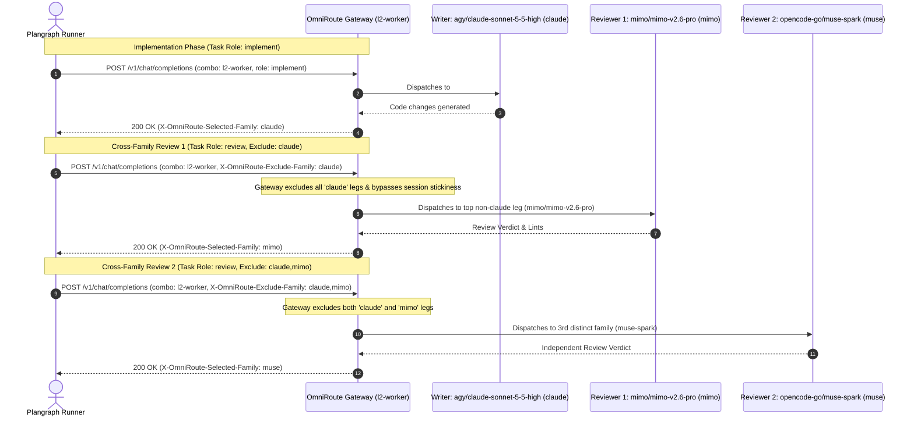

# Spawner review, interfaces, and operations

[Architecture and routing](SPAWNER.md) · [Cross-host ps](spawner-ps.md)

## 6. Cross-Family Review Protocol

To prevent self-review bias and single-model blindspots, Plangraph enforces strict cross-family isolation over shared OmniRoute combos:

$$\text{writer.family} \neq \text{reviewer}_1\text{.family} \neq \text{reviewer}_2\text{.family}$$



### Routing Envelope Headers

Requests dispatched through OmniRoute include routing envelope headers:

| Header | Description | Example |
|---|---|---|
| `X-OmniRoute-Task-Role` | Operational role | `implement`, `review`, `orchestrate`, `drive` |
| `X-OmniRoute-Risk` | Assessed risk band | `low`, `normal`, `high`, `critical` |
| `X-OmniRoute-Min-Intelligence` | Intelligence floor | `44.0` (normal), `45.0` (high), `46.0` (critical) |
| `X-OmniRoute-Required-Context` | Required token context | `32000`, `64000`, `128000` |
| `X-OmniRoute-Exclude-Family` | Comma-separated excluded families | `claude` (Rev 1), `claude,mimo` (Rev 2) |
| `X-OmniRoute-Author-Model` | ID of the author/writer model | `agy/claude-sonnet-5-5-high` |
| `X-OmniRoute-Effort` | Reasoning effort level | `low`, `medium`, `high`, `xhigh` |

### Gateway Response Telemetry

OmniRoute gateways return response headers reflecting the model actually selected and served:
- `X-OmniRoute-Selected-Model`: Canonical model identifier (e.g. `mimo/mimo-v2.6-pro`)
- `X-OmniRoute-Selected-Provider`: Active provider identifier (e.g. `mimo`)
- `X-OmniRoute-Selected-Family`: Canonical model family (e.g. `mimo`)

### Dual Reviewer Isolation Walkthrough

For a high-risk task where `agy/claude-sonnet-5-5-high` (family `claude`) is the writer:
1. **Writer**: Dispatched to `l2-worker`. Served model is `agy/claude-sonnet-5-5-high` (`claude`).
2. **Reviewer 1**: Dispatched to `l2-worker` with `X-OmniRoute-Exclude-Family: claude`. Gateway drops all Claude models; top remaining candidate is `mimo/mimo-v2.6-pro` (`mimo`).
3. **Reviewer 2**: Dispatched to `l2-worker` with `X-OmniRoute-Exclude-Family: claude,mimo`. Gateway drops both Claude and MIMO models; top remaining candidate is `opencode-go/qwen3.8-max` (`qwen`) or `opencode-go/muse-spark-1.3-contributor` (`muse`).

All 3 participants run over the **exact same** `l2-worker` combo definition without maintaining manual per-reviewer routes.

---

## 7. MCP Server & CLI Reference

### JSON-RPC 2.0 MCP Server (`src/plangraph/spawner/mcp.py`)

Run stdio MCP server:
```bash
python -m plangraph.spawner.mcp
```

#### Available MCP Tools

1. `plangraph_agent_spawn`:
   - `prompt` (string, required): Task prompt instructions.
   - `model_or_combo` (string, default `l2-worker`): Target model ID or combo route.
   - `role` (enum: `implement`, `review`, `orchestrate`, `drive`): Execution role.
   - `risk` (enum: `low`, `normal`, `high`, `critical`): Risk classification.
   - `dry_run` (boolean, default `false`): Plan command and telemetry without spawning subprocess.
   - `wait_seconds` (number, default `0.0`): Seconds to await process completion.
2. `plangraph_agent_status`:
   - `job_id` (string, optional): Specific job ID to inspect (returns all jobs if omitted).
3. `plangraph_agent_steer`:
   - `job_id` (string, required): Active job ID.
   - `message` (string, required): Steering instruction delivered to the agent process.
4. `plangraph_agent_cancel`:
   - `job_id` (string, required): Job ID to cancel.
5. `plangraph_agent_query_catalog`:
   - `combo` (string, optional): Filter by combo (e.g. `l2-worker`).
   - `family` (string, optional): Filter by model family (e.g. `mimo`, `claude`).
   - `min_intelligence` (number, optional): Minimum AA Intelligence floor.
6. `plangraph_agent_health`:
   - Reports spawner version, active/total jobs, catalog model counts, and the effective base URL the child receives (empty when none is configured).

#### Gateway endpoint setting

The base URL every gateway client uses is deployment config, read at run time; no
default ships in the source. Two helpers divide the work: `effective_child_base_url()`
is the URL a spawned child ends up using — and the one `plangraph_agent_health`
reports — while `effective_gateway_base_url()` resolves the environment sources, where
`OMNIROUTE_BASE_URL` wins over `PLANGRAPH_GATEWAY_URL`:

| source, in the order it is honoured | key |
|---|---|
| the child's own `OPENCODE_CONFIG_CONTENT` (kept by `setdefault`, see below) | `providers.omniroute.settings.baseURL` |
| environment (provider-level override, wins when set) | `OMNIROUTE_BASE_URL` |
| environment (gateway default) | `PLANGRAPH_GATEWAY_URL` |

On hosts without a root config (such as Windows workst), launch the spawner CLI with `PLANGRAPH_GATEWAY_URL=http://127.0.0.1:20128/v1` to point to the local gateway.

A gateway-keyed model (provider `mimo`/`omniroute`) with no base URL from any source
now fails closed on every platform — a Linux host with neither the root overlay nor a
URL environment variable launches no process and the run fails with
`not_served_on_host: gateway_base_url_unresolved`, falling through to the next leg.

A gateway breaker 503 / circuit-open counts as a failed run: it is never retried in a
loop on the same leg and is not a provider stop (only 429/402 advance the leg state);
the next writer picks the card up.

`gateway_url()` also takes a config mapping and reads its `gateway_url` key, but no
production caller passes one today: that argument exists for callers that do pass it
(the tests exercise it).

`build_child_env` merges into whatever `OPENCODE_CONFIG_CONTENT` already carries using
`setdefault`, so a child config that already sets `settings.baseURL` keeps that value
and no environment source displaces it. With no such key and neither environment
variable set, `build_child_env` writes no `baseURL` into the child provider config (a
caller that needs a value supplies its own), and `plangraph_agent_health` reports
`gateway_default_url` as `""`. Both sides read the same one helper,
`plangraph.spawner.clients.effective_child_base_url()`, so the reported URL always
matches the effective one.

### SQLite Catalog DB CLI (`src/plangraph/spawner/catalog_db.py`)

- **Initialize & Seed Database**:
  ```bash
  python -m plangraph.spawner.catalog_db init-and-seed [--db-path PATH]
  ```
- **Export Deterministic JSON**:
  ```bash
  python -m plangraph.spawner.catalog_db export-json [--output PATH]
  ```
- **Export OmniRoute Combos**:
  ```bash
  python -m plangraph.spawner.catalog_db export-combos [--output PATH]
  ```

### Provisioning the catalog DB (D3)

```bash
python3 -m plangraph.spawner.catalog_db init-and-seed
```

With no arguments this creates the default production DB
(`~/.cache/plangraph/spawner_catalog.db`) idempotently: re-running reproduces the
same rows, no duplicates. `PLANGRAPH_CATALOG_DB` overrides the path; `--db-path
PATH` works in either position (`... --db-path P init-and-seed` or `...
init-and-seed --db-path P`) and writes only `P`.

---

## 8. Host Bootstrap & AutoOS Delegation

Host binary and client prerequisites are delegated to AutoOS (`deploy/requirements-host.json`, `deploy/bootstrap.ps1`, `deploy/bootstrap.sh`) without duplicating package management code:

- Core runtimes: `git`, `python`, `nodejs`, `tailscale`, `omniroute`, `opencode-cli`
- Agent CLIs: `claude-code`, `qwen-code`, `gemini-cli`, `qoder-cli`, `agent-skill-links`

For host provisioning instructions, refer to [`deploy/README.md`](../deploy/README.md).
# Bounded dispatch and gateway evidence

`spawn --wait S` waits at most S seconds after supervisor startup. The default, `--wait 0`, returns the run id immediately with `status: running`; a detached supervisor keeps the child and record monitor alive. Use `result RUN_ID` to read the eventual result. If all eligible legs are limited, dispatch returns exit code 3 with the plan's evidence list and starts no child. Provider stops trigger a fresh eligibility plan with the original card, role and writer-family exclusions; already attempted legs are never retried during that run.

The OmniRoute fork emits provider failures as one JSON line on **stderr**:

```json
{"autoos_provider_response":{"leg":"omniroute/cx-gpt-6.1-sol","status":429,"body":"provider quota exhausted","headers":{"Retry-After":"60"}}}
```

The outer object must contain only `autoos_provider_response`; its object must
contain exactly `leg`, `status`, `body`, and `headers`. Leg and nonempty body are
strings, status is the integer 429 or 402, and headers map strings to strings.
The real child monitor passes this envelope to `runner.provider_response`.
Stdout JSON, free-text errors, other statuses and additional keys are not evidence.
This is a trusted harness transport convention, not cryptographic authentication:
the harness must reserve this envelope and not relay agent-authored stderr as it.
MCP tools do not expose any leg-state mutation operation.

CLI and MCP persist records through private 0600 temporary files and atomic rename.
Records and output tails redact `sk-` tokens, Bearer credentials and `*_KEY=`
assignments; child environment mappings are never persisted. Public entry points
use the shared hardened dispatch adapter in `spawner.runner` (the legacy service
remains available for compatibility).

### Transport envelope nonce (defense in depth)

Each runner invocation generates a random nonce sent as the
`X-OmniRoute-Run-Nonce` request header. A stderr provider envelope must echo
that value as `nonce` inside `autoos_provider_response`. Missing or mismatched
values are ignored and recorded as a `forged_envelope` run event, never a leg
mark. This does **not** close child-controlled stderr forgery: the child process
can still read its own environment, including request-header configuration.
Production must verify the nonce against the OmniRoute call log before trusting
provider evidence; call-log verification remains a follow-up.

CLI route/spawn accept `--require-bench` and repeatable `--bench-db PATH`.
MCP route/spawn accept `require_bench` and `bench_db`. The entry-point default
`PLANGRAPH_REQUIRE_BENCH=1` enables strict coverage; missing rows refuse before
starting a child and name the missing legs.
# Phase-review hardening

Strict benchmark refusals use `BenchRequired`, a `SpawnRefused` subtype carrying
the missing legs; refusal text is not an error classifier. A fallthrough refusal
preserves prior attempts in the run record.

`provider_response` is a trusted gateway-adapter API, not a child-output API.
Child evidence is accepted only through the exact nonce-checked stderr envelope.
Nonces are limited to 4096 active runs and removed on completion or cancellation;
dry runs do not retain nonces. Steering a job without stdin returns an explicit
`no stdin` error rather than claiming delivery.

Pure-document review exemptions carry `review_exempt`; zero reviewers without
that flag are invalid, and high/critical risk cannot claim the exemption.
Regression contracts: `test_existing_safety_contracts` in
`tests/test_w13_regressions.py` rejects card-asserted exemptions;
`test_provider_requires_authenticated_source` in the same file pins the trusted
adapter boundary. `test_candidate_json_and_limit` in `tests/test_w11_selection.py`
pins route JSON utility, prior/measured source, and skip evidence.
The Pro provider limits follow the catalog seed (1,000,000 context and 65,536
output); Flash follows the catalog seed's 1,000,000 context limit. The unused OmniRoute
model registry is omitted while its transport configuration remains available.
# Routing hardening

Mimo IDs are case-sensitive: only `mimo/mimo-v2.6-flash` and
`mimo/mimo-v2.6-pro` are accepted. Mixed-case variants are refused.
SQLite files are created privately before connecting. On Windows, mode bits do
not establish a private ACL; operators must secure the state directory ACL.
# Round-five failure contracts

Spawn refusals, including CLI/MCP preflight failures, persist private run records
with an exit code. Codes are 1 for execution/I/O failure, 2 for card/policy
refusal, 3 for benchmark policy/data failure, 4 for exhausted provider legs (status
`limited`), 5 for a writer that changed nothing (`failed`, `writer_no_changes`, D-3236).
If storage itself fails, the original refusal is retained and the persistence
failure is logged. Explicit override leg IDs are preserved even for shared models.

State queries do not initialize empty SQLite files. AST fanout that cannot read
or parse a Python file is unknown (`not_measured`), conservatively treated as
fanout 13 for sizing. Routing exclusion reasons are typed metadata, not parsed
exception messages. JSON-RPC requests must explicitly include `jsonrpc: "2.0"`.
Every model admission requires exact membership in the resolver catalog or
registered DEFAULT_LEGS. Case-insensitive Mimo detection chooses error text only;
it is not an admission gate. Unknown IDs, including glued and homoglyph variants,
are typed `SpawnRefused` failures.

For source checkouts, add the repository's `tools` directory to PATH to expose
the executable `plangraph-spawn` entry point (or use
`python -m plangraph.spawner.cli`).
# Completion delivery contract

Completion events carry `idempotency_key = run_id + ':' + status`. Delivery is
retryable: a delivered-marker write can fail after a successful sink call.
Each sink MUST durably deduplicate that key per recipient before exposing an
event, atomically with its observable append. `FileInbox` implements this under
its inbox lock. Command bridges must implement the same contract at the remote
sink; a successful command exit alone cannot guarantee exactly-once effects.
`test_marker_failure_sink_exactly_once` pins marker-failure replay behavior.
# Fixer writers and remaining gaps

Cards may carry `findings`, each with `text` and optional `files`. The pure
`split_findings` helper, also exposed through `plan_spawn.writer_groups`, merges
connected file ownership before balancing components into roughly ten-finding
writers. A shared file is never assigned to two writers. Indivisible components
may exceed ten; findings without files form a final unassigned bucket appended
to the smallest group. Dispatch fans these groups out in parallel.

See [spawner prompt rules](operations/spawner-prompt-rules.md) for fixer reports and retry bounds.

Both dispatch paths inspect the full writer output, before tail truncation.
A non-empty Remaining gaps section or unchecked Markdown checklist triggers
one continuation with only those gaps, on the same sandbox and selected leg.
The separate run record has `parent_run_id` and `continuation=1`; the parent
has `continuation_run_id`. A continuation cannot continue again. Clean reports,
nonzero exit codes, review runs, and continuation-limit refusals record their
reason in `continuation_reason`. Dry runs never continue. Live execution proof
belongs to L2/L1; unit tests use synthetic processes.
# Live completion delivery identity

The spawner's keeper completion sink posts `phase=finished` to
`POST /v1/record_run`. Set `PG_URL` to the keeper API base URL and
`PG_TOKEN_FILE` to a file containing a **spawner-role** bearer token. Set
`PLANGRAPH_SPAWN_ITEM` to the claimed/in-review item key. A successful live
acknowledgement precedes `runs/<id>/keeper.delivered`; a local inbox alone is
not keeper delivery. The keeper deduplicates by item, run ID and phase, so
retrying after marker-write failure does not append a second item event.
Missing identity leaves delivery pending with an error naming `PG_URL` and
`PG_TOKEN_FILE`; do not print or copy token contents into diagnostics.

The watchdog also requires `PG_URL` and `PG_TOKEN_FILE` for its keeper
identity. Provision these in its service environment, not an interactive
shell; use the least-privilege identity authorized for the watchdog verbs.
Host availability probes are cached for 300 seconds: newly served models
may not be noticed until that TTL expires.
This is a cache freshness bound, not a five-minute completion or delivery SLA:
child runtime, polling, outages and pending keeper retries can take longer.

### Build-L1 live RUN-EXIT-NOTIFY smoke
Build-L1 runs `bash tools/smoke-run-exit-notify.sh` from the checkout with
`PG_URL`, `PG_TOKEN_FILE` (spawner-role identity authorized for `record_run`
and `show` in the item's project), and `PLANGRAPH_SPAWN_ITEM` set to a real
claimed/in-review item key, for example `plangraph:RUN-EXIT-NOTIFY` if claimed.
Provision the token out of band; never paste it into a brief or command line.
The script uses the permitted cheap local harness alternative: a real Python
child printing OK, supervised through the normal spawn service, without an LLM
request or `--dry-run`. Only command construction is replaced, not monitoring,
record persistence, completion delivery, or the live keeper client.

Success requires rc 0, `runs/<id>/keeper.delivered`, and the same run ID in
`GET /v1/show?key=...`'s `run_ids`, a projection of `run_recorded` item events.
Any missing proof or HTTP/authentication failure exits nonzero. Private state
is retained in `.notify-smoke-*` beneath the checkout for build-L1 inspection.
The writer must not run this against the live keeper; build-L1 owns live proof.
The local marker follows acknowledgement: writing it before sending would lose
events on crash. Exactly-once visibility across marker failure instead relies
on the keeper's atomic `(item, run_id, phase)` idempotency key.
# Review policy
See [Review method](REVIEW-METHOD.md) for file-backed policy and review-scope admission.
## Claude Code sessions
See [spawner-sessions.md](spawner-sessions.md) (names are `<role>-NNNN`; relaunch starts a new one).
# Watchdog

Runs sample file signatures/git HEAD (edits), non-header output (activity), and process-tree CPU (post-edit only). Card `stall_min`, `first_edit_min`, `max_min` default to 20/15/90 minutes; reviews instead have a 25-minute default wall cap and run status `timed_out` (exit 124). Pre-edit, no activity or exceeding first-edit age stalls; post-edit, all signals must stop progressing. Maximum age wins. Status `stalled` exits 6; writer `timeout` exits 124; `writer_no_changes` exits 5. Events `watchdog_stalled`/`watchdog_timeout` carry rules and diagnostics. Private `runs/<run_id>/live.log` is capped at 2 MB; status exposes live tails and `last_activity_ts`. `PLANGRAPH_SPAWN_RUN_TIMEOUT` is an explicit operator override of that default review wall cap (seconds; it may raise or lower the cap), but explicit card `max_min` wins. `PLANGRAPH_SPAWN_WATCHDOG_INTERVAL` overrides sampling seconds. Dry runs plan inline-only review legs (including mimo-flash) without a diff; a live run of the same card still skips them with `inline_diff_failed` unless it has a `diff_ref` or an explicit `--leg`. Explicit `--leg` document reviews accept prompts unchanged without `diff_ref`; a supplied invalid ref still refuses. Verdicts accept trailing commentary, `ACCEPT` and `REQUEST_CHANGES`; the last VERDICT line decides, and template alternatives remain undecided.
### Refused dispatch (D-3605 a)

A refused dispatch (rate limit, quota, credits out, auth: HTTP 401/402/403/429 or a 429/402 provider envelope in the first output lines, first 30 s and 40 lines) ends the run at once instead of `running` until a stall rule fires: `run_watchdog.collect` marks the job failed (exit 7, event `dispatch_refused`) and reaps the process tree, `fallthrough_reason` books the leg down (`unavailable_until`, `PLANGRAPH_LEG_DOWN_S`, default 1800 s for credit/auth lines without a reset time), and one `LEG_REFUSED` line (run id, leg, reason) goes to the parent inbox and `PLANGRAPH_SPAWN_NOTIFY_CMD`. Process CPU accounting lives in `spawner/run_cpu.py`.
Cross-host ps: see [site configuration and transport](spawner-ps.md).
